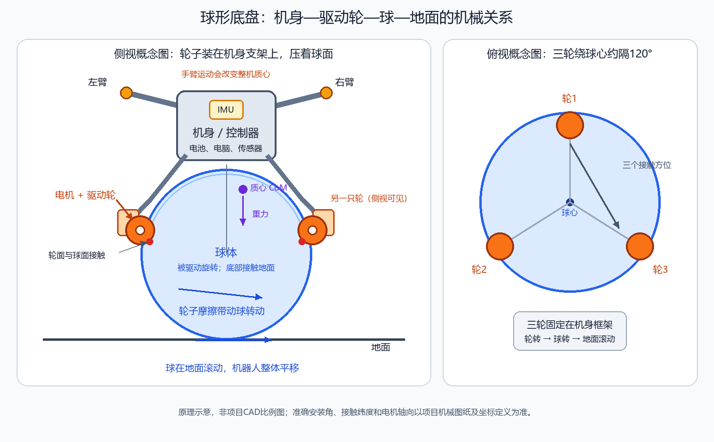

# 01 结构传感器与平衡状态

先修：[基础课程](../../../01_通用基础/00_基础课程总览.md)。项目：P1。目标：把公式对应到实际变量与调用。源码：[文件地图](../02_源码阅读与运行/01_源码版本与文件地图.md)。实验：[P1](../../../03_代码实验/02_项目实验/P1/README.md)。

## 1. 系统是什么

先建立一个画面：机器人上方是机身框架，框架上装着控制器、传感器、手臂和三只驱动轮；一个大球放在机身下方，三只小轮从不同方向压在球面上。小轮转动时，靠接触处的摩擦带动大球转；大球再与地面滚动接触，于是整台机器人移动。机身不是和大球粘成一个整体：控制器可以让大球相对机身滚动，借此把球送到机身下面，支撑身体。

从侧面看，是“上面的身体—下面的大球—最下面的地面”；从上面看，三只轮围着球分布，彼此约隔 120°。三轮从不同方向推动同一个球，合起来才能控制球向不同方向滚动。图是帮助理解关系的原理示意，不是项目机器人的精确 CAD 尺寸图；具体轮轴方向和正负号要以项目模型、坐标定义和代码为准。

为什么它需要一直控制？机身质心在大球接触区域上方，重力会让身体像倒立摆一样倒下。机身一旦向前偏，球若不移动，支撑区域就会落在质心后面；驱动轮需要让大球滚到身体下方，继续托住质心。两只手臂伸展或摆动还会移动整机质心，因此相同的球轮动作不一定产生相同的平衡效果。

所以项目同时处理三件事：机身不要倒、球/机身整体按目标速度移动、到达目标位置。轮子转得快不等于机器人一定按期望方向走，还要看球面接触几何、机身姿态和轮地接触。

先看反馈：IMU给四元数姿态与角速，三电机JointState给轮位置/速度，双臂JointState进入URDF质心计算。控制器根据球轮fk恢复球角速度，再按球半径得到机体水平速度，转到局部世界系积分位置。

## 2. 真实变量与单位

源码controlLoop取roll,pitch,yaw并减bias；vx=-R×angular_y，vy=R×angular_x。轮速度rad/s、球角速度rad/s，R米，vx/vy米每秒。位置x/y是积分值，没有外部定位就会漂移。yaw减启动偏置，形成局部参考，不等于绝对地图航向。

四状态分析顺序[x,ẋ,θ,θ̇]，而实机C++节点分别处理x/y/roll/pitch/yaw，不能把分析四状态直接称全部节点状态。

### 姿态、角速度和坐标系：三个不同的问题

IMU 的四元数整体描述“机身现在朝向哪里”。它不是位置，也不是四个独立角度；单位四元数的四个数合起来编码一个旋转，长度为 1，且 \(q\) 与 \(-q\) 表示同一个朝向。项目程序可以按约定从它换算出 Roll、Pitch、Yaw。四元数的乘法顺序和 SLERP 用于旋转组合、姿态插值等基础问题；只有在项目确实插值四元数时，才应说实际执行了 SLERP。可继续读[四元数乘法与 SLERP](../../../01_通用基础/03_坐标_运动学与动力学/04_四元数乘法双覆盖与SLERP.md)。陀螺仪角速度则描述“机身此刻转得多快”。姿态是一个方向状态，角速度是姿态变化的信息；三维姿态下，机身角速度分量也不总能直接当作 Roll/Pitch/Yaw 各自的导数。

同一个速度向量用机身坐标或世界坐标描述，数字可能不同，因为两套坐标轴朝向不同。只把向量从一个方向基底换到另一个基底时使用旋转；如果转换的是“位置点”，还要考虑两个坐标系原点之间的平移。项目中的 `world2Body2D` 只旋转水平分量，当前位置与目标位置各自变换后再相减，不能把这个函数误认为完整的三维位姿变换。

#### 加速度计读数怎样变成有用的运动信息？

加速度计安装在 IMU 坐标系里，所以它报出的三个数字首先沿着传感器自己的 x、y、z 轴。要把它用于世界坐标系，先按安装外参把传感器坐标转到机身坐标，再用当前姿态把机身坐标转到世界坐标。加速度计常见的输出是“比力”，静止时仍能读到约一个重力大小的量；在一种常见符号约定下：

\[
\mathbf a_w=R_{wb}R_{bs}\mathbf f_s+\mathbf g_w
\]

这里 \(\mathbf f_s\) 是传感器坐标系中的比力读数，\(R_{bs}\) 把传感器分量转到机身，\(R_{wb}\) 再把机身分量转到世界，\(\mathbf g_w\) 是世界系重力。不同设备对比力和重力的正负号可能相反，因此不要只背公式；应先让机器人静止，确认补偿后的世界系线加速度接近零。若不是零，先查轴向、安装外参、姿态方向和重力符号。

加速度计也可在机器人平移加速度较小时，利用“重力在各轴上的分量”估计倾角；但机器人快速前进、刹车或受冲击时，读数混入了真实平移加速度，倾角就会被带偏。互补滤波常用陀螺积分跟踪快速变化，再用较慢、较稳定的重力倾角纠正长期漂移：

\[
\theta_k=\alpha(\theta_{k-1}+\omega_{\text{gyro}}\Delta t)
+(1-\alpha)\theta_{\text{acc}}
\]

\(\omega_{\text{gyro}}\) 是陀螺角速度，\(\Delta t\) 是采样间隔，\(\theta_{\text{acc}}\) 是由重力方向推得的倾角，\(\alpha\) 是两种来源的混合权重。要积分加速度得到速度和位置，还会累积零偏与噪声，因此通常还需轮速、视觉或其他外部观测约束，并估计传感器偏置。

#### Kalman 在这条链里负责什么？

Kalman 滤波把“模型预测”和“传感器读数”按各自的不确定程度融合。预测协方差 \(P^-\) 表示预测有多不确定；测量协方差 \(R\) 表示传感器有多不确定；创新 \(r=y-H\hat{x}^-\) 是实际读数与预测读数的差；Kalman 增益 \(K_{\text{KF}}\) 决定这次差值应修正估计多少。协方差不是状态本身，也不表示状态一定错，它描述估计误差可能有多大以及不同状态误差如何相关。这里 Kalman 的 \(P,Q,R,K\) 描述不确定性和测量修正；LQR 章节里同名的符号描述代价与反馈，不能混用。可看[Kalman矩阵、协方差与创新](../../../01_通用基础/04_传感器与状态估计/05_Kalman矩阵协方差与创新.md)了解公式的逐项含义。

本源码快照能确认的是传感器回调、滤波缓存、轮速反算和位置积分；这些事实不能自动证明项目用了互补滤波或 Kalman/EKF。项目章节要讲清通用原理如何帮助理解传感器，同时把“源码确实实现了什么”单独标出。轮积分是依赖滚动假设的局部运动估计，不是地图真值。其他基础可继续读[主动/被动变换](../../../01_通用基础/03_坐标_运动学与动力学/01_坐标点向量与主动被动变换.md)、[欧拉角与四元数](../../../01_通用基础/03_坐标_运动学与动力学/03_欧拉角四元数与半角.md)和[IMU重力与漂移](../../../01_通用基础/04_传感器与状态估计/02_IMU比力重力坐标与漂移.md)。
## 3. 一轮手算

球半径R=.11m（现存配置值，不代表已实测校准），fk输出球角速[.2,-.3,0]，vx=.033m/s、vy=.022m/s。yaw=90°，机体增量[vx,vy]经世界旋转变[-.022,.033]m/s。配置周期.01s，本轮世界位移[-.00022,.00033]m。

如果假定无滑不成立，轮反馈积分就不是真实地面位移。身体姿态来自IMU，不可用轮积分代替。

## 4. 源码阅读顺序

先读initializeROS的订阅名，再读imuCallback/jointCallback滤波缓存，再读controlLoop状态获取和积分。`hasData`只说明收到过数据，不直接证明本帧还新鲜；继续寻找last_seen检查。现存该周期未看到按时间戳拒绝过期状态的完整逻辑。

## 5. 失败与排错

轮序错导致某轴反；R单位错导致速度比例错；yaw方向错导致世界积分横移；轮打滑使位置漂移；IMU旧帧使身体反馈滞后。逐轴检查输入与输出，再看多环参数。配置100Hz是定时器设定，实测周期需日志。

## 6. 英文、练习答案

“The ballbot estimates body tilt from the IMU and local motion from the wheel feedback through the ball-contact geometry. These estimates have different limitations, especially wheel slip and timing.”

追问：Is the integrated wheel position global ground truth? No. It is a local motion estimate under the rolling assumption.

1. 概念：球轮与普通全向底盘相同吗？答：接触几何与输入角速度不同。
2. 计算：angular_y=-1,R=.11？答：vx=.11m/s。
3. 代码：改轮顺序要改什么？答：反馈排列、ik/fk对应与电机ID一起确认。
4. 解释：静止积分慢慢漂？答：零偏/轮噪声/滑动/时间，不能写绝对定位准确。

下一步：[完整周期](../02_源码阅读与运行/02_一个周期的调用与数据流.md)。

## 精读补充：把中间步骤讲清楚

### 本章在完整周期中的位置

先画三类测量：姿态、轮速、双臂关节；轮积分的位置不是地图真值。收到过消息只能证明初始化数据出现，还要考虑年龄。用半径把角速度变线速度，再按yaw旋到局部世界，不能直接把三电机速度当身体vx/vy。

先回到[完整源码周期](../02_源码阅读与运行/02_一个周期的调用与数据流.md)，定位本章之前输入由谁产生、之后结果被谁消费；再读[对应基础推导](../../../01_通用基础/04_传感器与状态估计/01_传感器状态误差与噪声.md)。不要只背中间一个函数或矩阵。

### 用纸笔完成这一页的验收

1. 从本章数值例重算每个中间量，写单位和输入形状。
2. 对照[源文件地图](../02_源码阅读与运行/01_源码版本与文件地图.md)，指出活动分支和被注释的区别。
3. 解释上述特有误读点，并给一条能区分原因的日志字段。
4. 先用中文说清输入→计算→输出，再用本章英文口述；涉及个人贡献时查材料证据，不把教学重建说成历史部署。

## 历次提问归纳：本章要分清的状态与测量

这不是把聊天逐条抄回正文，而是把反复出现的疑惑归纳成可复述的判断。完整问题索引见 [P1 历次问题归纳与完整讲解](../05_中英文面试/06_历次问题归纳与完整讲解.md)。

- **机器人“此刻是什么状态”不是单个传感器读数。**姿态、角速度、轮速和位置估计分别描述不同运动量；IMU 给姿态/角速度相关信息，轮子反馈给轮运动信息，控制器再把它们组合成状态估计。
- **角度和角速度不能互相替代。**角度说“现在偏到哪里”，角速度说“正在往哪边、以多快转”；同样的角度误差，若角速度很大，控制器应更早制动。
- **位置估计要说清参考系和来源。**由轮速积分得到的是相对起点的估计，会累积误差；不能不加证据就说成外部测得的绝对位置。
- **状态顺序是模型定义的一部分。**后续写状态向量或读矩阵时，必须沿用本章规定的变量顺序和单位，不能只凭矩阵行列位置猜变量含义。
