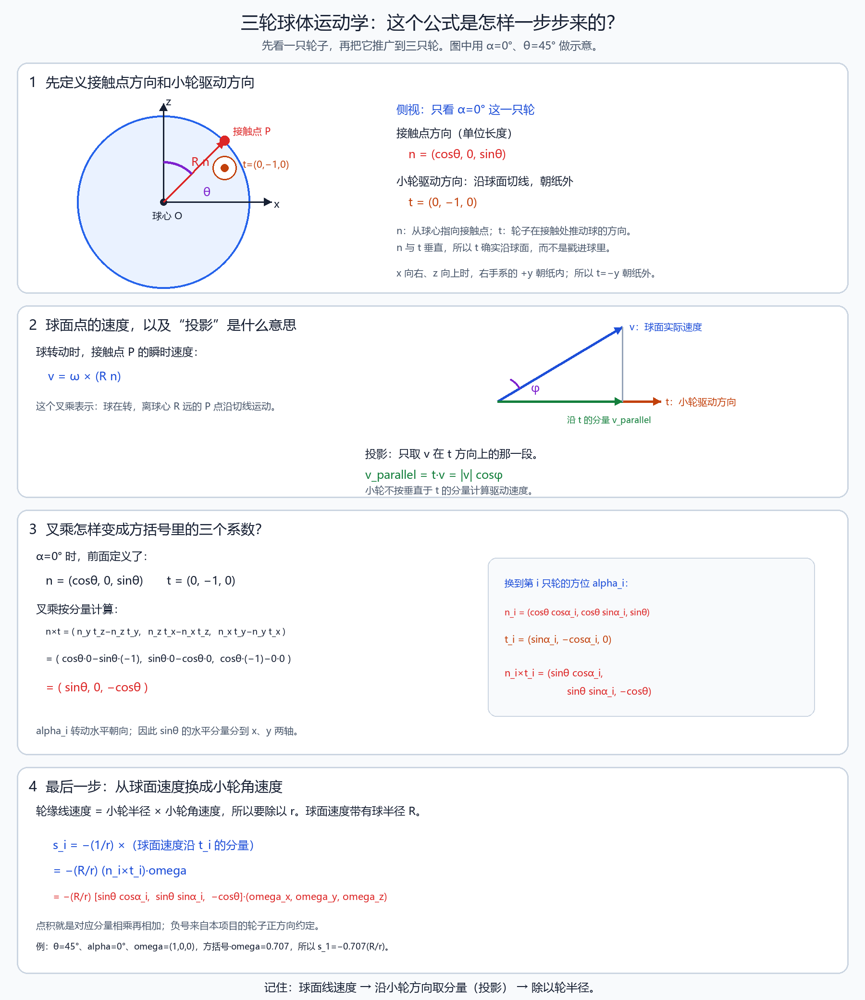

# 02 三轮球体运动学分配

先修：[基础课程](../../../01_通用基础/00_基础课程总览.md)。项目：P1。目标：把公式对应到实际变量与调用。源码：[文件地图](../02_源码阅读与运行/01_源码版本与文件地图.md)。实验：[P1](../../../03_代码实验/02_项目实验/P1/README.md)。

## 1. 先把球、接触点和小轮的方向说清楚

先只看一只轮，暂时不管另外两只。接触几何先放在随轮组固定的球心参考系里讨论；球相对轮组的转动，与球在地面参考系中的真实角速度，需要在机身也旋转时另行换算。定义：

- 球心是参考原点，竖直方向是 \(z\) 轴；
- \(\mathbf{n}_i\) 是从球心指向第 \(i\) 个接触点的单位方向；
- \(\mathbf{t}_i\) 是小轮在接触处推动大球的单位方向；
- \(\boldsymbol{\omega}=[\omega_x,\omega_y,\omega_z]^\mathsf T\) 是大球角速度；
- \(R\) 是大球半径，\(r\) 是小驱动轮半径；
- \(\theta\) 是接触点的高度角参数，\(\alpha_i\) 是第 \(i\) 只轮在球周围的方位角。

这里的 \(\theta\) 是**球面接触位置的几何角度**，不是机身的俯仰角；\(\alpha_i\) 是从上往下看时，第 \(i\) 只轮绕球心的方位，不是轮子的转速，也不是控制器临时要求机器人转过的角度。源码将三只轮的方位取为 \(0^\circ,120^\circ,240^\circ\)，并把 \(\theta\) 从 degree 转成弧度后计算三角函数。

按本章坐标约定：

\[
\mathbf{n}_i=
\begin{bmatrix}
\cos\theta\cos\alpha_i\\
\cos\theta\sin\alpha_i\\
\sin\theta
\end{bmatrix},
\qquad
\mathbf{t}_i=
\begin{bmatrix}
\sin\alpha_i\\
-\cos\alpha_i\\
0
\end{bmatrix}
\]

先看第 1 只轮，也就是 \(\alpha_1=0\)：

\[
\mathbf{n}_1=
\begin{bmatrix}\cos\theta\\0\\\sin\theta\end{bmatrix},
\qquad
\mathbf{t}_1=
\begin{bmatrix}0\\-1\\0\end{bmatrix}
\]

\(\mathbf n_1\) 指向球面上的接触点；\(\mathbf t_1\) 沿着小轮推动大球的方向。它们是两个不同的方向。

## 2. 球在转，接触点为什么会沿切线移动？

角速度 \(\boldsymbol{\omega}\) 说的是“球绕哪个方向、以多快的角速度转”。球面接触点到球心的向量是：

\[
\mathbf r_i=R\mathbf n_i
\]

刚体转动时，离转轴有距离的点会沿圆周切线运动，速度公式为：

\[
\mathbf v_i=\boldsymbol{\omega}\times\mathbf r_i
=R(\boldsymbol{\omega}\times\mathbf n_i)
\]

叉乘在这里不是普通乘法。它用“转轴方向”和“点离转轴的位置”确定点的瞬时运动方向；大小等于角速度乘以点到转轴的垂直距离。用右手定则可以判断方向：右手四指从 \(\boldsymbol{\omega}\) 转向 \(\mathbf r_i\)，拇指所指就是 \(\boldsymbol{\omega}\times\mathbf r_i\) 的方向。

这里 \(\mathbf v_i\) 是相对球心的转动速度项；若求地面参考系里的完整点速度，还要加球心平动速度并统一坐标。若参考系随机身转动，角速度也应使用相对机身的量。当前教学接触映射不展开完整的机身运动补偿，源码 fk 结果也不直接证明已得到世界参考系的球真实角速度。

所以，球不是简单地“沿小轮方向整体平移”。球正在转动，接触点的转动速度 \(\mathbf v_i\) 通常斜着走；小轮只能沿自己的驱动方向推动球。

## 3. “投影”就是只取沿小轮方向的那一段速度

接触点速度 \(\mathbf v_i\) 中，只有沿 \(\mathbf t_i\) 的分量会带动这只小轮。沿该方向的有符号速度分量为：

\[
v_{\parallel,i}=\mathbf t_i^\mathsf T\mathbf v_i
\]

为什么是点积？点积公式是：

\[
\mathbf a^\mathsf T\mathbf b
=\|\mathbf a\|\,\|\mathbf b\|\cos\varphi
\]

其中 \(\varphi\) 是两个方向的夹角。因为 \(\mathbf t_i\) 是单位向量，\(\mathbf t_i^\mathsf T\mathbf v_i\) 就是 \(\mathbf v_i\) 沿小轮方向的速度分量：同向为正，反向为负，垂直时为零。

例如速度是 \([3,4]^\mathsf T\)，方向单位向量是 \([0,-1]^\mathsf T\)，点积为 \(-4\)。它表示这个速度在指定方向上的分量是 \(-4\)，即实际朝相反方向走了 4 个速度单位。投影不表示把整个斜向速度都交给小轮，也不是把速度向量的每个数字单独相乘。

## 4. 为什么公式里会出现 \(\mathbf n_i\times\mathbf t_i\)？

把上面的接触点速度代入投影：

\[
v_{\parallel,i}
=\mathbf t_i^\mathsf T
\left[\boldsymbol{\omega}\times(R\mathbf n_i)\right]
\]

标量三重积允许把这串点乘、叉乘重新排一下：

\[
\mathbf t_i^\mathsf T
(\boldsymbol{\omega}\times\mathbf n_i)
=
\boldsymbol{\omega}^\mathsf T
(\mathbf n_i\times\mathbf t_i)
\]

于是：

\[
v_{\parallel,i}
=R(\mathbf n_i\times\mathbf t_i)^\mathsf T\boldsymbol{\omega}
\]

注意：\(\mathbf n_i\times\mathbf t_i\) **不是说球面直接沿这个方向滚动**。它是把“球角速度造成的接触点速度，再取小轮方向分量”改写成一次点积后得到的系数方向。真正的接触点速度仍是 \(\boldsymbol{\omega}\times(R\mathbf n_i)\)。

把第 1 只轮的方向代入叉乘。三维叉乘按分量计算：

\[
\mathbf a\times\mathbf b=
\begin{bmatrix}
a_yb_z-a_zb_y\\
a_zb_x-a_xb_z\\
a_xb_y-a_yb_x
\end{bmatrix}
\]

因此：

\[
\mathbf n_1\times\mathbf t_1
=
\begin{bmatrix}
\cos\theta\\0\\\sin\theta
\end{bmatrix}
\times
\begin{bmatrix}
0\\-1\\0
\end{bmatrix}
=
\begin{bmatrix}
\sin\theta\\0\\-\cos\theta
\end{bmatrix}
\]

例如第一项是 \(0\cdot0-\sin\theta\cdot(-1)=\sin\theta\)；第二项是 \(\sin\theta\cdot0-\cos\theta\cdot0=0\)；第三项是 \(\cos\theta\cdot(-1)-0\cdot0=-\cos\theta\)。

对任意方位角，代入 \(\mathbf n_i,\mathbf t_i\) 后得到：

\[
\mathbf n_i\times\mathbf t_i=
\begin{bmatrix}
\sin\theta\cos\alpha_i\\
\sin\theta\sin\alpha_i\\
-\cos\theta
\end{bmatrix}
\]

这就是公式方括号里的三个系数。方位角 \(\alpha_i\) 在这里用来告诉我们“这只轮在球的哪一侧”，所以它会改变 \(x,y\) 两个系数；它不是最后再额外乘上的一个角度。

## 5. 从接触点速度变成小轮角速度

大球和小轮在接触处无滑动时，接触双方的表面点速度在**同一参考系**中必须一致，沿驱动方向的相对速度为零。两只接触物体的转轴正方向可能让它们的角速度标量符号相反，但不能据此说接触点的物理速度方向相反。本章把小轮正转时沿 \(\mathbf t_i\) 的轮面速度记作 \(-rs_i\)，因此匹配球面投影速度时有：

\[
r s_i=-v_{\parallel,i}
\]

其中 \(s_i\) 是小驱动轮角速度。把上一节结果代入：

\[
s_i=-\frac{R}{r}
\begin{bmatrix}
\sin\theta\cos\alpha_i&
\sin\theta\sin\alpha_i&
-\cos\theta
\end{bmatrix}
\begin{bmatrix}
\omega_x\\
\omega_y\\
\omega_z
\end{bmatrix}
\]

方括号乘列向量就是普通点积：三个对应分量分别相乘再相加。例如：

\[
s_i=-\frac{R}{r}
\left(
\sin\theta\cos\alpha_i\,\omega_x+
\sin\theta\sin\alpha_i\,\omega_y-
\cos\theta\,\omega_z
\right)
\]

\(R/r\) 是无量纲的半径比例，所以输入和输出都是角速度，单位均为 rad/s。整体负号来自本项目定义的小轮正转方向；改变电机正方向或坐标约定时，符号可能改变。

一个数字例子：取 \(R/r=2,\theta=45^\circ,\alpha_1=0,\boldsymbol{\omega}=[1,0,0]^\mathsf T\)。此时：

\[
\mathbf n_1\times\mathbf t_1=
\begin{bmatrix}0.707\\0\\-0.707\end{bmatrix},
\qquad
(\mathbf n_1\times\mathbf t_1)^\mathsf T\boldsymbol{\omega}=0.707
\]

所以 \(s_1=-2\times0.707=-1.414\text{ rad/s}\)。这一步只是求“球以这个角速度转时，这只小轮需要怎样转才能不打滑”，不是在算机器人身体的前进速度。

## 6. 三只轮怎样叠成一个矩阵？

每只轮都有自己的方位角：

\[
\alpha_1=0,\qquad
\alpha_2=\frac{2\pi}{3},\qquad
\alpha_3=\frac{4\pi}{3}
\]

对每只轮使用同一条公式，只把 \(\alpha_i\) 换成该轮的角度。于是三行分别是：

\[
\begin{aligned}
s_1&=-\frac{R}{r}\left(\sin\theta\,\omega_x-\cos\theta\,\omega_z\right)\\
s_2&=-\frac{R}{r}\left(-\frac12\sin\theta\,\omega_x+\frac{\sqrt3}{2}\sin\theta\,\omega_y-\cos\theta\,\omega_z\right)\\
s_3&=-\frac{R}{r}\left(-\frac12\sin\theta\,\omega_x-\frac{\sqrt3}{2}\sin\theta\,\omega_y-\cos\theta\,\omega_z\right)
\end{aligned}
\]

现在把三条式子竖着叠起来：

\[
\begin{bmatrix}s_1\\s_2\\s_3\end{bmatrix}
=
\underbrace{
-\frac{R}{r}
\begin{bmatrix}
\sin\theta&0&-\cos\theta\\
-\frac12\sin\theta&\frac{\sqrt3}{2}\sin\theta&-\cos\theta\\
-\frac12\sin\theta&-\frac{\sqrt3}{2}\sin\theta&-\cos\theta
\end{bmatrix}}_{ik}
\begin{bmatrix}\omega_x\\\omega_y\\\omega_z\end{bmatrix}
\]

矩阵乘法在这里就是每一行分别做一次点积：

- 第一行和球角速度向量相乘，算出第 1 只轮的 \(s_1\)；
- 第二行算出第 2 只轮的 \(s_2\)；
- 第三行算出第 3 只轮的 \(s_3\)。

因此，**一行对应一只轮**；**一列对应大球绕一个坐标轴转动时，对三只轮分别造成的影响**。它把一个三维球角速度变成三个轮角速度。矩阵 \(ik\) 的名字是源码命名，不表示这里求的是关节角位置。它也不是机械臂的关节雅可比矩阵；虽然二者都能描述速度之间的映射，但这里专门把大球角速度换成三只驱动轮角速度。

源码的输入输出形状是：

\[
\boldsymbol{\omega}\in\mathbb R^3
\quad\longrightarrow\quad
\mathbf{s}=
\begin{bmatrix}s_1\\s_2\\s_3\end{bmatrix}\in\mathbb R^3
\]

如果已知三只轮速度，想反求球角速度，就是解 \(ik\boldsymbol{\omega}=\mathbf{s}\)。满秩且几何有效时可用 \(fk=ik^{-1}\) 表示这个反向映射；数值计算中一般更稳妥地解线性方程，不必显式求逆。这个反解仍然是在还原**角速度**，不是还原球的位置或机身姿态。

## 7. 一个数字例子：一行怎样算出一只轮的速度？

取教学数字 \(R/r=2,\theta=45^\circ\)，于是 \(\sin\theta=\cos\theta\approx0.707\)。

### 7.1 大球只绕 \(x\) 轴转

令 \(\boldsymbol{\omega}=[1,0,0]^\mathsf T\)。每行只剩 \(x\) 这一列：

\[
s_1=-2(0.707)=-1.414,\qquad
s_2=-2(-0.354)=0.707,\qquad
s_3=-2(-0.354)=0.707
\]

三只轮的速度不同，说明球绕 \(x\) 轴转时，三只轮在各自接触方向上受到的速度不同。

### 7.2 大球只绕 \(z\) 轴转

令 \(\boldsymbol{\omega}=[0,0,1]^\mathsf T\)。三行的 \(z\) 系数相同，所以三只轮同速：

\[
s_1=s_2=s_3=+1.414\text{ rad/s}
\]

在这一套坐标和轮子正方向约定下，三轮同速对应大球绕竖直 \(z\) 轴转动。这里说的是大球的 \(z\) 轴角速度；它是否和机身 yaw 完全相同，要看机身怎样被控制以及所用坐标系，不能只凭“三轮同速”就把球角速度和机身姿态角画等号。

### 7.3 为什么矩阵有时会退化？

\(\theta=0\) 时，所有轮行的 \(x,y\) 系数都为零，三行只剩相同的 \(z\) 分量，无法区分球绕 \(x,y\) 轴的转动；矩阵降秩。另一退化情况是 \(\theta=90^\circ\)，所有 \(z\) 系数为零，也无法由三轮速度恢复 \(z\) 轴转动。此时逆矩阵不存在，程序不能把普通逆矩阵当作总能用的操作。

现存配置的 \(R=0.11\text{ m},r=0.0635\text{ m},\theta=40^\circ\) 是文件中的参数值，不代表经过实机校准的测量值；本章教学数值也不是实机性能结论。

### 7.4 逆矩阵和伪逆：什么时候能从轮速反算球角速度？

球轮矩阵 \(ik\) 是 \(3\times3\)。几何不退化、三行独立时，它有普通逆矩阵，源码把反向映射记成 \(fk=ik^{-1}\)。手算一个小矩阵的逆，可以把 \([ik\mid I]\) 做高斯消元，化成 \([I\mid ik^{-1}]\)；实际程序更常直接解 \(ik\boldsymbol{\omega}=\mathbf{s}\)，避免显式求逆。

若矩阵因接触几何退化而降秩，普通逆不存在。伪逆 \(A^+\) 是更一般的“尽量匹配”的反算：它找一组数，使 \(Aq\) 尽量接近目标。对满行秩矩阵 \(A\in\mathbb R^{m\times n}\)，常见公式是：

\[
A^+=A^\mathsf T(AA^\mathsf T)^{-1}
\]

这里 \(A^+\) 一般是 \(n\times m\)，所以通常不是方阵，不能说它是对称矩阵。若 \(A\) 是实矩阵，\(AA^\mathsf T\) 是对称矩阵；这不代表乘完 \(A^\mathsf T\) 后的 \(A^+\) 也对称。球轮矩阵退化时，通用伪逆可由奇异值分解 \(A=U\Sigma V^\mathsf T\) 得到：把非零奇异值取倒数、零值仍置零，形成 \(\Sigma^+\)，再算 \(A^+=V\Sigma^+U^\mathsf T\)。手算 SVD 通常很繁琐；本项目满秩的方形 ik 可直接求逆，退化或近退化时则要承认某些运动方向无法可靠恢复。伪逆只能给最小二乘意义下的近似，不能凭空恢复一个轮子布局本身无法观测/产生的运动方向；接近奇异时也要留意噪声放大。

### 7.5 从三轮反馈一路算到水平速度：半径只放在对应的一步

记 \(c=(R/r)\sin\theta\)、\(d=(R/r)\cos\theta\)。三条轮速式相加、相减，可以直接得到逆映射：

\[
\omega_x=\frac{-2s_1+s_2+s_3}{3c},\qquad
\omega_y=\frac{s_3-s_2}{\sqrt3c},\qquad
\omega_z=\frac{s_1+s_2+s_3}{3d}.
\]

这与满秩情况下的 \(fk=ik^{-1}\) 是同一关系。分母中已有 \(R/r\)，所以反馈乘完 fk 后是球角速度，不应再乘一次小轮半径。只有需要把球的角运动换成水平速度时，才按相应滚动模型乘球半径。

例如沿用 \(R/r=2,\theta=45^\circ\)，测得三轮 \([-1.4142,0.7071,0.7071]\) rad/s，代入上式得到球角速度约 \([1,0,0]\) rad/s。若再取教学球半径 \(R=0.10\) m，按**当前源码**的 \(v_x=-R\omega_y,v_y=R\omega_x\)，水平速度为 \([0,0.10]\) m/s。一只小轮的轮缘速度则是 \(rs_i\)，与这个整机速度不是同一个量。接口若报电机轴转速而轮子经过减速器，还需先按传动比换到轮轴；当前矩阵默认输入已与所用轮半径对应。

这里还要区分“源码符号”与“一般滚动公式”。若在地面坐标中定义 z 向上、球真实角速度为 \(\boldsymbol\omega\)，地面接触点相对球心为 \(-R\mathbf e_z\)，无滑动要求

\[
\mathbf v_{\mathrm{center}}+\boldsymbol\omega\times(-R\mathbf e_z)=0,
\quad\Rightarrow\quad
v_x=R\omega_y,\quad v_y=-R\omega_x.
\]

它与当前控制器的两项符号相反。这说明不能把 fk 恢复的 `angular` 不加检查地称为该地面坐标约定下的真实球角速度；轮正方向、球角速度定义和反馈安装需要一起核对。文档保留源码的估计式，不据此宣称实际正方向已经校准。最有用的核对记录是：在规定轴向的小幅滚动下，同时记录三轮反馈符号、fk 输出和独立测得的地面移动方向。

输入 \(s_i\)、输出 \(\omega\) 都是 rad/s；\(ik,fk\) 的系数是无量纲；球半径的单位是 m；最终水平速度是 m/s。\(\theta,\alpha_i\) 用于三角函数时必须转成弧度。把这四个单位分开写，就能发现半径重复乘、大小球半径互换和 RPM 未转换等问题。

## 8. 实际输出路径的特殊点

controlLoop的angular_cmd变量名带tau，但最终通过ik进入v_des速度字段。它不是直接发布三只电机t_ff力矩。源代码先把姿态PID乘K_t2v，又在ik结果后再乘一次K_t2v；前馈在两者之间加入，所以反馈与前馈缩放次数不同，解释时不能省略。

要把“球轮运动学”和“控制器如何调用它”分开。几何公式本身的输入应是球的目标角速度，输出是三只驱动轮的目标角速度；这种关系只描述滚动几何，不描述力矩或电机动力学。但控制器当前传给 ik 的是姿态 PID 与 CoM 项组成的中间控制量，并没有先显式地通过转动惯量算出球角加速度、再积分成球角速度。因此不能把 tau 变量直接说成“球角速度”，也不能把该段说成严格完成了力矩到角速度的物理计算。

最终值写入消息 v_des。电机协议把 v_des 解释为电机轴角速度，单位 rad/s；它不是轮缘线速度 m/s。若要估算某个轮缘的切向速度，可在理想滚动下用轮半径乘电机角速度，但三轮对球的作用方向仍需按接触几何合成。整条源码控制路径的单位审计见[一个控制周期](../02_源码阅读与运行/02_一个周期的调用与数据流.md)。

limitVector用整体L2范数限幅8（当前wheel o_clamp），不是每轮单独clip8，也不是max绝对值缩放。整组同比例保持该线性映射方向，但执行器真实最大速度仍需独立核对。

## 9. 代码与失败

[ball_wheel_mapping教学实验](../../../03_代码实验/02_项目实验/P1/README.md)只复现几何往返，不连接轮。失败：latitude rad当degree；球半径与轮半径互换；轮序错；纬度退化；把输出当线速度。

## 10. 英文与练习

“The mapping projects the ball's contact velocity onto each wheel's drive direction. It maps ball angular velocity to wheel angular velocity, so it differs from a planar omni-wheel body-velocity matrix.”

追问：How is the output limited in this source? The wheel-command vector is scaled using its Euclidean norm.

1. 概念：ik在这里求角度位置吗？答：名称ik，但此处速度线性分配。
2. 计算：上例ω=[0,0,-1]？答：三轮-1.414214rad/s。
3. 代码：θ=0怎样处理？答：报告映射奇异，不任意求逆。
4. 解释：三轮同速为什么不直接表示前进？答：按此球接触几何，同速对应球z轴转动；机身yaw还需独立核对。

下一步：[完整周期](../02_源码阅读与运行/02_一个周期的调用与数据流.md)。

## 精读补充：把中间步骤讲清楚

### 本章在完整周期中的位置

矩阵每行是一只接触轮，输入是球角速而非平面车速度。用纯x、纯y、纯z三组输入看列作用，再把轮反馈反解检查轮序。限幅8是L2整向量范数，反馈与CoM前馈经过t2v的次数不同。

先回到[完整源码周期](../02_源码阅读与运行/02_一个周期的调用与数据流.md)，定位本章之前输入由谁产生、之后结果被谁消费；再读[对应基础推导](../../../01_通用基础/03_坐标_运动学与动力学/05_机械臂FKIK与雅可比.md)。不要只背中间一个函数或矩阵。

### 用纸笔完成这一页的验收

1. 从本章数值例重算每个中间量，写单位和输入形状。
2. 对照[源文件地图](../02_源码阅读与运行/01_源码版本与文件地图.md)，指出活动分支和被注释的区别。
3. 解释上述特有误读点，并给一条能区分原因的日志字段。
4. 先用中文说清输入→计算→输出，再用本章英文口述；涉及个人贡献时查材料证据，不把教学重建说成历史部署。

## 历次提问归纳：球角速度怎样变成三轮速度

本节把常见追问收成四条，完整问答目录见 [P1 历次问题归纳与完整讲解](../05_中英文面试/06_历次问题归纳与完整讲解.md)。

- **大球转动为什么会让接触点有速度？**接触点离球心有力臂；刚体转动时，点速度由“角速度叉乘位置”给出，方向沿接触处切线。
- **为什么要投影到小轮方向？**接触点速度只有沿小轮滚动方向的分量能带动该轮滚动；垂直于滚动方向的分量不会变成同样的轮缘滚动速度。
- **矩阵的每一行、每一列代表什么？**列对应球绕某轴转动的单位影响，行对应某一只小轮；矩阵乘球角速度向量得到三只轮的角速度目标。单位要继续经过半径、传动比或驱动接口换算。
- **反算为什么可能用伪逆？**三轮与球的几何映射若退化或含噪，普通逆矩阵可能不存在或不稳；伪逆求的是最小二乘意义下最接近的球角速度，不会凭空增加不可观测的信息。
