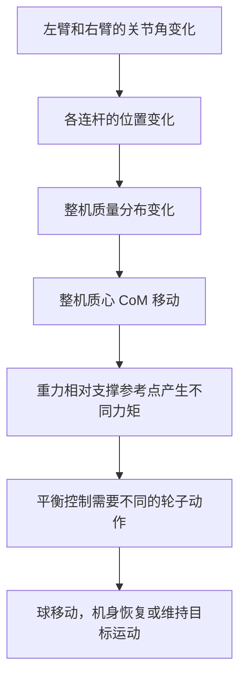
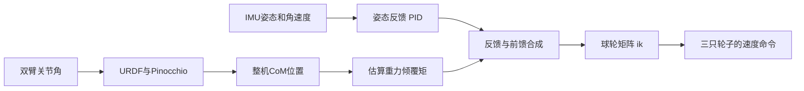

# 05 双臂 CoM 与重力前馈：手臂为什么会影响平衡

先修：[基础课程](../../../01_通用基础/00_基础课程总览.md)。项目：P1。源码入口：[文件地图](../02_源码阅读与运行/01_源码版本与文件地图.md)。完整控制周期：[一个周期的调用与数据流](../02_源码阅读与运行/02_一个周期的调用与数据流.md)。实验：[P1 实验手册](../../../03_代码实验/02_项目实验/P1/README.md)。

## 本章先记住三句话

1. **手臂动了，整台机器人的质量分布就变了，质心也会变。**
2. **质心偏离支撑参考位置时，重力会产生倾覆力矩。**
3. **重力前馈根据已知的手臂姿势，提前估算这部分力矩并加入控制命令；它不能代替姿态反馈。**

这章会依次回答：质心是什么、怎样算、为什么重力会让机身倾、项目代码怎样把 CoM 用进命令，以及源码目前没有做什么。

## 1. 先看机械画面：手臂为什么会影响球形底盘？

把机器人简化成“下面是球、上面是机身、机身上装着两条手臂”。球和地面接触，球与机身之间由三只驱动轮传递作用。机身和手臂的重量都由这套结构支撑。



手臂不是“挂在机器人外面、与底盘无关的东西”。例如两只手向前伸，很多手臂质量从机身附近移到了前方；整机质心也会向前移动。重力仍然竖直向下，但它相对支撑参考位置的力臂变了，因此倾覆趋势变了。

为了先看清原理，可以把球与地面接触附近、或控制模型指定的某个点，当成计算力矩的参考点。真实机器人中球会滚动，参考点未必是一个固定的铰链；所以计算 CoM 和力矩时，**CoM 坐标、重力方向、参考点和控制器轴向必须使用一致的坐标约定**。本章先用简化模型解释物理，再单独指出源码实现与理想公式的区别。

## 2. CoM 是什么？为什么不能直接平均两只手的位置？

CoM 是 Center of Mass，中文叫**质心**。可以把它想象成整个物体质量“平均分布”的位置：如果把整台机器人缩成一个点，平动时可以近似把总质量看作集中在这个点。

### 2.1 先用跷跷板理解“质量加权平均”

一块 8 kg 的机身和一个 1 kg 的零件，不能把它们的位置简单平均。较重的机身应该对总质心有更大的影响。

一维时公式是：

\[
x_{\mathrm{CoM}}=
\frac{m_1x_1+m_2x_2+\cdots+m_nx_n}
{m_1+m_2+\cdots+m_n}
\]

- \(m_i\)：第 \(i\) 个部件有多重，单位 kg；
- \(x_i\)：这个部件的质心在同一条坐标轴上的位置，单位 m；
- 分子：把每个位置按部件质量加权后相加；
- 分母：所有部件的总质量。

较重的部件移动一点，通常比轻部件移动同样距离更能改变整机 CoM。

### 2.2 三维公式

将每个部件的三维质心位置写成向量 \(\mathbf r_i=[x_i,y_i,z_i]^{\mathsf T}\)，整机质心为：

\[
\mathbf r_{\mathrm{CoM}}=
\frac{\sum_i m_i\mathbf r_i}{\sum_i m_i}
\]

这不是“两个手末端的位置平均”。它要纳入模型里的机身、手臂连杆以及其他有质量的部件；每个连杆的质量不同，连杆自身的质心也不一定在端点。

### 2.3 URDF 和 Pinocchio 各自做什么？

可以按四步理解：

1. **URDF 提供机器人模型信息。**它描述连杆怎样连接，通常还包括每个连杆的质量、局部质心和惯量。
2. **关节角 \(q\) 决定连杆姿态。**手臂改变关节角后，各连杆在机器人模型中的位置随之改变。
3. **先把每个连杆的局部质心变到同一坐标系。**若连杆 \(i\) 的局部质心为 \(\mathbf r_{i,\text{local}}\)，它相对机身的位置和朝向是 \(\mathbf p_i(q),R_i(q)\)，则用下一行公式把这个局部点变到机身坐标。

   \[
   \mathbf r_i^{\text{body}}=R_i(q)\mathbf r_{i,\text{local}}+\mathbf p_i(q)
   \]

4. **Pinocchio 按质量加权求和。**它根据 URDF 和输入的 \(q\) 计算整机 CoM；提供关节速度 \(\dot q\) 时，还可以计算 CoM 速度。

所以，“Pinocchio 算 CoM”不是凭空猜一个位置，而是先用关节状态更新模型几何，再把各个有质量部件的质心统一到一个坐标系，最后做质量加权平均。

<a id="com-local-frames"></a>
### 2.4 “连杆自己的坐标系”从哪里来？

坐标系可以先想成贴在零件上的三支小箭头：一支标 x，一支标 y，一支标 z。连杆自己的坐标系，就是固定贴在这根连杆上的方向标记。连杆移动或转动时，这三支箭头跟着连杆一起移动或转动。

URDF 不只描述哪根连杆接在哪个关节上，也用关节原点、连杆原点和惯性原点来描述模型几何。每根连杆的质量和局部质心通常是相对该连杆坐标系给出的。因此，URDF 里的局部 CoM 坐标不是相对机身的位置，而是从这根连杆自己的原点出发，沿它自己的 x/y/z 轴走多少。

例如，某连杆的局部 CoM 是向量 [0.2, 0, 0]ᵀ m，意思是：从连杆原点出发，沿连杆自己的 x 轴走 0.2 m。要知道这个点在机身坐标系中在哪里，还要知道这根连杆现在相对机身的朝向和位置。

这也解释了公式中的两个量：

- Rᵢ(q)：连杆自己的三根方向箭头，相对机身坐标轴转成了什么方向；
- pᵢ(q)：连杆自己的原点，在机身坐标系中的位置。

公式

\[
\mathbf r_i^{\text{body}}=R_i(q)\mathbf r_{i,\text{local}}+\mathbf p_i(q)
\]

分成两步读：先把“从连杆原点到质心”的偏移方向转到机身坐标轴，再加上“连杆原点在机身哪里”。左边的结果是质心相对机身原点的位置。

### 2.5 一个两段手臂例子：关节角怎样决定位置和朝向？

下面的数字只是为了手算方便，不是 P1 的实测尺寸。设机身坐标系 x 向前、y 向左、z 向上；肩关节原点固定在：

\[
\mathbf p_{\text{shoulder}}=\begin{bmatrix}0.3\\0\\0.5\end{bmatrix}\text{ m}
\]

上臂长 0.4 m，质心在上臂中点，也就是距肩关节 0.2 m。

**情况一：手臂伸直朝前，肩关节角 q₁=0。**为了这个教学例子，我们把上臂自己的 x 轴定义成伸直时朝前。此时它的方向和机身 x 轴一致，所以 R₁=I（单位矩阵，不改变方向）。上臂质心在机身中的位置是：

\[
\mathbf r_{\text{upper}}^{\text{body}}
=I\begin{bmatrix}0.2\\0\\0\end{bmatrix}
+\begin{bmatrix}0.3\\0\\0.5\end{bmatrix}
=\begin{bmatrix}0.5\\0\\0.5\end{bmatrix}\text{ m}
\]

也就是前方 0.5 m、高 0.5 m。此时公式可以简写成“局部质心偏移 + 连杆原点位置”，因为 R₁=I。

**情况二：上臂绕肩关节转到左侧，肩关节角 q₁=90°。**肩关节转动后，上臂自己的 x 轴也转向机身的 y 轴。局部偏移仍然是沿上臂 x 轴 0.2 m，但换成机身坐标后变成 [0, 0.2, 0]ᵀ m。因此：

\[
\mathbf r_{\text{upper}}^{\text{body}}
=\begin{bmatrix}0.3\\0\\0.5\end{bmatrix}
+\begin{bmatrix}0\\0.2\\0\end{bmatrix}
=\begin{bmatrix}0.3\\0.2\\0.5\end{bmatrix}\text{ m}
\]

同一段 0.2 m 的长度没有变；变的是它相对机身的方向。这时不能只相加原来的局部向量和连杆原点位置，必须先把局部向量旋转到机身坐标系。

**前臂的位置还要沿关节链继续算。**若上臂长 0.4 m，肘关节原点在上臂末端，那么：

\[
\mathbf p_{\text{elbow}}(q_1)
=\mathbf p_{\text{shoulder}}
+R_1(q_1)\begin{bmatrix}0.4\\0\\0\end{bmatrix}
\]

当 q₁=0 时，肘在 [0.7, 0, 0.5]ᵀ m；当 q₁=90° 时，肘在 [0.3, 0.4, 0.5]ᵀ m。肘关节角 q₂ 再决定前臂相对上臂怎样转。Pinocchio 按关节连接关系，从肩、上臂、肘到前臂逐段算出每根连杆的朝向和原点位置。

所以，q 表示各关节现在摆到什么角度；它决定每一段的位置 pᵢ(q) 和朝向 Rᵢ(q)。这不表示连杆此刻正在运动。手臂可以静止，但若保持在 90° 姿势，Rᵢ(q) 仍是旋转后的矩阵。关节是否正在转，要看关节速度 q̇。

### 2.6 Pinocchio 是计算器，不是控制器

可以用三样东西理解它：

1. **URDF 是说明书**：告诉程序连杆和关节怎样连接、质量在哪里；
2. **q 是姿势清单**：告诉程序每个关节现在转到哪里；
3. **Pinocchio 是几何计算器**：根据说明书和姿势，算每根连杆在哪里、朝哪边，以及局部质心在机身坐标系中的位置。

计算每个连杆 CoM 后，Pinocchio 再按连杆质量做加权平均。给它 q̇ 后，可以进一步计算 CoM 速度。它不会因此让手臂移动，也不负责发电机命令。

项目代码里的 pin_q 和 pin_dq 是按 Pinocchio 模型顺序填写的状态数组：前者放关节位置，后者放关节速度。源码用预设的左右臂关节名查询**模型**索引，然后按接收数组的原顺序填值；它没有按每条消息的 `msg.name` 重排。ROS JointState 的顺序是否正好与预设名称一致，仍需发布端证据。简单单自由度模型中位置和速度索引常相同；更复杂模型要分别核对位置索引与速度索引。

<a id="com-continuous-rotation"></a>
### 2.7 从 0° 连续转到 90°：轴的定义不变，轴在机身中的朝向会变

沿用肩原点 \([0.3,0,0.5]^{\mathsf T}\) m、上臂局部质心 \([0.2,0,0]^{\mathsf T}\) m。教学关节绕机身 +z 轴转角 \(\varphi\)，其旋转矩阵是

\[
R_z(\varphi)=\begin{bmatrix}\cos\varphi&-\sin\varphi&0\\\sin\varphi&\cos\varphi&0\\0&0&1\end{bmatrix},\qquad
r^{\mathrm{body}}(\varphi)=\begin{bmatrix}0.3+0.2\cos\varphi\\0.2\sin\varphi\\0.5\end{bmatrix}.
\]

| 关节角 | 局部 x 轴在机身中的方向（R 第一列） | 该连杆质心在机身中的位置（m） |
|---|---|---|
| 0° | [1,0,0] | [0.5,0,0.5] |
| 45° | [0.7071,0.7071,0] | [0.4414,0.1414,0.5] |
| 90° | [0,1,0] | [0.3,0.2,0.5] |

连杆的局部质心始终是 [0.2,0,0]，模型没有重新定义其 x 轴；是同一根连杆带着自己的轴一起转动，所以机身坐标中的分量连续变化。\(R(0)=I_3\) 仅表示这个教学零位两组轴对齐；实际 URDF 关节零位还可能有固定安装旋转，不能假定每个实际 link 在 q=0 时 R 都是单位矩阵。

再构造一个连贯的质量加权例：8 kg 机身质心为 [0,0,0.5] m，2 kg 的简化臂质量集中在上述连杆质心，其他部件暂不纳入。则总质心为

\[
r_{\mathrm{CoM}}(\varphi)=\begin{bmatrix}0.06+0.04\cos\varphi\\0.04\sin\varphi\\0.5\end{bmatrix}\mathrm{m}.
\]

0°、45°、90° 的总 CoM 分别是 [0.10,0,0.5]、[0.0883,0.0283,0.5]、[0.06,0.04,0.5] m。该例只研究一个臂质量的旋转；真实双臂模型要继续加入每个连杆并按总质量归一化。手臂位置变化了 0.2 m，不意味着整机 CoM 也变化 0.2 m，因为其作用还受到 2/10 的质量比例约束。

<a id="com-mass"></a>
## 3. 用数字亲手算一次 CoM

下面是帮助理解的教学模型，不是 P1 机器人的实际质量测量：

| 部件 | 质量 \(m_i\) | 质心位置 \([x_i,y_i,z_i]\) |
|---|---:|---|
| 机身 | 8 kg | \([0,0,0.5]\) m |
| 左臂整体的简化质量 | 1 kg | \([0.3,0.2,0.6]\) m |
| 右臂整体的简化质量 | 1 kg | \([0.3,-0.2,0.6]\) m |

总质量：

\[
M_{\mathrm{total}}=8+1+1=10\text{ kg}
\]

分别计算三个方向。

**x 方向：**

\[
x_{\mathrm{CoM}}=
\frac{8\times0+1\times0.3+1\times0.3}{10}
=\frac{0.6}{10}=0.06\text{ m}
\]

**y 方向：**

\[
y_{\mathrm{CoM}}=
\frac{8\times0+1\times0.2+1\times(-0.2)}{10}=0
\]

**z 方向：**

\[
z_{\mathrm{CoM}}=
\frac{8\times0.5+1\times0.6+1\times0.6}{10}
=\frac{5.2}{10}=0.52\text{ m}
\]

所以整机 CoM 是 \( [0.06,0,0.52]^{\mathsf T}\) m。虽然机身 CoM 在 \(x=0\)，两臂对称地向前伸，使整机 CoM 向前偏了 6 cm。

如果左臂向后移动到 \( [-0.3,0.2,0.6]\) m，右臂仍在 \( [0.3,-0.2,0.6]\) m，则两只手臂的 x 方向质量加权项抵消，教学模型中 \(x_{\mathrm{CoM}}=0\)。注意这里左臂的 \(y\) 仍为 \(+0.2\) m；若它同时横向移动，\(y_{\mathrm{CoM}}\) 也会改变。

这说明：**左右对称只可能让某些方向抵消，不意味着所有方向 CoM 都不变。**

## 4. CoM 偏了，重力为什么会产生力矩？

### 4.1 先回忆力和力矩

地球对质量 \(M\) 的机器人施加重力：

\[
\mathbf F_g=M\mathbf g
\]

若世界坐标系的 \(z\) 轴向上，重力向量可写为：

\[
\mathbf g=[0,0,-g]^{\mathsf T},\qquad g\approx9.81\text{ m/s}^2
\]

力是否会让物体绕参考点转动，取决于它的作用线离参考点有多远。力矩是“力乘垂直力臂”的三维版本：

\[
\boldsymbol\tau=\mathbf r\times\mathbf F
\]

这里 \(\mathbf r\) 必须从**力矩参考点指向 CoM**。如果作用线正好穿过参考点，力臂为零，重力就不会对该点产生这个方向的转动力矩。

### 4.2 把重力力矩展开

令 CoM 相对参考点的位置为：

\[
\mathbf r=[x_{\mathrm{CoM}},y_{\mathrm{CoM}},z_{\mathrm{CoM}}]^{\mathsf T}
\]

在刚才“\(z\) 轴向上、重力向下”的约定下：

\[
\boldsymbol\tau_g
=\mathbf r\times(M\mathbf g)
=\begin{bmatrix}
-Mg y_{\mathrm{CoM}}\\
 Mg x_{\mathrm{CoM}}\\
0
\end{bmatrix}
\]

读这个结果时先不要纠结正负号，先看方向关系：

- CoM 的 \(x\) 偏移会产生绕 \(y\) 轴的重力力矩；
- CoM 的 \(y\) 偏移会产生绕 \(x\) 轴的重力力矩；
- CoM 越远、总质量越大，力矩通常越大；
- \(z_{\mathrm{CoM}}\) 不出现在这个简化水平面偏移公式里，因为竖直重力与竖直高度方向平行，不会靠竖直高度本身产生水平倾覆力矩。

正负号会随着坐标轴朝向、roll/pitch 定义和“正力矩”方向改变。做题时必须先画坐标轴，不能把某个资料的加号不加检查地照搬。

<a id="com-gravity-signs"></a>
### 4.3 用右手定则看清 roll 为什么是负号、pitch 为什么是正号

这里使用右手坐标系：x 向前、y 向左、z 向上；重力向下。力矩的计算顺序是先写从参考点指向质心的位置向量 r，再写重力 F：

\[
\boldsymbol\tau_g=\mathbf r\times\mathbf F_g
\]

这里的右手定则专指**叉乘的右手定则**：右手食指指向第一个向量 r，中指指向第二个向量 F，拇指指向叉乘结果 r×F。顺序不能反过来；F×r 会指向相反方向。

**质心在左侧时：** y_com 为正，所以位置向量有 +y 分量；重力沿 -z。按 +y 叉乘 -z，拇指指向 -x：

\[
\tau_{g,x}=r_yF_z-r_zF_y
=(+y_{\mathrm{CoM}})(-mg)-0
=-mgy_{\mathrm{CoM}}
\]

也可以这样想：重力把左侧质心往下拉，左边下沉对应负 x 方向的 roll 转动。绕 +x 的正转动会让 +y 一侧朝 +z（向上）转；重力造成的向下转动与它相反，所以是 -x。

要抵消这个负 x 力矩，补偿方向必须为 +x：

\[
\tau_{\mathrm{roll,comp}}=+mg y_{\mathrm{CoM}}
\]

**质心在前方时：** x_com 为正，向下的重力会产生 +y 方向的 pitch 力矩；补偿取相反方向：

\[
\tau_{g,y}=+mgx_{\mathrm{CoM}},
\qquad
\tau_{\mathrm{pitch,comp}}=-mgx_{\mathrm{CoM}}
\]

因此在这套轴定义下，重力本身的 roll/pitch 力矩是 [-mg y_com, +mg x_com]，理想抵消项是 [+mg y_com, -mg x_com]。如果质心偏到另一侧，x_com 或 y_com 变成负数，补偿方向也会跟着反过来。

“正 roll 力矩”说的是绕 x 轴的旋转方向，不是机器人整体向右平移，也不是规定轮子向右转。最终三只轮子往哪边转，要看后面的球轮矩阵和电机正方向。

### 4.4 教学数字：6 cm 偏移代表什么？

使用上一节的教学总质量 \(M=10\text{ kg}\)，并令 \(x_{\mathrm{CoM}}=0.06\text{ m},y_{\mathrm{CoM}}=0\)：

\[
|\tau_{g,y}|=Mg|x_{\mathrm{CoM}}|
=10\times9.81\times0.06
=5.886\text{ N·m}
\]

意思是：在这个教学参考点和简化模型下，重力对 \(y\) 轴造成约 \(5.886\text{ N·m}\) 的倾覆力矩。若 CoM 回到参考点正上方，这个由水平偏移产生的力矩就会变小。

但 CoM 在参考点正上方不代表机器人永远不需要控制。球形机器人像倒立摆，轻微扰动、手臂继续运动、轮地打滑和传感器误差仍会要求反馈控制不断修正。

## 5. 重力前馈是什么？它和 PID 有什么不同？

先把两者想成不同时间做的事：

- **反馈 PID：**先看到身体已经偏了或正在转，再根据测得的误差调整动作；
- **前馈：**已知手臂姿势让 CoM 移到了哪里，就提前估算重力倾覆趋势，把补偿量加进控制命令。

可以用搬箱子类比：搬运者已经知道箱子里装了重物，就会提前多用一些力；不必等手臂已经被压低很多后才开始反应。重力前馈同样是“根据已知模型提前准备”，而姿态反馈继续处理模型不准、外力、延迟和其他误差。

控制合成的概念图：



## 6. 理想物理公式与项目代码要分开看

### 6.1 理想物理公式

若 \(M_{\mathrm{total}}\) 是参与计算的总质量，且 CoM 位置正好是相对同一个力矩参考点表达的，那么重力力矩为：

\[
\boldsymbol\tau_g
=\mathbf r_{\mathrm{CoM}}\times(M_{\mathrm{total}}\mathbf g)
\]

用于抵消它的前馈力矩方向应与 \(\boldsymbol\tau_g\) 相反。这个公式告诉我们物理趋势，不直接规定程序变量必须写加号还是减号。

### 6.2 当前 C++ 控制路径的代码形式

本项目带手臂补偿的 C++ 控制器，在姿态 PID 后写入：

```cpp
tau_roll  += K_tff_g_ * m_torso * g * y_com_;
tau_pitch -= K_tff_g_ * m_torso * g * x_com_;
```

按源码的轴和正负号约定，代码把横向 CoM 偏移乘上系数后加到 `tau_roll`，把前后 CoM 偏移乘上系数后从 `tau_pitch` 中扣除。比如 `x_com` 为正时，`tau_pitch` 这个中间数值会减小；它映射成机身实际朝哪个方向动作，还要继续看 `ik` 矩阵和电机正方向，不能只看这个减号。

这里的 `tau_roll`、`tau_pitch` 虽然名字里有 `tau`，**不能因此就认定它们是最终电机的 N·m 力矩**。在该控制路径中，它们是姿态 PID 和前馈合成后的中间控制量；后续还要经过球轮矩阵 `ik`、`K_t2v_` 缩放和限幅，最终进入轮速命令。

理想公式的 \(M_{\mathrm{total}}\) 要和 CoM 模型、参考点匹配。源码则读取参数 `M` 到名为 `m_torso` 的变量，再与 Pinocchio 发布的 CoM 分量相乘。要判断它是否等于严格的物理总重力力矩，必须核对 URDF 纳入了哪些质量、CoM 是相对哪个原点、参数 `M` 对应哪些部件，并看系数是否经过标定；不能只凭变量名断言完全一致。

<a id="com-feedforward-units"></a>
#### 两个量为什么加在一起？它们分别作用在哪里？

把代码先读成普通的加法：

\[
\text{合成 roll 控制量}
=\text{姿态反馈算出的 roll 控制量}
+\text{CoM 重力补偿量}
\]

pitch 也是同样的做法。源码中的 **+=** 表示“保留左边已经算出的数，再加上右边这一份”；**-=** 表示“从原来的数里减去右边这一份”。这不是把一个力矩施加到手臂、另一个力矩施加到底盘，而是把两份控制作用放进同一个机身 roll 或 pitch 通道。

- 姿态 PID 看 IMU 测到的机身角度和角速度，回答“机身现在偏了多少、正往哪边转”，据此算反馈修正；
- CoM 前馈看手臂姿势导致的质心偏移，估算重力即将造成的倾覆趋势，提前给一份抵消量；
- 合成后的 roll/pitch 控制量继续进入球轮矩阵，变成三只轮子的速度命令。轮子推动球，球的运动再帮助支撑和调整上方机身。

所以它们最终共同影响的是**整台机器人机身的 roll/pitch 平衡**。重力不是只作用在手臂上；手臂改变质量分布后，整机重力对选定参考点的合力矩发生变化。前馈是在估计并抵消这项变化，PID 则根据实际姿态继续纠偏。

在单位清楚的理想设计里，如果两份数都是相对同一参考点、绕同一轴、单位一致的控制力矩（例如 N·m），它们可以直接相加。**但不能仅凭变量名 tau 就断定当前源码中的数都是真实 N·m。**当前实现先将 PID 输出乘一次 K_t2v_，再加 CoM 项；合成后经过 ik 和另一次 K_t2v_ 缩放才成为轮速命令。CoM 项在两次缩放之间加入，只经历后一次。因此，这些 tau 更稳妥地说是同一控制通道里的中间数值；源码意图把它们合成，但没有在此处证明两项具有严格一致的物理单位。若要判断其物理标定，还要追踪参数定义、量纲和电机映射。

可以用一个纯算术例子理解加法：假设 roll PID 给出中间值 (-2)，CoM 前馈给出 (+0.7)，合成值就是 (-1.3)。这个例子只说明两项在同一通道里叠加；这里的数字不是实机力矩或测量结果。

### 6.3 一个源码数字例子：只追踪计算，不声称是实测力矩

当前配置中的教学/源码参数包括 \(M=18.0214\text{ kg}\)、\(g=9.81\text{ m/s}^2\)、\(K_{\mathrm{tff\_g}}=1.01\)。假设某一帧的 \(x_{\mathrm{com}}=0.01\text{ m}\)，那么 pitch 中间量的改变量为：

\[
\Delta\tau_{\mathrm{pitch}}
=-1.01\times18.0214\times9.81\times0.01
\approx-1.786
\]

这个数是按代码表达式计算出的**中间命令增量**。因为该值随后进入比例缩放和轮速分配，而且源码没有在这个位置给出完整的物理单位校准，不能把 \(-1.786\) 直接称作 \(-1.786\text{ N·m}\) 的电机输出。

<a id="com-source-chain"></a>
## 7. 从两臂 JointState 到轮速命令：逐站看源码

### 第 1 站：模型节点收到两条手臂消息

`CompensationNode` 订阅：

- `/left/Arm/JointState`
- `/right/Arm/JointState`

ROS `JointState` 通常包含关节名、位置、速度和时间戳。关节位置 \(q\) 表示每个关节当前转到哪里；关节速度 \(\dot q\) 表示它转得多快。

这两个话题是独立到达的。节点缓存左右臂“最近收到的消息”，没有在这段代码中按时间戳把左右臂同步到同一时刻。因此两臂快速运动时，发布的 CoM 可能由时间略有差别的左右臂状态拼成。

### 第 2 站：把关节值放进 Pinocchio 的状态数组

节点从 URDF 建 Pinocchio 模型，建立位置数组 `pin_q` 和速度数组 `pin_dq`。代码按 `left_arm_joint_1...4`、`right_arm_joint_1...4` 这些预期名称查询模型关节索引，再把消息中的位置和速度写到相应数组。

这一步要检查三件事：

1. **名字是否存在。**源码只把找到的名字加入索引列表；缺失关节可能造成索引数和消息数不匹配。
2. **消息数组顺序是否一致。**代码没有逐个读取 `msg.name` 再重排 `msg.position`；它假定消息数组顺序恰好就是预期的关节顺序。应核对发布端，不能只看两个数组长度相同。
3. **位置索引与速度索引是否相同。**代码取 Pinocchio 关节的 `idx_q`，随后也把它用于 `pin_dq`。对简单的单自由度转动关节，位置和速度索引常恰好对应；对包含浮动基座或特殊关节的模型，一般应分别用 `idx_q`、`idx_v`。模型结构改变时要重新检查。

此外，`pin_q`、`pin_dq` 初始为零，当前节点只更新左右臂指定索引。若 URDF 中还存在其他可动关节，而它们没有由消息更新，模型计算就相当于把它们留在零位。

<a id="com-pin-indices"></a>
#### 从实际数组写入看 idx_q 与 idx_v，不能靠“看起来是第几个关节”猜

`joint_id` 是模型关节表的编号；`idx_q` 是该关节在位置向量中的起点；`idx_v` 是它在速度向量中的起点，三者不是同一个索引。`nq` 是位置表示的总维数，`nv` 是速度的总维数。

普通固定基座、标量转动关节的教学模型可能有 nq=nv=8，此时位置和速度起点恰好对应。但若含自由浮动基座，常用位置表示为 3 个平移数加 4 个四元数（7 维），速度为 3 个线速度加 3 个角速度（6 维）；紧随其后的一个标量关节可能从 q[7] 开始，而速度从 v[6] 开始。用同一 `idx_q` 填两者就会写错。连续转动关节也可能采用两维角度表示和一维速度；关节角不总是“一关节占一个 q 数字”。

当前源码的真实链是 `buildModelFromUrdf` → `createData` → `np.zeros(nq/nv)` → 预设关节名查 `joint_id/idx_q` → 直接把消息 position/velocity 数组写到两套索引 → `centerOfMass(model,data,q,v)`。代码把 `idx_q` 复用给速度数组，是一个需检查的前提。更通用的建议是分别建立 q/v 索引，并按消息名字匹配；位置初态采用模型的合法中性姿态，尤其不能把四元数全置零。这些是改进建议，本轮没有修改或运行该节点。

**目前无法从本地快照完成的核对：**launch 指向 `$(find mujoco_rl_env)/ballbotgym/assets/uni.urdf`，在已检查的 AIRS 源码树里未找到 `.urdf` 文件。因此不能确认实际根连杆、是否浮动基座、nq/nv、每个局部 CoM、模型总质量，或所有零位是否有效。目录名含 `mujoco` 不表示这次 CoM 计算运行了 MuJoCo；活动函数调用的是 Pinocchio。需要补齐实际部署 URDF 及其版本，才能关闭这些模型证据缺口。

### 第 3 站：Pinocchio 求 CoM 位置与速度

主循环在左右臂都至少收到过消息后调用：

```python
pin.centerOfMass(model, data, pin_q, pin_dq)
```

直观理解：

- `model`：从 URDF 建立的机器人结构和质量模型；
- `data`：保存本次运动学/质心计算结果的工作区；
- `pin_q`：当前关节位置；
- `pin_dq`：当前关节速度。

随后代码从 `data.com[0]` 取 CoM 位置，从 `data.vcom[0]` 取 CoM 速度，并发布到 `/com_pos` 和 `/com_vel`。这里把 \(x,y\) 填进 `Pose2D` 的 `x,y` 字段，**字段叫 x/y 并不自带坐标系定义**。

### 第 4 站：底盘节点消费 CoM 位置

带补偿的底盘控制器订阅 `/com_pos`，在 `comPosCallback` 中滤波后保存 `x_com_`、`y_com_`。控制周期中，姿态 PID 先算出 `tau_roll`、`tau_pitch`，再把第 6.2 节的重力前馈加进去。

注意：CoM 发布消息是 `geometry_msgs/Pose2D`，它没有标准 Header 时间戳和 frame_id。仅看消息本身不能知道数据采样时刻及其精确参考坐标系；对真实部署，发布者和订阅者必须通过约定或改用带时间戳/坐标系的消息保持一致。

### 第 5 站：控制量经过球轮分配，才成为电机目标

源码随后把三轴中间量组成 `angular_cmd`，计算 `ik * angular_cmd`，再乘一次 `K_t2v_`、做向量限幅并设置轮速命令。可以把实际顺序写成：

\[
\begin{aligned}
\mathbf u_{\mathrm{PID,scaled}}&=K_{\mathrm{t2v}}\,\mathbf u_{\mathrm{PID}}\\
\mathbf u_{\mathrm{mix}}&=\mathbf u_{\mathrm{PID,scaled}}+\mathbf u_{\mathrm{gravity}}\\
\mathbf s_{\mathrm{raw}}&=K_{\mathrm{t2v}}\,ik\,\mathbf u_{\mathrm{mix}}\\
\mathbf s_{\mathrm{cmd}}&=\operatorname{limit}(\mathbf s_{\mathrm{raw}})
\end{aligned}
\]

这条源码路径有一个重要细节：姿态 PID 输出在进入 `angular_cmd` 前已经乘过一次 `K_t2v_`，最后轮速向量又整体乘一次；重力前馈是在这两次缩放的中间加入，所以它只经过后一次。这种写法不等于一个量纲清楚的“纯力矩到轮速”物理模型。复述项目时应说明真实计算顺序，不要把 tau 字段名称直接当成单位证明。

### 量纲核对：前馈最后到电机时是什么量？

重力矩公式 \(mgd\) 描述的是重力相对参考点产生的物理力矩；它的单位在质量用 kg、距离用 m 时为 N·m。当前 C++ 代码把这个数乘 K_tff_g 后加进 tau_roll / tau_pitch，但合成量后续还要经过 ik、K_t2v 缩放、限幅和命令低通。命令最终放入电机 v_des 字段，电机接口把它解释为角速度 rad/s。

所以要按层回答：CoM 项的物理来源是重力力矩；代码里的 tau_roll / tau_pitch 是进入后续映射的中间命令值；驱动收到的是轮轴目标角速度；电机实际产生的力矩由电机内部控制过程形成。当前仓库没有完整给出 tau 与 v_des 之间的量纲校准，也没有证据说 CoM 补偿直接作为电机力矩发送。逐项信号表和 mode=1 的驱动路径见[一个控制周期：从传感器读数到三台电机](../02_源码阅读与运行/02_一个周期的调用与数据流.md)。

## 8. 当前源码能确认什么，不能据此声称什么？

### 已能从调用链确认

- Pinocchio 节点接收双臂 `JointState`，按模型计算并发布 `/com_pos`、`/com_vel`；
- 带手臂补偿的 C++ 底盘节点订阅 `/com_pos`，并使用其水平位置分量进入重力前馈；
- `has_velocity=true` 是补偿节点 launch 中的设置；
- 重力项确实加入 `tau_roll` 和 `tau_pitch`；
- 最终轮命令还经过球轮矩阵、比例缩放和限幅。

### 不能仅凭这段代码声称

- 不能说底盘已经使用 `/com_vel` 做了 CoM 速度反馈：当前速度订阅回调是注释状态，而且注释中的话题名与发布端 `/com_vel` 也不同；
- 不能说 `K_tff_a_` 已经做了有效的 CoM 加速度前馈：这个参数被读取/保存，但当前这段活动控制周期里没有使用它计算命令；
- 不能说 Pinocchio 输出的 CoM 一定是完整、同步、标定后的真实整机 CoM；这还依赖 URDF 质量属性、关节数据完整性、参考坐标系和时间同步；
- 不能说该前馈单独保证机器人稳定。姿态反馈仍要处理误差、扰动和模型不准。

### `has_velocity=false` 为什么不应直接启用？

补偿节点的默认/launch 设置是 `true`，此时直接使用 JointState 中已有的 velocity 数组。`false` 分支试图用相邻位置差分估速度，但当前实现有明显风险：

1. 第一次回调时缓存的上一条消息还是 `None`，代码就访问上一帧时间戳和位置；
2. 它在循环里把 `msg.velocity` 赋成一个标量，而 ROS JointState 的 velocity 应是与关节对应的数组；
3. 没有先保护 \(\Delta t=0\)、时间倒退或异常时间戳。

所以阅读结论是“这个分支需要修复并验证”，不能说它是当前可靠的速度估计器。本轮只做源码阅读，没有运行或修改机器人节点。

## 9. CoM 前馈常见错误与排查顺序

| 现象或误区 | 先检查什么 | 为什么 |
|---|---|---|
| 把 CoM 当成两只手末端的平均 | URDF 中所有 link 的质量和局部质心 | 质心是全模型按质量加权，不是只看末端 |
| 手臂对称却仍然倾斜 | 两臂轨迹、每个 link 质量和 \(x/y\) 分量 | 左右对称只会抵消特定方向的分量 |
| 前馈方向越补越歪 | 世界/机身轴、roll/pitch 正方向、源码正负号 | 叉乘方向取决于参考系和坐标约定 |
| 前馈大小异常 | CoM 原点、米/毫米、模型总质量与 `M` 参数 | 力矩约等于质量×重力×力臂，单位和参考点都重要 |
| 手臂动时补偿延迟或跳变 | 两条 JointState 时间戳、缓存年龄、消息顺序 | 左右臂消息异步，旧数据会造成 CoM 不对应同一时刻 |
| 发布了 `/com_vel` 却看不到速度补偿 | 检查底盘订阅和回调是否实际启用 | 发布者有输出，不代表订阅端使用了它 |
| 参数 \(K_{tff_a}\) 有值就认为加速度前馈在工作 | 在活动 controlLoop 中查它是否参与表达式 | 参数存在或 UI 能设置，不等于它进入了控制输出 |
| 增加前馈后仍不平衡 | 检查反馈、限幅、摩擦、模型误差和执行器能力 | 前馈只抵消已知的那部分重力效应 |

建议按这个顺序排查：**先检查模型和单位 → 再看左右关节数据及时间 → 再验证 CoM 坐标 → 然后手算重力矩符号/大小 → 最后追到轮速命令和限幅。**不要一开始就只调 `tff_g`，否则可能用错误参数掩盖坐标或数据问题。

## 10. 学习实验：只算，不接机器人

P1 实验手册中的 `com_feedforward` 使用合成的固定手臂位置展示质心变化和重力矩关系，不依赖 Pinocchio，也不连接真实电机。可以按下面步骤手算或看实验输出：

1. 先写出每个部件的质量和 CoM 坐标；
2. 分别计算 x、y、z 方向的质量加权和；
3. 把手臂某个部件向前或向后移动，重新算 CoM；
4. 用 \(\mathbf r\times M\mathbf g\) 算倾覆力矩；
5. 对照代码补偿项，检查方向是否与该源码的符号约定相反；
6. 记录“这是几何教学计算”，不要把合成数据写成实机测量或稳定性结果。

## 11. 面试英文表达

**简短版：**

> “Arm motion shifts the robot’s center of mass. The gravity moment therefore changes, so the controller adds a model-based feedforward term based on the estimated CoM. Feedback is still needed for disturbances and model errors.”

中文意思：手臂运动会改变机器人质心，重力力矩随之变化，因此控制器根据估计的 CoM 加入模型前馈；外界扰动和模型误差仍由反馈处理。

**结合当前源码的谨慎版：**

> “The arm compensation node uses Pinocchio to estimate the CoM from arm joint states and publishes CoM position and velocity. In the checked C++ controller path, CoM position is consumed for gravity feedforward, while the CoM velocity subscription is commented out. I distinguish this source-level behavior from a fully validated physical torque model.”

中文意思：手臂补偿节点用 Pinocchio 根据手臂关节状态估计 CoM，并发布位置和速度；但在检查过的 C++ 控制路径中，实际使用的是 CoM 位置，速度订阅仍被注释。我把源码能证明的行为与经过完整验证的物理力矩模型区分开。

### 面试追问

**Q: Is the center of mass just the average of the two hand positions?**  
A: No. It is the mass-weighted average of the centers of mass of all modeled links.

**Q: Does the controller use the published CoM velocity?**  
A: The checked controller subscribes to CoM position. The CoM velocity subscription is commented out, so I would not claim that this path uses it.

**Q: Why keep PID feedback if there is gravity feedforward?**  
A: Feedforward compensates for the predictable effect of the arm configuration. Feedback corrects the remaining tracking error, disturbances, and model mismatch.

## 12. 本章复习卡

```text
URDF：机器人结构、质量、连杆局部质心
关节角 q：决定连杆当前摆在哪里
CoM：所有部件质心按质量加权后的平均位置
重力：F = M g
力矩：τ = r × F，r 必须从参考点指向 CoM
前馈：根据已知手臂姿势，提前估算重力影响
反馈：根据 IMU 实际姿态误差继续修正
项目数据链：JointState → Pinocchio → /com_pos → gravity FF → ik → wheel command
证据边界：当前路径消费 CoM 位置；不要声称已消费 CoM 速度/加速度
```

## 13. 自测题与参考答案

1. **为什么不能取两只手末端的平均当作整机 CoM？**  
   因为整机 CoM 由所有有质量的连杆和机身共同决定，且每个部件按自己的质量和局部 CoM 加权。
2. **8 kg 机身位于 x=0，两只 1 kg 手臂各位于 x=0.3 m，总质量是多少，CoM x 坐标是多少？**  
   总质量 10 kg；x 坐标是 \((8\times0+1\times0.3+1\times0.3)/10=0.06\) m。
3. **若总质量 10 kg、水平 CoM 偏移 0.02 m，重力力矩大小约多少？**  
   \(10\times9.81\times0.02=1.962\text{ N·m}\)，这是简化物理模型关于指定参考轴的大小。
4. **Pinocchio 怎样知道手臂摆动后 CoM 移动？**  
   关节角更新模型中连杆姿态，URDF 提供各连杆质量和局部质心，Pinocchio 把这些质心变到共同坐标系后进行加权计算。
5. **为什么有了重力前馈还需要 PID？**  
   前馈依赖模型并只补偿可预测项；姿态反馈还要处理扰动、模型误差、滑动、延迟和剩余误差。
6. **发布 `/com_vel` 是否能证明底盘用上了它？**  
   不能。要继续看订阅、回调是否启用，以及该量是否进入活动控制表达式。
7. **为什么 `tau_pitch` 不能直接称为电机输出力矩？**  
   它后面还要经过球轮矩阵、`K_t2v_` 缩放和限幅，当前路径最终发出的是轮子目标速度命令。
8. **`has_velocity=false` 这一分支能否直接当作可靠实现？**  
   不能。要先处理首帧缓存为空、velocity 数组赋值错误和时间差异常，再做独立验证。

### 坐标变换与力矩符号自测

9. **连杆局部 CoM 向量 [0.2, 0, 0]ᵀ 是相对谁的位置？**  
   它是从该连杆自己的原点出发、沿连杆自己的 x 轴量出的偏移，不是相对机身原点的位置。
10. **手臂静止时为什么仍可能需要 R_i(q)？**  
    R_i(q) 表示连杆当前朝向；它不是“正在转”的速度。手臂可以静止在一个转过的姿势，朝向仍然不同于机身坐标轴。
11. **在 x 向前、y 向左、z 向上的约定下，左侧 CoM 为什么对应负 x 重力力矩？**  
    质心位置向量有正 y 分量，重力有负 z 分量；按 r × F_g 的右手定则，结果沿负 x。抵消它的 roll 补偿沿正 x。
12. **姿态 PID 数值和 CoM 前馈数值是同一种东西吗？为什么源码能相加？**  
    它们被放进同一 roll/pitch 控制通道，表示反馈修正与模型前馈；理想设计要求相同参考轴和一致单位。但源码变量名和加法本身不能证明它们都是 N·m，必须核对缩放、标定和单位。

下一步：[完整控制周期](../02_源码阅读与运行/02_一个周期的调用与数据流.md)。

## 精读补充：用一张流程卡复述本章

1. **手臂关节变化**：改变了各连杆在机身周围的位置。
2. **重算 CoM**：按各连杆质量加权，不对手末端做简单平均。
3. **算重力趋势**：从选定参考点指向 CoM 的向量，与重力相乘叉乘得到力矩。
4. **加前馈**：把预测的重力补偿量放进姿态控制中间量。
5. **仍留着反馈**：IMU 姿态和角速度环修正模型没有预测到的部分。
6. **映射到执行器**：球轮矩阵把中间量分配到轮子，经过缩放和限幅后才发命令。

源码阅读时，再回到[文件地图](../02_源码阅读与运行/01_源码版本与文件地图.md)和[完整周期](../02_源码阅读与运行/02_一个周期的调用与数据流.md)，分别核对 [kinetic_compensation_node.py](../../../../03_源码实验/02_原始项目源码/resume/项目源码/AIRS/Robot/arm_controller/scripts/kinetic_compensation_node.py) 的 JointState→Pinocchio 路径，以及 [arm_compensation_pid_controller_node.cpp](../../../../03_源码实验/02_原始项目源码/resume/项目源码/AIRS/Robot/chassis_controller/src/arm_compensation_pid_controller_node.cpp) 的 CoM 消费和轮命令路径。力、力矩、质心和惯量的基础可读[力、力矩、惯量与功率](../../../01_通用基础/01_数学与物理基础/11_力力矩惯量与功率.md)。

## 历次提问归纳：从关节角到 CoM，再到补偿方向

本节收拢了关于 Pinocchio、局部坐标、旋转、重力力矩、正负号和前馈单位的反复疑惑。完整总览见 [P1 历次问题归纳与完整讲解](../05_中英文面试/06_历次问题归纳与完整讲解.md)。

- **为什么连杆质心要旋转再平移？**URDF 中的质心先用连杆自己的局部坐标描述；关节角改变连杆朝向，因此先用 Rᵢ(q) 把局部向量转到机身方向，再用 pᵢ(q) 把它移到机身原点下。若局部轴和机身轴恰好同向，旋转矩阵才是单位矩阵。
- **Pinocchio 是什么？**它是读取机器人模型并进行正运动学/动力学计算的软件库：给定关节状态 q，沿 URDF 关节树更新各连杆位姿，把各连杆质量和质心统一到同一坐标系后做质量加权平均。它不替代传感器，也不负责决定控制策略。
- **CoM 偏移为什么产生倾覆力矩？**按 τ = r × F 计算，重力 F = m g 作用在 CoM，参考点是支撑/底盘约定原点。方向由坐标轴、叉乘顺序和右手定则决定；补偿方向取反，但代码中的正负仍要和它的轴定义逐项核对。
- **重力项和姿态环输出能否直接相加？**只有它们已换到同一控制通道并具有一致量纲时才可以物理上相加。源码中名字叫 tau_* 不足以证明它是 N·m；还要继续追 K_tff_g、K_t2v、几何分配和最终速度接口。
- **为什么有 CoM 位置仍可能倾斜？**CoM 前馈只补偿模型可预测的重力部分；模型质量/坐标、消息时效、接触力、动态运动和限幅都会造成残差，姿态反馈仍然必需。
