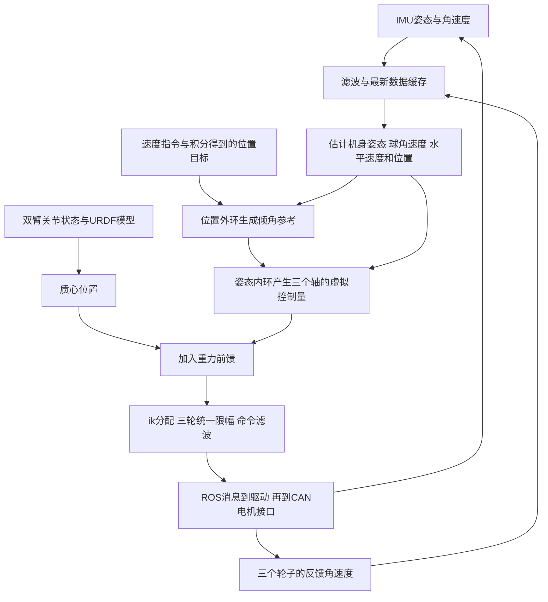

# 一个控制周期：从传感器读数到三台电机

本章把原来的十步提纲展开为可逐段学习的完整教程。读到哪一步不明白，就停在该步的数字例子，不需要一次记住全部变量。若先想看整机架构、异步话题、100/10 Hz 时间假设、LQR实际作用和效率测量方法，先读[端到端闭环、数据时序与实时性](../00_项目全貌与学习路线/03_P1端到端闭环、数据时序与实时性.md)；本章再沿一个周期往下追每个变量和函数。

**阅读对象**：现存 `arm_compensation_pid_controller_node.cpp` 的级联PID路径，以及它调用的PID、滤波和驱动。配置来自同目录的launch和YAML。[源码文件与版本](01_源码版本与文件地图.md)。本章没有运行ROS、修改原项目代码或证明实机效果。数字来自源码参数与人为指定的状态，是手算示例。

## 0. 学完这一章具体能做什么？

你应能回答下面六个问题：

1. IMU与轮子分别告诉控制器什么？
2. 三个轮速怎样变成“底盘向前多快”？
3. 位置误差为什么先变成倾角目标？
4. 机身倾角怎样影响轮子命令？
5. 手臂移动为什么需要额外补偿？
6. 发出命令后，控制器怎样知道实际运动是否达到目标？

建议先读0—4节认识数据，再读5—10节认识控制，最后按第11节完整手算。先修知识可以按需返回：[矩阵与维度](../../../01_通用基础/01_数学与物理基础/03_矩阵乘法转置与维度.md)、[PID](../../../01_通用基础/05_控制与优化/02_PID三项离散实现与调参.md)、[级联控制](../../../01_通用基础/05_控制与优化/04_级联前馈与多速率.md)。

## 1. 先理解机器人为什么要不断计算

### 1.1 球形底盘为什么不能只下达一次轮速？

机身支撑在球上，类似把一根杆竖在手上：杆往前倾时，需要调整下面的支撑，使其重新支撑住杆。球形机器人的轮子驱动球滚动，球与地面相互作用，改变机身运动。

这是理解平衡的直觉。真正运动还包含质量、惯量、接触与电机动态，不能直接把“往前倾就始终给某个轮子正转”当通用控制规则。正负号要看IMU、球轴和电机定义。

双臂移动时，整机质心变化。身体看起来还没大幅倾倒，重力已经可能产生不同的倾覆作用。控制器因此需要持续取得状态并重新决定输出。

### 1.2 一个周期是什么意思？

launch配置 `freq=100`，代码设

\[\Delta t=\frac1{100}=0.01\ \mathrm{s}.\]

它计划每10 ms调用一次 `controlLoop`：读缓存→估计运动→算参考→算控制→分配轮速→发布命令。下次再读新的状态，重复这个流程。

100 Hz是配置，不是本轮测出的实际运行频率。操作系统调度、消息传输和电机响应会影响真实间隔。控制器并不是瞬间完成所有物理动作，计算与机器人连续运动同时发生。



## 2. 先把容易混淆的量分开

### 2.1 目标、测量、估计、控制命令

|类别|本项目例子|你应该怎样理解|
|---|---|---|
|目标|`x_d_`、`pitch_d_`|希望到的位置、希望达到的倾角|
|测量|IMU姿态、`joint_data.velocity`|传感器或驱动返回的数据|
|估计|`vx_`、`x_`|把测量代入几何与积分关系计算出来的状态|
|虚拟控制量|`tau_roll`、`tau_pitch`、`tau_yaw`|中间控制计算结果，用来分配轮子动作|
|执行器命令|消息中的 `v_des`|发送给驱动的三个期望电机速度|

`pitch_d_`表示期望机身倾角，不是电机速度。`x_`是积分估计的位置，不是GPS或视觉直接测到的绝对位置。

源码把中间量命名为 `tau_*`，但最终写入 `v_des`，且经过两次比例转换。不能仅凭变量名就说它是已经校准为N·m的实际电机力矩。真正单位需要沿模型、控制增益、分配矩阵和驱动接口核对。

### 2.2 下划线、后缀d和点分别是什么？

- `x_`末尾的下划线是C++成员变量命名习惯，没有数学运算含义。
- `x_d_`中的d表示desired，期望位置；它不是导数。
- 数学符号 \(\dot x\) 表示每秒变化率。源码常用 `vx_` 表示速度，不用在变量名上写数学的点。
- `roll_angular_`存的是IMU角速度的x分量，不是一个角度。

### 2.3 形状与单位表

|量|形状|本章使用的含义与单位|
|---|---|---|
|轮反馈 \(\omega_m\)|3×1|三轮角速度；按模型期望使用rad/s，驱动标定需核对|
|`fk`|3×3|轮角速度到球角速度的几何映射|
|球角速度 \(\omega_b\)|3×1|绕球x/y/z轴的角速度，rad/s|
|球半径R|标量|配置0.11 m|
|`vx_`,`vy_`|各一标量|沿机身方向的水平速度，m/s|
|`x_`,`y_`|各一标量|世界方向下的积分位置，m|
|roll/pitch/yaw|各一标量|姿态角，rad|
|倾角参考|各一标量|位置外环的输出，rad|
|`x_com_`,`y_com_`|各一标量|模型质心的水平分量，m；模型坐标原点和轴需一致|
|`ik`|3×3|三个虚拟轴控制量到三个轮子输入的分配矩阵|

ROS消息格式能告诉你字段叫什么、是数组还是标量，但不会自动证明“每个字段都在正确坐标系和单位中”。

## 3. 第一步：回调把数据放在哪里？

### 3.1 回调不是每次都完整执行一次控制

`initializeROS`订阅：

|话题|回调|主要作用|
|---|---|---|
|`/imu/data`|`imuCallback`|把IMU交给 `imu_filter_`|
|`/chassis_state_topic`|`jointCallback`|把轮子反馈交给 `wheel_state_filter_`|
|`/cmd_vel`|`cmdVelCallback`|更新目标速度和目标位置|
|`/com_pos`|`comPosCallback`|更新滤波后的质心水平位置|

回调可以理解为“有新消息时负责收货”。定时器的 `controlLoop`负责“到计算时间时，用已经收下的数据作一次计算”。各类消息不一定同一时刻到达。

### 3.2 滤波器具体做了什么？

补充源码：[filters.cpp](../../../../03_源码实验/02_原始项目源码/resume/项目源码/AIRS/Robot/chassis_controller/src/filters.cpp)。`ImuFilter::filter_imu`直接复制姿态四元数，角速度才经过所配置的低通滤波；本版本加速度滤波截止频率参数为0，没有创建对应滤波器。因此不能把它笼统描述成“所有IMU字段都滤过了”。

低通滤波的一条更新式是

\[z_k=\beta r_k+(1-\beta)z_{k-1},\]

其中r是本次输入，z是滤波后的值。这里源码使用

\[\beta=\frac{\Delta t}{\Delta t+T_f},\qquad T_f=\frac1{2\pi f_c}.\]

配置截止频率 \(f_c=0.8\) Hz、设计采样频率100 Hz：\(T_f\approx0.19894\) s，\(\beta\approx0.04786\)。若上一输出0、本次原始角速度1 rad/s，第一次滤波输出约0.04786 rad/s。它只是一次滤波手算，不能用来声称整机实际延迟恰好0.19894 s。

这里的 \(\beta\) 表示“新数据权重”。一些教材用alpha表示“旧数据权重”，写法可能相反，必须先看等式。

**重要时间区别**：IMU/轮反馈滤波在各自消息回调发生时更新，却使用由控制器freq配置计算的滤波系数。若消息实际到达频率不是100 Hz，同一系数的真实时间含义会变化；不能因为控制定时器是100 Hz，就认定每种传感器也按100 Hz更新。

### 3.3 不同信号分别在哪里滤波？

先把“滤波”理解成一个很具体的动作：新数值到来时，程序把它和上一次滤波结果按比例混合。它不会等控制定时器主动去传感器取数，而是在相应消息回调里更新缓存；控制周期读取的是各缓存最新保存的结果。

本版本的一阶低通每次按下面方式更新：

\[
z_{\text{new}}=\beta r_{\text{new}}+(1-\beta)z_{\text{old}}.
\]

这里 \(r_{\text{new}}\) 是刚到的新读数，\(z_{\text{old}}\) 是上次滤波输出。当前配置的截止频率为 \(0.8\text{ Hz}\)，系数按控制器配置的 \(100\text{ Hz}\) 计算：

\[
\Delta t=0.01\text{ s},\qquad
T_f=\frac{1}{2\pi(0.8)}\approx0.19894\text{ s},\qquad
\beta=\frac{0.01}{0.01+0.19894}\approx0.04786.
\]

因此每次新读数只占约 \(4.8\%\)，上次结果占约 \(95.2\%\)。例如滤波输出原来为0，新角速度读数为 \(1\text{ rad/s}\)，第一次滤波输出约为 \(0.0479\text{ rad/s}\)。这会压低突然的噪声尖峰，也会让真实变化显得更慢。

|信号|什么时候更新|当前版本怎样处理|控制周期读到什么|
|---|---|---|---|
|IMU 姿态四元数|IMU 回调到达|原样复制，不经过这里的低通|最近一条姿态四元数|
|IMU 角速度 x/y/z|IMU 回调到达|三个轴各自做 0.8 Hz 一阶低通|最近一条滤波角速度|
|IMU 线加速度|IMU 回调到达|配置截止频率为0，直接复制|最近一条原始线加速度；本平衡控制路径没有用它计算轮命令|
|轮子 JointState 位置|轮状态回调到达|位置滤波截止频率为0，直接复制|最近一条原始轮位置|
|轮子 JointState 速度|轮状态回调到达|三个轮速各自做 0.8 Hz 一阶低通|最近一条滤波轮角速度|
|轮子 JointState effort|轮状态回调到达|effort 截止频率为0，直接复制|最近一条原始 effort；本状态估计主要读取 velocity|
|CoM 的 x/y|/com_pos 回调到达|x、y 各自做 0.8 Hz 一阶低通|最近一条滤波质心水平位置|
|CoM 的 theta|/com_pos 回调到达|theta 截止频率为0，直接复制|最近一条原始 theta；当前前馈没有使用它|
|最终轮命令 v_des|控制周期即将发布消息时|三个命令各自做 0.8 Hz 一阶低通|本周期滤波后的电机目标角速度|

命令位置 p_des 和扭矩前馈 t_ff 的滤波截止频率也是0；电机增益和编号直接复制。滤波器初值为0，所以启动后第一条读数不一定原样通过。例如静止轮子第一帧反馈不是0时，滤波轮速会从0逐渐靠近实际读数。命令也有相同的启动过渡。

还有两种容易混在一起的平滑：

1. /cmd_vel 的 vx_d、vy_d 在命令回调中按 \(v_{\text{new}}=v_{\text{old}}+0.25(v_{\text{msg}}-v_{\text{old}})\) 更新。这是目标速度的逐消息平滑，不是上表的 LowPassFilter，也不是机身姿态反馈。
2. 最终 v_des 的低通发生在控制周期构造电机消息时；它在整组三轮限幅之后、ROS 发布之前。

滤波系数按100 Hz设计，但轮速、IMU和CoM滤波器分别在各自回调更新，实际回调频率未必都等于100 Hz。若实际到达率不同，实际滤波快慢也会改变。滤波不是免费的“去噪”：它会让反馈滞后，所以平衡环的效果要同时考虑噪声和延迟。

### 3.4 hasData究竟证明什么？

它证明滤波器至少收过一次数据。它不证明数据刚刚更新、姿态可信、三个轮子完整、消息来自同一时刻。

`ImuFilter`中的 `filtered_msg_`没有在该函数中复制原消息Header；原始消息另存于 `latest_raw_msg_`。因此以后做时间检查时，应追踪原始时间戳或单独保存到达时间，不能假设过滤后的消息自动保留了Header。此处是源码阅读事实，未运行检查设备消息。

## 4. 第二步：控制之前为什么先检查状态？

`controlLoop`先看：ROS是否继续运行、控制器是否使能、IMU与轮反馈是否收过数据。

如果还没使能，程序return：结束本次计算；它不是数学里的返回0，也不自动向电机发送零命令。

如果没有状态，本次不能正确计算姿态或球速度。源码等待数据后才进入正常运算。但“没有新状态”和“没有任何状态”不同：当前 `hasData`检查不能识别长期旧数据。

然后从四元数得到roll/pitch/yaw，减去bias。开启控制时使用第一帧yaw设置 `yaw_bias_`，目的是把当时朝向作为初始参考，而不是证明获得地理绝对航向。

如果 \(|roll|>0.5\) 或 \(|pitch|>0.5\)，执行 `reset()`并return。0.5 rad约28.65°。`reset`清状态、积分和若干滤波缓存，但该跌倒分支没有直接调用 `setZeroVelocityCommand`或 `enable(false)`。因此需要沿驱动/硬件超时追踪电机会怎样处理上一命令。[保护与恢复详解](../01_原理与子系统/06_启动限幅跌倒与恢复.md)。

这与停止使能时的路径不同：`enable(false)`会调用零命令函数。不要把两个分支当作同一动作。

## 5. 第三步：三个轮速怎样变成球角速度与水平速度？

### 5.1 先区分三个轮子和球的三个轴

\[
\omega_m=\begin{bmatrix}\omega_1\\\omega_2\\\omega_3\end{bmatrix},\qquad
\omega_b=\begin{bmatrix}\omega_{bx}\\\omega_{by}\\\omega_{bz}\end{bmatrix}.
\]

第一列向量列的是轮1、轮2、轮3的转速；第二列列的是同一个球绕x、y、z轴的角速度。二者的三个数不是同一组物理量。

源码配置：

\[
F_k=\begin{bmatrix}
-0.598718&0.299359&0.299359\\
0&-0.518505&0.518505\\
0.251192&0.251192&0.251192
\end{bmatrix},\qquad \omega_b=F_k\omega_m.
\]

比如球y轴角速度就是第二行乘轮速：

\[\omega_{by}=0\omega_1-0.518505\omega_2+0.518505\omega_3.\]

各系数编码轮子安装位置、接触方向、半径与轴约定。它们不是“某种机器人都可以直接用”的通用数字。[球轮几何详解](../01_原理与子系统/02_三轮球体运动学分配.md)。

### 5.2 为什么再乘半径？

角速度rad/s表示每秒转过多少角度。半径为R的轮/球转过小角度 \(\Delta\phi\) 时，接触处对应弧长 \(R\Delta\phi\)。除以时间得到线速度 \(v=R\omega\)。

源码采用

\[v_x=-R\omega_{by},\qquad v_y=R\omega_{bx}.\]

球绕y轴转影响x方向滚动，绕x轴转影响y方向滚动。负号由本项目坐标、接触与正方向约定决定，不是因为速度天然必须为负。

这种几何推算依赖理想接触/滚动假设；轮或球打滑后，测得转速不再完整代表地面运动，积分位置会偏。

## 6. 第四步：为什么机身速度要转到世界方向再积分？

### 6.1 用一个90°朝向例子理解

机器人“向自己前方走1 m”时，如果它正朝世界北方，世界位置增量就是向北。机身方向和世界方向不是永远重合。

设yaw=\(\psi\)，代码的 `body2World2D`是

\[
\begin{bmatrix}\Delta x_w\\\Delta y_w\end{bmatrix}
=\begin{bmatrix}\cos\psi&-\sin\psi\\\sin\psi&\cos\psi\end{bmatrix}
\begin{bmatrix}v_x\Delta t\\v_y\Delta t\end{bmatrix}.
\]

若yaw=90°，机身速度 \([1,0]\) m/s、dt=0.01 s，机身增量 \([0.01,0]\) m被转成世界增量 \([0,0.01]\) m。

然后

\[x_{k+1}=x_k+\Delta x_w,\qquad y_{k+1}=y_k+\Delta y_w.\]

积分相当于不断累计每一小步位移。这里使用固定dt；真实间隔不一致或速度有偏，误差也会不断累计。

### 6.2 外环为什么又要转回机身方向？

位置目标以世界方向记，roll/pitch影响机身方向的运动。控制器需要知道“目标在我的前后还是左右”。`world2Body2D`使用上述旋转矩阵的转置：

\[R_{bw}=\begin{bmatrix}\cos\psi&\sin\psi\\-\sin\psi&\cos\psi\end{bmatrix}.\]

源码分别计算当前位置 \(b=R_{bw}p_w\) 和目标位置 \(b_d=R_{bw}p_{d,w}\)，于是位置误差为

\[b_d-b=R_{bw}(p_{d,w}-p_w).\]

这里有一个容易被函数名误导的地方：函数只旋转，没有减去机身原点的位置。`bx`不是把世界中的当前机器人点完整转换到以机器人自身为原点的坐标系；它是世界原点到该点的位置向量沿机身轴方向的分量。因为目标和当前点使用相同原点，两者相减仍正确得到沿机身轴表达的目标位移。

若要完整转换任意世界点到真正机身坐标，通常需要 \(p_b=R_{bw}(p_w-t_w)\)。不能把这里只做旋转的小函数当作完整齐次坐标变换。

另外，随着yaw变化，旋转后坐标分量的时间导数一般还会含旋转项。源码将机身水平速度作为外环速度反馈，是它的实现选择，不等于证明 `vx_`永远精确等于上述旋转后绝对坐标 `bx`的导数。

## 7. 第五步：位置外环为什么输出倾角？

### 7.1 位置离目标远，不表示立刻让电机猛转

机身想改变水平运动，需要在保持平衡的条件下改变球与身体的运动。外环先提出适度的倾角参考，内环负责追踪并维持身体状态。

代码调用：

```cpp
roll_d_  = -y_controller_(by, vy_, by_d, vy_d_);
pitch_d_ =  x_controller_(bx, vx_, bx_d, vx_d_);
```

以XLoop为例，四个输入依次是当前位置、当前速度、目标位置、目标速度。输出 `pitch_d_`是下一层的倾角目标。YLoop到roll多了负号，由本项目x/y与roll/pitch的对应约定决定。

### 7.2 P和D在此分别做什么？

配置Kp=0.06、Kd=0.3、Ki=0。若使用速度差分支：

\[pitch_d=\operatorname{clip}\big(0.06(b_{x,d}-b_x)+0.3(v_{x,d}-v_x),-0.1,0.1\big).\]

第一项：离目标越远，越倾向提出较大的倾角参考。

第二项：当前速度已经比目标速度快时，抑制进一步前进；当前速度太慢时，给出更多修正。

**例子**：还差0.2 m，但已经以0.1140711 m/s向前，目标速度0：

\[0.06×0.2+0.3×(0-0.1140711)=-0.02222133\ \mathrm{rad}.\]

你可能问“目标还在前面，为什么倾角目标是负的？”因为这一步同时在处理位置与速度：还没到达目标，但正在运动，需要让速度减下来。控制不是只看位置误差。

0.1 rad约5.73°是外环倾角参考的上限，不是“机身实际倾角永远不会超过5.73°”。输出有限、执行器跟踪和真实运动是不同层次。

### 7.3 源码的D分支与教科书公式不同在哪里？

[PID实现](../../../../03_源码实验/02_原始项目源码/resume/项目源码/AIRS/Robot/chassis_controller/src/pid_controller.cpp)是：

```cpp
if (xd != 0.0) d_error = txd - xd;
else d_error = (error - last_error_) / dt_;
```

`xd`为当前速度。它非零时用速度差；恰好为零时，用前后两次误差的差分。因此上面的速度差公式不能不加条件地覆盖该类的全部情况。

如果速度真的是0、目标位置突然跳0.2 m、上一误差0、dt=0.01 s，D误差是20 m/s，输出未限幅前 \(0.012+0.3×20=6.012\)，最后参考截到0.1 rad。

真实速度0是合法测量，不表示“没有速度反馈”。这段代码用数值0切换分支，可能导致行为变化。理解这个区别，才能说明参考平滑、启动状态和D项为什么重要。

## 8. 第六步：姿态内环怎样计算？

位置外环提出pitch_d之后，姿态环要比较“希望倾多少”和“现在倾多少”。

```cpp
tau_pitch = K_t2v_ * pitch_controller_(pitch_, pitch_angular_, pitch_d_);
```

这里调用了三个参数。头文件给第四个参数 `txd`默认值0，所以代码实际使用目标角速度0。你可以理解为在当前周期追踪一个倾角参考，同时抑制身体的旋转。

假设当前IMU y轴角速度非零，此时

\[a_{pitch}=161(pitch_d-pitch)+46.8(0-\omega_y),\]

经过PID输出限幅，再乘 \(K_{t2v}=0.75\)。

例如pitch=0.02 rad、pitch_d=−0.02222133 rad、IMU y轴角速度0.1 rad/s：

\[
\begin{aligned}
e_{pitch}&=-0.04222133,\\
P&=161×(-0.04222133)=-6.79763413,\\
D&=46.8×(-0.1)=-4.68,\\
a_{pitch}&=-11.47763413,\\
tau_{pitch,\,feedback}&=0.75×a_{pitch}=-8.60822560.
\end{aligned}
\]

角度误差会wrap到[−π,π]，所以跨过角度边界时不会直接使用约360°的大差。本例误差很小，不触发跨界调整。

IMU输出的角速度是传感器/机身轴的角速度分量，一般不等于欧拉角逐项对时间求导。近直立、小角度时常作近似；安装方向和姿态约定必须一致，不能在任意大姿态下直接混用。

### 8.1 姿态内环的输出是不是力矩？

先分清“控制器计算出的数”和“电机轴实际施加的力矩”。

1. Roll/Pitch PID先根据角度误差、角速度阻尼和积分项算出一个数。
2. 程序把这个数乘 \(K_{\mathrm{t2v}}=0.75\)，保存进名叫 tau_roll、tau_pitch 的变量。
3. 后面还会把这些数与CoM补偿合在一起，乘矩阵 ik，再乘一次 \(K_{\mathrm{t2v}}\)，限幅并写入电机速度字段。

源码没有在姿态 PID 输出处调用 \(J\ddot q=\tau\)、\(\tau=I\alpha\) 之类动力学公式，也没有把这个数写到电机消息的扭矩前馈字段。因而最稳妥的叫法是“姿态环中间控制量”。变量叫 tau 不足以证明它的单位就是 \(\text{N·m}\)，也不足以证明它是电机实际输出力矩。

物理上，若一个控制器真输出已标定的力矩，力矩会先造成角加速度，再经时间积分改变角速度；但本源码没有这段显式的“力矩→角加速度→球角速度”计算。它走的是一条经过标量缩放和运动学矩阵、直接形成电机目标速度的控制路径。具体系数是否经过实机标定，需要实验记录或参数说明；仅凭当前代码无法证明。

## 9. 第七步：手臂质心怎样产生前馈？

### 9.1 为什么手臂改变质心？

质心是各部分质量加权后的平均位置：

\[p_{com}=\frac{\sum_i m_i p_i}{\sum_i m_i}.\]

手臂关节一转，各连杆的位置p_i改变，即使没有增加质量，质心也会移动。URDF记录关节关系、质量与惯性参数；Pinocchio根据这些信息和当前关节状态计算质心。

`kinetic_compensation_node.py`把两臂关节角与速度填到模型状态，调用 `pin.centerOfMass`，发布 `/com_pos`以及 `/com_vel`。当前底盘节点只订阅质心位置，速度回调相关代码是注释。因此不能把该运行路径描述成“位置与质心速度均已接入动态前馈”。

### 9.2 从重力和力臂理解两个分量

令质心相对支撑参考的力臂为 \(r=[x_c,y_c,z_c]^T\)，重力为 \(F_g=[0,0,-mg]^T\)。重力矩

\[r\times F_g=[-mgy_c,\ mgx_c,\ 0]^T.\]

其反向补偿为 \([+mgy_c,-mgx_c,0]^T\)，对应源码：

```cpp
tau_roll  += K_tff_g_ * m_torso * g * y_com_;
tau_pitch -= K_tff_g_ * m_torso * g * x_com_;
```

这个物理解释要求质心的位置原点、轴方向与补偿参考一致。Pinocchio模型质心坐标是否恰好相对于支撑点、YAML质量与该模型质量是否匹配，仍需要核对模型和部署设置。本章不靠这两个代码符号自动证明实际机械标定正确。

### 9.3 一个厘米的偏移为什么也有影响？

代码 `m_torso`读取YAML的M=18.0214，g=9.81，K_tff_g=1.01。设输入x_com=0.01 m、y_com=0：

\[1.01×18.0214×9.81×0.01=1.78557833.\]

pitch虚拟量因此再减1.78557833。本例从−8.60822560变成−10.39380393。

这说明补偿可在模型已知质心偏移时提前改变命令。反馈仍要处理未建模扰动、质心估计错误和电机实际跟踪。此乘积源于物理力矩计算，但被加入并经尺度转换的控制通道，不能直接把最终三轮v_des说成这三个物理力矩。

## 10. 第八步：三个虚拟轴怎样变成三个轮子？

### 10.1 ik是分配表，不是另一个PID

配置矩阵为

\[
I_k=\begin{bmatrix}
-1.113490&0&1.327006\\
0.556745&-0.964311&1.327006\\
0.556745&0.964311&1.327006
\end{bmatrix}.
\]

令 \(a=[tau_{roll},tau_{pitch},tau_{yaw}]^T\)，先计算 \(I_ka\)，源码随后又整体乘0.75：

\[\mathbf{s}_{raw}=0.75\,I_k\mathbf{a}.\]

`ik`每一行负责一个轮子、每一列负责一种虚拟轴作用。一个轮子的输出通常同时受到三个轴影响；一个轴也通常需要多个轮子共同产生。

源码在姿态PID输出时已乘一次t2v，在分配后又乘一次。纯反馈部分因此带两次比例；前馈在两次之间加入，因此只带后面一次。必须按真实顺序读，不能把整个式子直接简化成“反馈和前馈都乘同一个0.75²”。

这里要把“运动学上应当如何解释”和“源码实际传了什么”分开。几何上，球轮矩阵通常应把期望球角速度（rad/s）映射成三只小轮的角速度（rad/s）。但当前控制器送进矩阵的是姿态PID与CoM项合成的中间控制量；源码没有在这里先用球的转动惯量求角加速度，再对角加速度积分成球角速度。因此不能把矩阵输入直接称为已算出的球角速度。矩阵输出被程序当成三只电机速度命令的数值，最后放进 v_des；驱动协议将 v_des 定义为电机角速度 rad/s。中间数值到 rad/s 的物理标定，当前源码没有完整说明。

把源码顺序写成一组符号会更清楚。令 \(\mathbf p\) 是三个姿态 PID 各自的原始输出，令 \(\mathbf g\) 是 CoM 前馈项，则：

\[
\mathbf g=
\begin{bmatrix}
K_{\mathrm{tff\_g}}M g y_{\mathrm{com}}\\
-K_{\mathrm{tff\_g}}M g x_{\mathrm{com}}\\
0
\end{bmatrix},\qquad
\mathbf a=0.75\mathbf p+\mathbf g,\qquad
\mathbf s_{\mathrm{raw}}=0.75\,ik\,\mathbf a.
\]

接着程序对 \(\mathbf s_{\mathrm{raw}}\) 做三轮整体范数限幅，再让命令低通滤波器把它和上次发布值混合，最后写进 v_des。这样数 0.75 的位置一眼可见：PID反馈经过两次；CoM项是在中间加入，所以只经过矩阵后的那一次。这里 M 表示源码读取的机身质量参数，g 是重力加速度。

这也回答“力矩怎样变成球角速度”：真实的力学关系需要经过转动惯量和时间，例如简化情况下 \(\alpha=\tau/I\)、\(\omega_{\text{new}}=\omega_{\text{old}}+\alpha\Delta t\)。但这段控制周期没有进行这样的计算，而是用配置缩放系数和轮子分配矩阵直接产生速度目标。不要把这条工程映射讲成已经实现了完整力矩动力学。

### 10.2 为什么是整体范数限幅？

`limitVector`求

\[n=\sqrt{u_1^2+u_2^2+u_3^2}.\]

若n>8，三个值一起乘8/n；否则原样返回。它限制三轮命令的整体长度，不是先分别把每个数裁剪到±8。

例子 `[0,6,-6]`：每个数都没有超过8，但整体长度是 \(\sqrt{72}\approx8.485\)，所以仍会缩放为 `[0,5.65685,-5.65685]`。同比例缩放保持三个分量的比例；独立裁剪一般会改变原来的组合方向。

它只检查此处命令向量，不是完整的电机功率、电流、温度或地面摩擦限制。

### 10.3 限幅后还经过一次命令滤波

`setVelocityCommand`构造消息后，调用 `semotor_command_filter_`再publish。计算出的action与真正发布的v_des因此可能不同；滤波器的上一输出会影响本次结果。

若没有说明滤波初始状态，就不能从一个周期的action直接算出精确发布值。这也是为什么有“理论计算结果”和“实际日志结果”两类记录。

如果滤波历史从0开始，且本周期限幅后的某只轮命令为 \(5.6569\text{ rad/s}\)，按 \(\beta=0.04786\) 算，第一帧发布值约为 \(0.2707\text{ rad/s}\)，并不是立刻跳到 \(5.6569\)。下一周期如果目标保持不变，滤波输出再往目标靠近。这个算例只说明命令滤波器，不表示真实电机已经达到该速度。

<a id="cycle-worked-example"></a>
## 11. 把第5—10节串成一个完整手算

### 11.1 给定输入和假设

- 控制器已使能，已取得完整且可用的缓存；dt=0.01 s。
- 本例指定**滤波后的**轮反馈 `[0,1,−1]` rad/s，不把它当原始读数。
- yaw=0、roll=0、pitch=0.02 rad；IMU角速度 `[0,0.1,0]` rad/s。
- 本次积分前x=0、y=0；世界位置目标x_d=0.201140711 m、y_d=0。
- 目标水平速度0；yaw目标0；x_com=0.01 m、y_com=0。
- Roll/Yaw通道上一误差为0，当前误差也为0；Ki全为0。
- 所有参数取本章所读配置。控制命令滤波的历史输出暂不指定。

设目标位置为0.201140711，是为了让本次积分之后的剩余位置误差恰好0.2 m，便于手算。它是构造的学习例子。

### 11.2 完整结果表

|步骤|计算|本例结果|
|---|---|---|
|球角速度|fk×[0,1,−1]|[0,−1.037010,0] rad/s|
|机身水平速度|v_x=−0.11×(−1.037010)|0.1140711 m/s|
|本次世界位移|yaw=0，dx=v_x×0.01|0.001140711 m|
|积分后位置|0+dx|0.001140711 m|
|位置误差|0.201140711−0.001140711|0.2 m|
|外环P项|0.06×0.2|0.012 rad|
|外环D项|0.3×(0−0.1140711)|−0.03422133 rad|
|pitch目标|P+D，无需限幅|−0.02222133 rad|
|姿态误差|−0.02222133−0.02|−0.04222133 rad|
|姿态PID|161×误差+46.8×(−0.1)|−11.47763413，中间控制尺度|
|第一次比例|PID×0.75|−8.60822560|
|质心pitch补偿|−1.01×18.0214×9.81×0.01|−1.78557833|
|合成三个轴|roll=0，yaw=0|[0,−10.39380393,0]|
|ik与后一次比例|0.75×ik×合成轴|[0,7.51714460,−7.51714460]，待写入v_des的三轮速度命令数值；接口约定rad/s，但上游中间量的物理标定未完全说明|
|整体长度|sqrt(2)×7.51714460|10.63084784，超过8|
|统一缩放|三个数都乘8/10.63084784|[0,5.65685425,−5.65685425]，限幅后的三轮v_des目标数值|
|构造命令|按mode填字段|见下一节|
|命令滤波|本次action+滤波器历史|未指定历史，不能给精确发布值|

每一行的结果成为下一行的输入。这个例子算到了**发送滤波之前的action**。它没有预测未来轨迹、没有算真实电机电流，也不是机器人实测结果。

## 12. 第九步：ROS消息怎么交给电机？

### 12.1 mode=0分支会填写什么？

本节表格只说明控制器处于 mode=0 时怎样填消息，不代表每种启动方式的整机默认值。发送控制器与接收驱动必须使用相同 mode；本节末尾会对照单独 launch 和整机组合 launch。

源码函数 `setVelocityCommand`在mode0时设置：

|字段|本例值|作用|
|---|---|---|
|id|[1,2,3]|要控制的电机编号|
|p_des|[0,0,0]|位置字段；本配置位置增益为0|
|v_des|[0,5.65685,−5.65685]|期望速度，随后还会滤波|
|p_kp|[0,0,0]|不在该配置中用位置误差产生作用|
|p_kd|[6,6,6]|源码使用WheelVelocityLoop.Kp填入此字段|
|t_ff|[0,0,0]|没有直接把tau_roll/pitch写成电机力矩前馈|

不要因为字段叫p_kd就断定“这是机身姿态PID的Kd”。它属于电机模式接口，赋值来源是wheel_controller_.getKp()，姿态环和电机端参数是两层不同东西。

电机接口头文件对 IMPEDANCE 参数的定义是：p_des 为期望角度rad，v_des 为期望角速度rad/s，p_kp 为刚度参数，p_kd 为阻尼参数，t_ff 为扭矩前馈N·m。本控制器这一分支发出 p_des=0、p_kp=0、p_kd=6、t_ff=0，并同时给 v_des。可以据此说主机在阻抗模式下提供一个角速度目标和电机端阻尼参数；电机实际输出力矩由驱动/固件内部根据模式处理，不是 tau_roll 直接填进了 t_ff。固件内部算法和真实速度跟踪效果仍需要额外资料或测量。

mode=1则填 v_des、v_kp、v_ki。单独的 arm_compensation_pid_controller.launch 默认 mode=0；单独的 chassis_and_waist.launch 默认 mode=1。若把这两个单独 launch 按默认值一起启动，控制器和驱动模式不一致。整机组合 launch arm_chassis_imu_pid_controller.launch 的 chassis_mode 默认1，并把同一个参数同时传给底盘驱动和底盘控制器，因此组合启动时模式一致。实际运行仍应核对所用 launch 和覆盖参数。

模式不匹配会影响代码字段访问，不只是控制含义不同。例如控制器按 mode=0 发消息时不会填写 v_kp、v_ki；若驱动却按 mode=1 处理，它会按电机编号读取这些数组。反过来，控制器按 mode=1 发消息而驱动按 mode=0 处理时，p_des、p_kp、p_kd、t_ff 等数组也可能缺少。启动配置必须成对核对；不要依靠“消息里总有所有字段”这个假设。

### 12.2 驱动不是重新跑一遍机身PID

`chassis.cpp`接收命令并缓存。在循环里取最新一条、清理积压，然后按电机模式调用 `set_motor_para_bt`。

“取最新”是为了避免还在执行过去的一大串目标。它不能替代超时停机：如果新命令长期不来，还要看电机/总线/驱动是否主动处理旧指令。

驱动随后读取电机位置、速度、力矩反馈，发布JointState，控制器下一次收到时再更新轮缓存。反馈回来了，闭环才闭合。

### 12.3 mode=1时，速度命令怎样被电机接收？

整机组合 launch 默认采用 mode=1。控制器把经过低通的三轮目标角速度放入 v_des，把 WheelVelocityLoop 的 Kp=6、Ki=10 放入 v_kp、v_ki，再放入三个电机编号；消息注释把电机1/2/3标为前轮、左后轮、右后轮。驱动节点在 SPEED 模式下调用电机接口时，按下面顺序传参：

\[
\text{目标角速度},\quad \text{速度环 }K_p,\quad \text{未使用参数},\quad
\text{未使用参数},\quad \text{速度环 }K_i.
\]

电机接口头文件明确把第一个参数解释为期望角速度，单位 \(\text{rad/s}\)，并把后两个有效增益解释为速度环 \(K_p\)、\(K_i\)。驱动把这些值打包成CAN命令帧发送。也就是说，主机侧姿态控制器负责算三只轮“应该转多快”；电机/驱动内部速度控制负责根据这个目标驱动电机。主机侧的 wheel_controller_ 在本控制周期没有用当前轮速调用 PID 运算，它在这里提供增益值和三轮整体限幅值。

电机固件和电流环内部如何实现、实际带宽是多少、收到命令多久达到目标，当前仓库没有给出足够证据；需要电机固件资料或实测。控制器给出速度目标，不等于速度瞬间达到，也不等于主机直接给出电机力矩。

mode=0则是另一种命令契约：控制器还填写零位置目标、位置比例/阻尼字段和零扭矩前馈；驱动在阻抗模式下按这组参数发命令。即使这个模式下消息含有速度目标，它也不是纯速度模式，两边必须使用同一个 mode。

### 12.4 控制频率、驱动频率和电机内部速度环不是一个频率

整机组合 launch 的 chassis_freq 默认100 Hz，名义上控制器每10 ms算一次并发布一次三轮目标，驱动状态发布也按该参数配置为100 Hz。这个数字只表示软件配置目标，不是实测周期保证。

控制器在默认 ros::spin 单线程中处理订阅回调和定时器回调。IMU、轮速、CoM、cmd_vel各自到达时更新各自缓存；定时器触发时读当前缓存，并不等待四类数据同时更新。话题队列长度和缓存只决定消息排队/保留方式，不会自动把测量时间对齐。

驱动线程发现命令缓存有消息时，取最新一条并清空较旧积压，然后按电机编号逐个调用 CAN 接口。接口中的 send_recv 是请求并等待响应的调用；状态发布时也会逐个读取电机位置、角速度和扭矩。因此一次底盘更新涉及主机计算、ROS传输、三台电机的CAN请求/响应和电机内部执行。当前仓库没有给出这些步骤的耗时统计，所以不能仅由“100 Hz”推断端到端延迟是10 ms，也不能声称每个电机每10 ms都已达到目标。

mode=1 把速度目标和速度环增益交给电机控制器。电机固件内部速度环的运行频率、带宽和响应时间不在当前仓库中；这与主机侧100 Hz姿态控制周期是两件事。要评估实时性，应分别记录控制器实际周期/执行时间、传感器数据年龄、ROS发布到驱动接收的时间、CAN往返时间和轮速跟踪误差。

## 13. 速度指令怎样变成目标位置？

`/cmd_vel`通常提供线速度与偏航角速度目标。代码先平滑目标水平速度：

\[v_d\leftarrow v_d+0.25(v_{msg}-v_d).\]

假设原目标速度0、新指令0.4 m/s，第一条消息之后目标速度0.1 m/s，而不是立即0.4。第二条相同消息之后0.175 m/s；第三条0.23125 m/s。这是按消息更新的递推。

`cmd_freq=10`给 `cmd_dt=0.1 s`，代码把平滑后的目标水平速度乘cmd_dt、转到世界方向、加到x_d/y_d。第一条消息在yaw=0时，目标位置因此向前增加0.1×0.1=0.01 m。

如果消息实际20 Hz到达，仍每条按0.1 s累计，则同样速度会比按真实0.05 s累计的目标走得快。消息频率不是纯通信问题，它进入了参考轨迹。

偏航路径有额外区别：`yaw_angular_d_`进行平滑，但 `yaw_d_`用原始 `msg->angular.z * cmd_dt_`积分。当前姿态PID调用又没有把平滑后的 `yaw_angular_d_`作为第四个参数传入。不能因为该变量被算出，就声称它已经作为YawLoop的目标角速度参与D项。

## 14. 发布话题里的字段也要按赋值理解

源码用Pose2D发布 `/controller_vel`与 `/controller_pos`，但字段含义不是完全照消息名称推断：

|消息|x|y|theta|
|---|---|---|---|
|controller_vel|机身v_x|机身v_y|yaw姿态角|
|controller_pos|积分世界x|积分世界y|R×球z角速度|

特别是 `controller_pos.theta`在本版本被赋为 `R*angular[2]`，并非yaw角。不能直接将它当标准二维位姿的航向供导航模块使用。接口消费者必须核对实际赋值、单位与坐标。

这里还出现同一条消息混用速度/姿态语义的情况。面试时可以说明当前源快照的行为，再提出更清晰的带Header专用消息作为改进思路；没有改原代码或部署记录时，不说自己已经完成此改进。

## 15. 用“症状→这一周期哪一步”理解故障

|观察到的现象|优先检查|为什么|
|---|---|---|
|控制器一直等待|使能、话题名、IMU与轮回调|第一步没有可用状态，后续控制不会执行|
|身体没有横移但位置不断增加|轮符号、fk、打滑、积分偏置|位置来自转速积分，可能与地面真实位移不一致|
|目标一变倾角参考就顶到±0.1|外环D分支、上次误差、指令平滑|突然误差差分可能很大|
|手臂移动后有明显静态倾斜|模型CoM、坐标原点、质量、tff_g|补偿作用可能与真实重力矩不同|
|三轮有命令但效果很弱|前后两次t2v、统一限幅、输出滤波、电机mode|中间量到电机之间还有多层处理|
|加大PID后振荡|角速度滤波、消息/执行延迟、饱和、坐标符号|增益不能弥补错误或过时的反馈|
|跌倒后电机仍可能持续动作|reset/return与零命令路径、驱动超时|清计算状态不自动清电机上一命令|

上述是排查方向，不是每个症状已确定只有一个原因。实际要保存输入、参考、中间量、限幅前后、发布值和反馈，按时间顺序定位。

## 16. 这个项目怎样和PID、LQR、状态估计串起来？

|知识|本运行路径中的位置|
|---|---|
|状态估计|IMU姿态、轮几何推算水平速度、积分位置与低通缓存|
|坐标变换|机身增量到世界方向、位置误差到机身轴方向|
|级联PID|位置外环给倾角，姿态内环给虚拟轴控制量|
|前馈|模型质心产生重力补偿|
|运动学|fk读取运动，ik分配执行器动作|
|执行器闭环|模式命令经ROS/CAN到电机，反馈回来|
|LQR|另一路离线线性模型与对照分析，本章C++循环没有在线求Riccati|

现存滤波器是低通与缓存等具体实现，本章没有看到整个机身状态使用Kalman更新的路径。不能因为学了KF，就在面试中把它加入此项目的实机实现。

LQR与MPC可以帮助学习设计选择，但必须说明“现存运行路径、历史材料、独立教学”分别有哪些证据。见[CV/PS证据](../04_贡献_证据与材料映射/01_CV_PS表述与证据.md)。

## 17. 三个英文问题，怎样从本章回答？

### Q1. Could you walk me through one control cycle?

**中文思路**：反馈是什么→估计什么→外环输出什么→内环输出什么→质心补偿→三轮分配→驱动与反馈。

**English**：

“The controller reads the latest IMU and wheel feedback. It converts wheel rates into ball motion, estimates horizontal velocity, and integrates position. The outer position loop generates bounded roll and pitch references. The inner attitude loop uses the angle error and angular-rate feedback. A model-based centre-of-mass term is then added. The controller allocates the three virtual-axis commands to wheel-speed commands, scales and filters them, and sends them to the motor driver. Motor feedback closes the loop.”

**追问**：Are those commands direct joint torques?

“The variable names include tau, but this implementation publishes desired wheel velocities. I would identify the actual command field and conversion stages before describing its physical units.”

### Q2. Why use an outer position loop and an inner attitude loop?

“The outer loop asks for horizontal motion through a bounded tilt reference. The inner loop stabilizes the body while following that reference. I need to check the closed-loop response, delay and saturation; the configured update frequency alone does not prove that the inner loop can track every outer-loop command.”

**中文提示**：讲两层各自的输入输出，再讲跟踪能力；不只背“内快外慢”。

### Q3. How do the moving arms affect balance?

“Moving the arms changes the modelled centre of mass and therefore the gravity moment. The controller uses the horizontal centre-of-mass position for feedforward compensation, while feedback handles the remaining error. In this source snapshot, the compensation velocity is published separately but is not consumed by the chassis controller.”

**贡献边界**：这些回答解释现存实现。将它们改为“I implemented”之前，需与本人真实职责、历史版本和可核对记录对应。

## 18. 小白自测：先不看答案，能否逐步说出来？

1. `x_d_`中的d是不是对时间求导？
2. 三轮转速向量与球三轴角速度向量为什么都三维，却不是同一个量？
3. yaw=90°时，机身向前0.01 m变成世界哪个方向的增量？
4. 当前误差0.2 m、速度0.1 m/s、目标速度0，外环未限幅输出多少？
5. 三轮raw=[0,6,−6]，整体上限8，要不要限幅？
6. `reset(); return;`是否等于已经向电机发出了零速度？
7. `yaw_angular_d_`被计算了，能否据此说它参与了姿态D项？
8. 没有命令滤波历史，是否能直接给出最后publish的v_des？
9. 为什么 `world2Body2D`不能直接用于任意世界点的完整坐标变换？
10. `controller_pos.theta`能否直接视为机器人yaw？

### 答案与解释

1. 不是，desired目标；数学导数用点或速度变量表示。
2. 一个按执行器编号，一个按球旋转轴；映射矩阵连接这两种描述。
3. 世界正y方向，增量 `[0,0.01]` m。
4. 0.06×0.2+0.3×(−0.1)=−0.018 rad；速度差使用当前速度非零的分支。
5. 要，长度sqrt(72)>8；缩放为 `[0,5.65685,−5.65685]`。
6. 不是；需要找到零命令、使能和硬件超时的实际调用路径。
7. 不能；当前YawLoop调用未传该变量作为第四个参数。
8. 不能；action还会与上一滤波输出结合。
9. 它只旋转，没有减机身原点平移；位置误差两点相减可消去共同原点。
10. 不能；本源码赋值是R×球z轴角速度。

## 19. 下一步怎样用现有教学程序？

[P1实验入口](../../../03_代码实验/02_项目实验/P1/README.md)有三个独立教学程序：球轮映射、平衡控制比较、质心前馈。先用本章理解每段输入输出，再按README运行并记录真实结果。这些程序没有复刻ROS缓存、全部PID分支、电机模式或完整驱动，不把它们当成上述实机源码的运行验证。

本次仅深化文档与做表达式手算；没有执行教学程序、测试、ROS节点或硬件。学习记录只填你自己真正算出、讲通或运行过的内容。

## 补充：最后用单位追踪，姿态环、前馈和电机各拿到什么？

|阶段|程序里实际得到什么|可以确认的物理单位|不要误称为什么|
|---|---|---|---|
|IMU姿态|四元数，转换成Roll/Pitch/Yaw|角度以rad参与控制|不是角速度；当前节点不对姿态四元数做低通|
|IMU角速度|机身三个轴的角速度|rad/s；先经0.8 Hz低通|不是大球角速度，也不一定等于任意姿态下的欧拉角导数|
|轮子反馈|三个电机的转速|电机接口以rad/s提供，先经0.8 Hz低通|不是机器人平面线速度m/s|
|外环输出|目标Roll/Pitch角度|rad，配置限幅约±0.1 rad|不是三个电机命令|
|姿态PID输出|角度误差、角速度项和积分项按PID增益算出的数，随后乘一次0.75|当前源码没有完整给出该中间量的物理单位|不能只凭 tau_roll / tau_pitch 名称认定为N·m|
|CoM重力项|质量×重力加速度×水平质心力臂|若kg、m、m/s²单位正确，乘积代表N·m量纲的重力矩|经过K_tff_g并与姿态中间量相加后，不能直接称作电机力矩|
|ik后命令|三个数进入三只电机各自的v_des|电机协议将v_des解释为轴角速度rad/s|不是球的线速度、不是电流，也不是电机力矩|
|轮缘切向速度|如需估算，理想圆轮关系为 \(v=r\dot\phi\)|m/s；实际还受传动比与接触方向影响|不是控制器发送的v_des字段单位|
|mode=1电机执行|速度目标、速度环Kp/Ki通过CAN送到电机|速度目标rad/s；增益的具体单位由固件定义|不是主机又算了一次机身PID，也不是主机直接下发力矩|

### 为什么“姿态PID输出”与“重力前馈”可以在程序里相加？

源码把它们放在同一个roll或pitch命令通道中：姿态反馈项负责纠正已经发生的偏差，CoM前馈项负责提前补偿手臂姿态预测得到的重力影响。程序层面把两个数相加，说明设计者希望它们作用在同一轴向控制通道。

但“能写在同一个加法表达式里”不等于“单位已被证明完全一致”。CoM项的 \(mgd\) 来自力矩公式；姿态PID经过第一次 \(K_{\mathrm{t2v}}\) 缩放；两项相加后又共同经过 ik 和第二次 \(K_{\mathrm{t2v}}\)。当前参数文件没有把所有增益的单位完整写出，也没有在这里提供标定记录。因此学习和面试时应说“重力矩形式的前馈项被加入姿态控制中间通道”，不要说“控制器直接把准确的N·m力矩发给电机”。

### 物理上力矩怎样影响球角速度？源码实际又怎样做？

对一个简化的刚体，如果转动惯量为 \(I\)，合力矩为 \(\tau\)，可以写：

\[
\alpha=\frac{\tau}{I},\qquad
\omega_{\text{new}}=\omega_{\text{old}}+\alpha\Delta t.
\]

也就是：力矩先改变角加速度，角加速度在一段时间内积累后才改变角速度。真实球形底盘还会有机身、接触轮、双臂和接触约束之间的耦合。

但当前控制周期没有按这两条公式从 tau_roll / tau_pitch 求出球角加速度或球角速度。源码把三轴中间量经过比例系数和 ik，直接得到三只电机的速度目标数值。因而它是一条经过配置/调节的“平衡误差→电机速度目标”实现路径，不是完整的力矩动力学仿真。

### 最后发的是线速度还是角速度？

发送的是三只电机的目标**角速度**。电机接口头文件把期望速度注明为rad/s，整机组合 launch 默认使用mode=1速度控制。轮子半径 \(r=0.0635\text{ m}\)，如果只想估计一个轮的轮缘速度，可用 \(v=r\dot\phi\)。例如 \(\dot\phi=2\text{ rad/s}\)，理想轮缘速度大小为 \(0.127\text{ m/s}\)。但轮子在球面上的推动方向不同，整个机器人向前/向侧方的速度要由三轮接触几何共同决定，不能把一个轮缘速度直接当底盘速度。

因此四个常见问题可以这样准确回答：

1. **姿态环输出力矩吗？**它算出姿态中间控制量；当前代码没有证明这些数经过物理标定后就是N·m，也没有直接将其发到电机扭矩字段。
2. **重力前馈是力矩吗？**其 \(mgd\) 部分按物理公式代表重力矩；代码乘补偿系数后加入控制中间量，再映射为速度命令。
3. **力矩怎样变成球角速度？**物理上需经过转动惯量、角加速度和时间积分；当前运行路径没有显式做这个计算。
4. **最终给电机什么？**整机组合 launch 默认把三只电机的目标角速度（rad/s）和内部速度环增益送给驱动；电机随后尝试跟踪，真实响应还取决于固件、执行器能力和通信时序。

