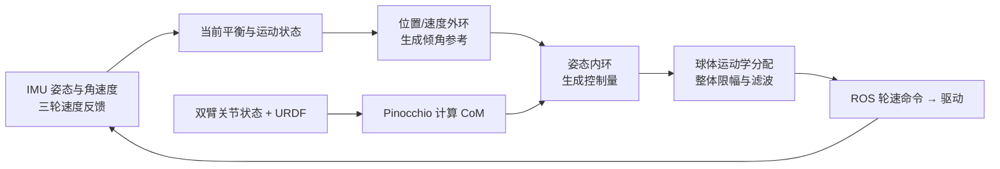

# P1 AIRS 球形机器人：从传感器到球轮动作

## 先建立整机画面

本项目要同时解决两件事：让球形底盘按目标移动，让机身保持平衡。三只小驱动轮在球内推动大球；IMU 和轮速反馈帮助控制器估计运动；双臂姿态会改变质心，并影响平衡。

**两条控制证据要分开：**当前实机控制链以级联 PID 和球轮速度命令为主；四状态倒立摆与 LQR 章节用于解释离线模型和设计方法。不能把教学模型中的等效力矩直接当成实机 ROS 轮速，也不能把离线 LQR 说成每个实机周期都在求 Riccati 方程。

## 推荐学习顺序

1. [项目结构与完整数据链](00_项目全貌与学习路线/01_项目结构与完整数据链.md)：认清硬件、节点、消息和驱动边界。
2. [先修知识与学习验收](00_项目全貌与学习路线/02_先修知识与学习验收.md)：检查本章需要的力学、坐标、PID 和矩阵基础。
3. [端到端闭环、数据时序与实时性](00_项目全貌与学习路线/03_P1端到端闭环、数据时序与实时性.md)：按一次真实控制周期，串起输入、缓存、计算和输出。
4. [对话疑惑覆盖与复习索引](00_项目全貌与学习路线/04_对话疑惑覆盖与复习索引.md)：把多轮疑惑定位到真实正文标题，按数值例验收，并标明仍缺的模型、标定和实测证据。
5. 按原理章节顺序学：

| 章节 | 先回答的问题 |
|---|---|
| [01 结构、传感器与平衡状态](01_原理与子系统/01_结构传感器与平衡状态.md) | 哪个部件在动？IMU、轮速分别测到什么？什么叫保持平衡？ |
| [02 三轮球体运动学分配](01_原理与子系统/02_三轮球体运动学分配.md) | 球的角速度怎样变成三只小轮的转速？投影和叉乘各表示什么？ |
| [03 级联 PID 与实机执行链](01_原理与子系统/03_级联PID与实机执行链.md) | 外环怎样产生倾角参考？内环输出什么？命令怎样到驱动器？ |
| [04 四状态倒立摆与 LQR](01_原理与子系统/04_四状态倒立摆与LQR分析.md) | 质量、惯量和重力怎样形成 \(A,B\)？\(Q,R,P,K\) 分别做什么？ |
| [05 双臂 CoM 与重力前馈](01_原理与子系统/05_双臂CoM与重力前馈.md) | URDF、关节角和 Pinocchio 怎样得到 CoM？重力矩为何进入平衡控制？ |
| [06 启动、限幅、跌倒与恢复](01_原理与子系统/06_启动限幅跌倒与恢复.md) | 使能、reset、限幅和停机分别保证什么？失败后怎样判断？ |

## 曾经卡住的概念，从这里复习

| 疑惑 | 主讲位置 |
|---|---|
| 三只轮的方向、球面接触点、叉乘、投影和正负号 | 第 02 章 |
| 外环和姿态环是否输出力矩；目标速度为零时轮子为何仍会动 | 第 03 章 |
| \(A_{11},A_{12},A_{22}\) 的物理意义；两条耦合方程怎样变成 \(A_c,B_c\) | 第 04 章 |
| LQR 怎样从模型和代价得到 \(P,K\)，为什么反馈为 \(-Kz\)，和 PID 有何关系 | 第 04 章与[历次问题归纳](05_中英文面试/06_历次问题归纳与完整讲解.md) |
| 连杆局部坐标怎样随关节旋转；CoM 怎么质量加权；右手定则和重力矩符号 | 第 05 章 |
| 重力前馈是否与姿态环输出同量纲、作用对象是谁、源码的缩放顺序 | 第 05 章及[完整周期](02_源码阅读与运行/02_一个周期的调用与数据流.md) |
| reset 是否等于停电机、倾角阈值、整体范数限幅和恢复条件 | 第 06 章 |

逐项复习以[对话疑惑覆盖与复习索引](00_项目全貌与学习路线/04_对话疑惑覆盖与复习索引.md)为入口；[历次问题归纳与完整讲解](05_中英文面试/06_历次问题归纳与完整讲解.md)用于练全链口述。正文已补入力矩的时间积分、两次0.75的数值/单位条件、惯性矩阵与单位矩阵形状、0°–45°–90°连续CoM例、q/v索引反例及滤波历史；学习实验与实机证据分别说明。

## 回到源码、做实验和准备面试

- 源码：[版本与文件地图](02_源码阅读与运行/01_源码版本与文件地图.md) → [一个控制周期](02_源码阅读与运行/02_一个周期的调用与数据流.md) → [环境与运行入口](02_源码阅读与运行/03_环境配置与运行入口.md)。
- 实验：[逐步实验手册](03_实验_故障与验证/01_逐步实验手册.md)、[故障诊断与量化方法](03_实验_故障与验证/02_故障诊断与量化方法.md)、[四状态 LQR 仿真实验](03_实验_故障与验证/03_LQR四状态仿真实验操作手册.md)。
- 证据与表达：[CV/PS 表述与证据](04_贡献_证据与材料映射/01_CV_PS表述与证据.md)、[术语与口述](05_中英文面试/01_术语与三种长度口述.md)、[原理实现问答](05_中英文面试/02_原理实现与验证问答.md)、[连续追问](05_中英文面试/03_连续追问模拟.md)、[控制链路与实时性深挖](05_中英文面试/05_控制链路与实时性深挖.md)、[白板练习](05_中英文面试/04_综合推理与白板练习.md)。

## 每章的学习检查

合上文档后，先说出实际部件和信号，再讲清每个量的来源、单位、方向、计算步骤、输出消费者；最后自己改一个数字重算，并说明失败时先看哪条日志。源码静态阅读、教学计算、仿真结果和实机验证分别记录，不能互相替代。
