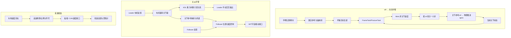

# P2 项目结构与完整数据链

## 先分成三条独立链

P2 有 VR 机械臂仿真/遥操作、Leader/Follower 主从手臂、差速底盘三条学习线。都出现“目标、控制、执行、反馈”，但目标的来源、模型、控制量和驱动接口不同；不能把三个目录当成同一个正在运行的周期。



## 三条链的输入输出对照

| 链路 | 当前输入 | 核心计算 | 输出 | 要验证什么 |
|---|---|---|---|---|
| VR 手柄控制 | 手柄位置/朝向、起始标定、仿真当前关节 | 相对位姿映射、末端任务、逆运动学 | 关节速度小步或仿真状态 | 目标是否在工作空间、QP 是否成功、仿真状态是否更新 |
| Leader/Follower | 两侧关节/电机反馈、关节参考、重力模型 | 坐标/单位转换、KDL 重力项、跟踪控制 | MIT 电机字段或驱动请求 | 位置/速度/力矩字段含义、限位、实际 ACK 与反馈 |
| 差速底盘 | 车体速度要求、左右轮反馈 | 车体速度到轮速度、PID/里程计 | 轮速或 CAN 命令 | 命令比例和方向、板端控制是否启用、里程计时效 |

## 为什么 VR 分支有 MuJoCo、Mink 和积分三步

手柄目标是“手腕想去哪里”，它本身还不是关节命令。MuJoCo 的机器人模型根据关节状态更新连杆几何；Mink 用当前模型几何/Jacobian、末端任务和其他任务求一组关节速度；程序在短时间 (dt) 内把速度积成新关节配置，再让模型更新下一帧状态。

```text
当前关节配置 q
  → 模型更新手腕位置、朝向和 Jacobian
  → 任务误差形成末端运动要求
  → Mink 在约束/权重下求 q̇
  → q_next ≈ q + q̇·dt
  → MuJoCo 更新几何，进入下一次计算
```

MuJoCo 在这里是能按模型计算运动学/动力学并推进仿真状态的软件库。现实机械臂运行时可以由真实编码器提供关节状态、由机器人模型库计算几何/Jacobian；它不要求实机上必须运行 MuJoCo。详细边界见[MuJoCo 与 Mink](../01_原理与子系统/02_MuJoCoMink任务约束与求解.md)。

图中采用主遥操意图路径：积分生成关节参考，ctrl送执行器，mj_step产生新qpos。独立XarmIKSolver直接写qpos再mj_forward属于另一种运动学更新。当前上游Mink内部先解Δq再除dt返回速度，历史版本未锁；全局正则与任务LM可并存。五章主讲与逐数字验收的落点见[对话疑惑覆盖索引](04_对话疑惑覆盖与复习索引.md)。

## 为什么主从分支要区分 Leader 与 Follower

Leader 侧解决“人推动时，重力怎样影响手感和电机输出”；Follower 侧解决“怎样根据参考和自身反馈跟随”。KDL 使用机械模型计算重力相关力矩；MIT 命令字段可能包含位置、速度、刚度、阻尼和前馈力矩。每个字段要按驱动协议解释，不能统称“关节角命令”。

详细推导见[KDL 重力补偿与主从跟踪](../01_原理与子系统/04_KDL重力补偿与主从跟踪.md)。重力前馈的模型输出、控制器输出和真实电机力矩要分别核对。

## 当前源码边界

- VR 仿真路径里的 `MuJoCo qpos/ctrl` 属于模拟状态/控制接口；它不自动证明硬件目标也发到了真实机械臂。
- 主从、VR 和底盘的目录/入口不同；材料里共同出现不代表三者在同一进程或控制周期。
- 底盘 `speed_send`、板端 PID 和 CAN 接收链要沿本地板端代码核对；函数名存在不代表当前运行配置调用。
- 目标、状态估计、执行命令和反馈回执分别记录；命令成功返回不等于设备已到目标。
- 参数和手算例用于理解算法，不能当成标定值或实机性能。

## 下一步阅读

先读[端到端流程与面试地图](03_P2端到端流程与面试地图.md)获得全局顺序，再读[源码版本与文件地图](../02_源码阅读与运行/01_源码版本与文件地图.md)、[一个周期的调用与数据流](../02_源码阅读与运行/02_一个周期的调用与数据流.md)。VR 坐标/姿态、Jacobian 与阻尼的历史疑问集中在[历次问题归纳与完整讲解](../05_中英文面试/05_历次问题归纳与完整讲解.md)，但推导仍以各原理章节为主。
