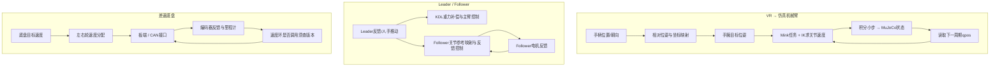

# P2 VLAI 机械臂与底盘：目标怎样变成机器人动作

## 先分清项目中的三条线

P2 的资料涵盖 VR 机械臂仿真/遥操作、主从机械臂的重力补偿与跟随、差速底盘控制。它们可放在同一个项目背景下学习，但要分别追踪各自的入口、模型和执行器，不能把三套代码自动拼成一条已部署链。

## 推荐学习顺序

1. [项目结构与完整数据链](00_项目全貌与学习路线/01_项目结构与完整数据链.md)：看清三条链的输入、输出和边界。
2. [先修与学习验收](00_项目全貌与学习路线/02_先修知识与学习验收.md)：重点检查坐标变换、矩阵、微分、力矩和线程/消息基础。
3. [P2 端到端流程与面试地图](00_项目全貌与学习路线/03_P2端到端流程与面试地图.md)：先学习整条系统如何把目标送到末端，再按下表进入原理。
4. [对话疑惑覆盖与复习索引](00_项目全貌与学习路线/04_对话疑惑覆盖与复习索引.md)：逐主题核对所有疑惑、四份全文附件、计算验收和剩余外部证据。

| 章节 | 先回答的问题 |
|---|---|
| [01 VR 相对位姿与坐标标定](01_原理与子系统/01_VR相对位姿与坐标标定.md) | 手柄的“移动/转向”参考哪个坐标系？初始姿势怎样消掉？轴映射 \(C\) 和缩放怎样影响目标？ |
| [02 MuJoCo 与 Mink 任务求解](01_原理与子系统/02_MuJoCoMink任务约束与求解.md) | MuJoCo 提供什么模型状态？Mink 怎样把末端目标变成关节速度？为什么每周期再积分？ |
| [03 奇异、阻尼、限位与异常保持](01_原理与子系统/03_奇异阻尼限位与异常保持.md) | Jacobian 的数怎样由模型几何得到？奇异值小为什么让关节速度变大？QP 和阻尼怎样处理？ |
| [04 KDL 重力补偿与主从跟踪](01_原理与子系统/04_KDL重力补偿与主从跟踪.md) | URDF/KDL 如何算重力力矩？Leader 和 Follower 分别读什么、发什么？MIT 命令字段表示什么？ |
| [05 差速 PID、里程计与 ROS 2/CAN](01_原理与子系统/05_差速PID里程计与ROS2CAN.md) | 车体速度怎样分成左右轮目标？轮速反馈怎样变成里程计？接口命令与物理执行怎样区分？ |

## 曾经卡住的概念，从这里复习

| 疑惑 | 主讲位置 |
|---|---|
| VR 和机器人基座的轴为什么不一样；坐标系、旋转矩阵和 SE(3) 分别表达什么 | 第 01 章与[历次问题归纳第 1–4 节](05_中英文面试/05_历次问题归纳与完整讲解.md) |
| \(C\) 如何标定轴向；初始位姿、相对位移、相对旋转的乘法顺序 | 第 01 章 |
| 米和弧度不能直接相加时，位置与朝向怎样组成末端运动要求 | 第 02 章；完整推导见历次问题归纳 |
| 雅可比每列怎么来；MuJoCo 为什么能由关节角算几何；实机没有 MuJoCo 怎么办 | 第 02、03 章 |
| 优化器到底在选什么；阻尼项为什么惩罚整组关节步长；λ、奇异值和伪逆如何关联 | 第 03 章 |
| Leader 被人推动时怎样托住手臂；Follower 如何跟随；位置、速度、力矩字段不能混用 | 第 04 章 |

全部疑惑的正文落点见[对话疑惑覆盖与复习索引](00_项目全貌与学习路线/04_对话疑惑覆盖与复习索引.md)。五个专章已补入起点/坐标、完整SE(3)、误差到六维速度、FK与叉乘、全局/任务LM、KDL/MIT、编码器/PID/通信的连续讲解。先读正文和手算，再用[历次归纳](05_中英文面试/05_历次问题归纳与完整讲解.md)及面试Q01–Q49复述。

2026-10-12在线核验的Mink当前上游与历史项目安装版本分开说明：内部Δq/API速度、任务LM及默认限制不能跨版本当成历史实测事实。本次是文档与静态源码整理，没有运行软件测试或更改源码。

## 回到源码、实验和证据

- 源码：[版本与文件地图](02_源码阅读与运行/01_源码版本与文件地图.md) → [调用与数据流](02_源码阅读与运行/02_一个周期的调用与数据流.md) → [环境与运行入口](02_源码阅读与运行/03_环境配置与运行入口.md)。
- 实验：[逐步实验](03_实验_故障与验证/01_逐步实验手册.md)、[故障与量化](03_实验_故障与验证/02_故障诊断与量化方法.md)。没有运行的代码和模型输出只能称为预期。
- 面试：[材料证据](04_贡献_证据与材料映射/01_CV_PS表述与证据.md)、[术语与口述](05_中英文面试/01_术语与三种长度口述.md)、[原理实现问答](05_中英文面试/02_原理实现与验证问答.md)、[连续追问](05_中英文面试/03_连续追问模拟.md)、[白板练习](05_中英文面试/04_综合推理与白板练习.md)。

代码存在不等于个人编写，仿真模型能算不等于实机已执行。每次复述都要明确正在讲哪条链、哪份版本和哪种证据。
