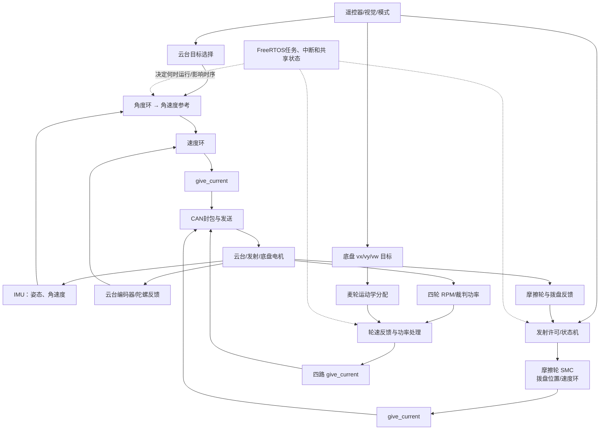

# P3 项目结构与完整数据链

## 先认清机器人在同时做什么

这台机器人有三个主要控制对象：云台、发射机构和底盘。遥控器给出操作意图，视觉/裁判系统提供额外信息，IMU 与电机编码器提供反馈。控制程序根据各自目标算命令，通过 CAN 发给电机；电机的新反馈再回到对应控制环。

三个闭环会交错运行，但它们不共享同一种目标、反馈、控制周期或电机字段。项目阅读要把每条线分开，再理解它们如何共同使用 MCU、CAN 和功率预算。

## 一条链中的量分别代表什么

| 子系统 | 目标/输入 | 反馈 | 中间计算 | 发给驱动的量 |
|---|---|---|---|---|
| 云台 | 遥控/视觉给出的 yaw、pitch 目标与模式 | 编码器角度、IMU 陀螺角速度 | 角度环生成角速度参考；速度环用角速度误差算输出 | 电机协议中的 `give_current` 数值 |
| 摩擦轮 | 发射许可与目标 RPM | 电机 RPM、电流等 | 当前活动摩擦轮路径调用 SMC；源码中的 VSP 调用需看注释状态 | 电机协议中的电流尺度命令 |
| 拨盘 | 单发/连发状态和累计编码目标 | 拨盘累计位置、速度和计时 | 位置环生成速度参考，速度环生成电流；状态机检查进度 | 拨盘电机电流尺度命令 |
| 底盘 | 车体前进、横移和旋转要求 | 四轮 RPM、裁判功率与缓冲信息 | 麦轮映射、轮速缩放、功率处理、四路速度 PID | 四路电机电流尺度命令 |

`give_current` 是协议字段/数值尺度。没有电机常数、驱动定义和标定时，不直接把它说成安培或 N·m。RPM、角度、角速度、功率和能量也要各自标单位。

## 一次任务数据怎样按时间前进

1. **通信/中断先接收数据。**遥控、IMU、CAN 电机反馈和裁判信息进入相应缓存或共享结构。
2. **任务读当前缓存。**云台、发射和底盘任务按各自调度时机取得最近输入。若数据没有时间戳/年龄检查，“最近缓存”也可能已过时。
3. **模式与状态先决定能否控制。**例如云台/底盘使能、发射许可、故障状态会影响是否继续计算目标。
4. **每个环独立计算。**云台和拨盘可能是级联环；摩擦轮和底盘轮速环使用不同反馈变量和算法。
5. **限幅/功率策略修改理想命令。**最终电机命令可能与控制器原始输出不同，必须记录每一步缩放后的结果。
6. **CAN 封包送往不同电机。**目标字段被映射到协议 ID 和顺序；协议成功仍不能单独证明机械动作完成。
7. **下一批反馈形成下一轮输入。**编码器、IMU、离线状态和裁判信息用于更新控制器判断。

FreeRTOS 的任务优先级和延时 API 描述调度意图；实际周期还受任务计算、抢占、中断、锁和通信影响。要声称某个环达到固定频率，需要在同一控制入口做时间戳测量。

## 源码边界与常见误读

- `PID.c`、`SMC.c` 里存在实现，不等于当前运行路径调用了它们；必须沿控制任务追到实际调用和最终 CAN 字段。
- VSP 相关参数初始化不等于 VSP 算法正在用；当前所查摩擦轮路径与拨盘路径要分别追踪。
- `BLOCK`、`FAIL` 等状态名不等于拨盘已经清电流或电机已停；要查状态分支、输出字段、驱动和恢复路径。
- 轮目标经过运动学、最大转速缩放和功率算法以后会变化；看到原始目标不能当作最终发送命令。
- “发送 CAN 命令”“收到电机反馈”“完成发射/达到角度”是三个不同证据级别。
- 当前静态源码能说明可见实现，不能单独证明某次比赛实机结果或个人负责全部模块。

细节入口：[端到端任务与反馈链](03_P3端到端任务与反馈链.md)、[一个控制周期](../02_源码阅读与运行/02_一个周期的调用与数据流.md)、[FreeRTOS 与反馈](../01_原理与子系统/01_硬件反馈与FreeRTOS任务.md)、[云台控制](../01_原理与子系统/02_云台角度速度环与视觉仲裁.md)、[发射与堵转](../01_原理与子系统/03_摩擦轮拨弹PID与滑模版本.md)、[麦轮](../01_原理与子系统/04_麦轮运动学与轮速反馈.md)、[功率](../01_原理与子系统/05_功率缓冲与输出缩放.md)。
