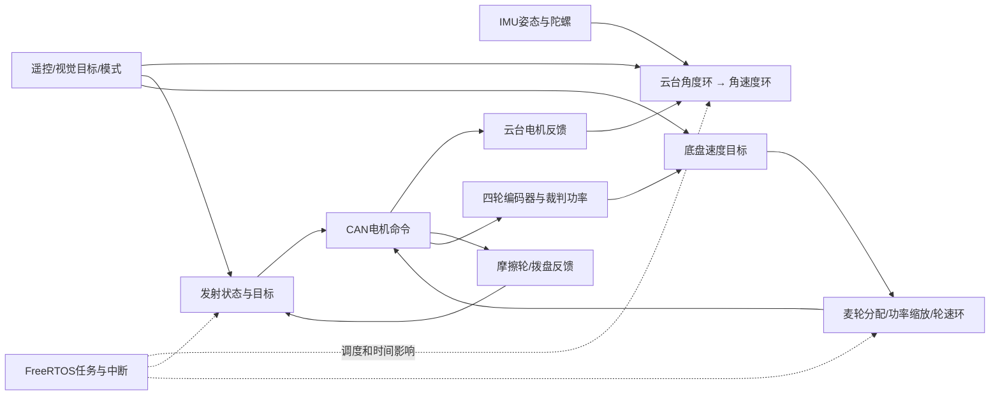

# P3 RoboMaster 英雄机器人：多任务、多闭环怎样一起工作

## 先看机器人正在做什么

机器人一边让云台指向目标，一边让摩擦轮/拨盘完成发射，还要让麦克纳姆轮底盘移动。它们用到不同的反馈和控制输出，但共享 MCU、任务调度、电源和 CAN 通信资源。

## 推荐学习顺序

1. [项目结构与完整数据链](00_项目全貌与学习路线/01_项目结构与完整数据链.md)：按“目标、反馈、计算、执行、回读”认出模块。
2. [先修知识与学习验收](00_项目全貌与学习路线/02_先修知识与学习验收.md)：先理解角度/角速度、PID、CAN 和任务周期。
3. [端到端任务与反馈链](00_项目全貌与学习路线/03_P3端到端任务与反馈链.md)：串起遥控和传感器输入到电机命令的三条控制链。
4. [对话疑惑覆盖与复习索引](00_项目全貌与学习路线/04_对话疑惑覆盖与复习索引.md)：逐组定位实际章节标题，含两附件中已校正的源码差异与待补证据。
5. 按以下章节逐层深入：

| 章节 | 先回答的问题 |
|---|---|
| [01 硬件反馈与 FreeRTOS 任务](01_原理与子系统/01_硬件反馈与FreeRTOS任务.md) | SPI/DMA、CAN 解码后得到什么？任务周期、`vTaskDelay`、`osDelay` 与 `vTaskDelayUntil` 各意味着什么？ |
| [02 云台角度/速度环与视觉仲裁](01_原理与子系统/02_云台角度速度环与视觉仲裁.md) | IMU 字节怎样变成四元数和角度？角度误差怎样变成电机协议命令？ |
| [03 摩擦轮、拨弹 PID 与滑模](01_原理与子系统/03_摩擦轮拨弹PID与滑模版本.md) | 摩擦轮速度和拨盘位置有什么不同？VSP/SMC 哪个分支实际调用？堵转怎样判断和恢复？ |
| [04 麦轮运动学与轮速反馈](01_原理与子系统/04_麦轮运动学与轮速反馈.md) | 前后、横移和旋转速度如何分配给四个轮？轮序和坐标符号怎样影响结果？ |
| [05 功率缓冲与输出缩放](01_原理与子系统/05_功率缓冲与输出缩放.md) | 裁判系统反馈怎样影响允许功率？缩放发生在控制链的哪一步？ |
| [06 CAN 失联、初始化与模式状态](01_原理与子系统/06_CAN失联初始化与模式状态.md) | 上电、在线、失联、恢复、停止和模式切换分别怎么判断？ |

## 曾经卡住的概念，从这里复习

| 疑惑 | 主讲位置 |
|---|---|
| FreeRTOS tick 是什么；一个任务的实际周期怎样由计算、延时和抢占决定 | 第 01 章 |
| SPI+DMA 读到的是哪些原始传感器量；AHRS 怎样递推姿态四元数，再转成相对参考姿态的角度 | 第 02 章 |
| 变比例 PID 的 \(k_0,k_1,k_2\) 如何调；SMC 滑动面、到达律和边界层分别做什么 | 第 03 章与[问题归档](05_中英文面试/05_历次问题归纳与完整讲解.md) |
| 发射“允许”、状态机“正在执行”、设备“确实发出”如何区分；堵转阈值与反转分支到底做什么 | 第 03 章 |
| 四轮顺序、RPM/rad/s、轮速反馈、功率公式和限幅先后关系 | 第 04、05 章 |

详细教学均在对应原理章；[逐组复习索引](00_项目全貌与学习路线/04_对话疑惑覆盖与复习索引.md)直接跳到 CMSIS版本、超期补跑、四元数乘法、VSP参数耦合、趋近律推导、发射许可/堵转和功率抗积分等段落。[历次问题归纳](05_中英文面试/05_历次问题归纳与完整讲解.md)用于面试主线复习。源码中有某种算法不等于当前活动路径启用了它；请从入口追到调用点和输出字段。

## 源码、实验与面试

- 源码：[版本与文件地图](02_源码阅读与运行/01_源码版本与文件地图.md)、[一个控制周期](02_源码阅读与运行/02_一个周期的调用与数据流.md)、[环境与入口](02_源码阅读与运行/03_环境配置与运行入口.md)。
- 实验：[逐步实验](03_实验_故障与验证/01_逐步实验手册.md)、[故障诊断](03_实验_故障与验证/02_故障诊断与量化方法.md)。教学仿真参数不是电机实机参数。
- 表达：[CV/PS证据](04_贡献_证据与材料映射/01_CV_PS表述与证据.md)、[术语与口述](05_中英文面试/01_术语与三种长度口述.md)、[原理问答](05_中英文面试/02_原理实现与验证问答.md)、[连续追问](05_中英文面试/03_连续追问模拟.md)、[白板练习](05_中英文面试/04_综合推理与白板练习.md)。

阅读源码可以确认计算与调用；真实控制周期、抗扰表现和实机安全效果还需要对应日志、测量和硬件验证。
