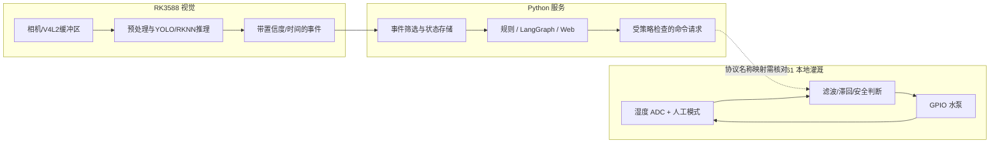

# P4 OpenHarmony 智能园艺与边缘 AI：传感器、视觉与设备动作

## 先把系统分成三条会交换信息的线

P4 同时有本地灌溉、边缘视觉和服务器服务。Hi3861 可以根据本地湿度和人工模式控制水泵；RK3588 负责采集图像、运行病害检测并发送结果；Python 服务处理事件、规则/Agent建议和 Web 交互。设备采样、模型推理、服务处理和网页显示各有自己的时间。

## 推荐学习顺序

1. [项目结构与完整数据链](00_项目全貌与学习路线/01_项目结构与完整数据链.md)：分清端侧、边缘计算和服务器职责。
2. [先修知识与学习验收](00_项目全貌与学习路线/02_先修知识与学习验收.md)：理解采样、阈值、图像、网络消息和事件时间。
3. [端到端数据与执行链](00_项目全貌与学习路线/03_P4端到端数据与执行链.md)：从湿度/图像输入一路追到输出与回执。
4. 按子系统深入：

| 章节 | 先回答的问题 |
|---|---|
| [01 硬件、端云与事件数据链](01_原理与子系统/01_硬件端云与事件数据链.md) | 哪些信息在端侧产生，哪些由服务器处理？消息经过哪些设备和网络？ |
| [02 土壤湿度滞回与人工优先](01_原理与子系统/02_土壤湿度滞回与人工优先.md) | ADC 数值怎样变成湿度状态？为何开/关阈值不同？人工停止怎样优先？ |
| [03 V4L2、YOLO 与 RKNN INT8](01_原理与子系统/03_V4L2YOLO与RKNNINT8.md) | 图像缓冲区如何流转？检测框从像素怎样产生？量化有什么代价？ |
| [04 结构化视觉状态与时间戳](01_原理与子系统/04_结构化视觉状态与时间戳.md) | 候选框怎样变成事件？置信度、事件时间和接收时间如何区分？ |
| [05 LangGraph 规则、工具与决策](01_原理与子系统/05_LangGraph规则工具与决策.md) | State、Node、Edge 如何传递工作单？规则、LLM建议和执行授权各负责什么？ |
| [06 Web 通信、执行回执与恢复](01_原理与子系统/06_Web通信执行回执与恢复.md) | TCP 字节流怎样还原消息？命令请求、设备 ACK 和真实水泵状态怎样区分？ |

## 曾经卡住的概念，从这里复习

| 疑惑 | 主讲位置 |
|---|---|
| ADC 数字是否直接就是湿度；滞回为何要记住上一次开关状态 | 第 02 章 |
| V4L2 交给程序的是图像数据还是文件；缓冲区为何要归还 | 第 03 章 |
| YOLO 检测框、病害事件、置信度和模型精度指标之间的区别 | 第 03、04 章 |
| INT8 怎样把浮点模型变成低位宽计算，速度与精度如何权衡 | 第 03 章 |
| LangGraph 是不是另一个神经网络；LLM 建议如何经过人工/规则策略才能影响设备 | 第 05 章 |
| TCP 为什么要自己拼消息；服务动作与端侧命令名称不一致怎样影响闭环 | 第 06 章 |
| 时间戳、事件去重、数据库记录和真实设备执行回执分别能证明什么 | 第 04–06 章 |

完整问题归纳见[历次问题归纳与完整学习地图](05_中英文面试/05_历次问题归纳与完整讲解.md)。重点是辨认每条信息的来源、时间、状态和下游消费者，不能让建议文本代替执行证据。

## 源码、实验与证据

- 源码：[版本与文件地图](02_源码阅读与运行/01_源码版本与文件地图.md) → [调用与数据流](02_源码阅读与运行/02_一个周期的调用与数据流.md) → [环境与运行入口](02_源码阅读与运行/03_环境配置与运行入口.md)。
- 实验：[逐步实验](03_实验_故障与验证/01_逐步实验手册.md)、[故障与量化](03_实验_故障与验证/02_故障诊断与量化方法.md)。未连接设备或未运行模型时，输出只写预期。
- 面试：[CV/PS证据](04_贡献_证据与材料映射/01_CV_PS表述与证据.md)、[术语口述](05_中英文面试/01_术语与三种长度口述.md)、[原理问答](05_中英文面试/02_原理实现与验证问答.md)、[连续追问](05_中英文面试/03_连续追问模拟.md)、[综合推理](05_中英文面试/04_综合推理与白板练习.md)。

当前阅读以本地源码快照为准。代码路径和协议存在只能支持静态结论；部署、推理速度、识别精度及水泵动作需要运行记录或硬件反馈确认。
