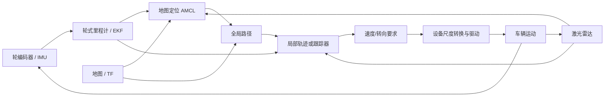

# P5 项目结构与完整数据链

## 先回答导航到底要完成什么

导航不是单个算法。小车得先估计自己在哪，再根据地图找路；车靠近障碍或路线拐弯时，局部规划/跟踪器要产生短时间可执行的运动要求；驱动接口把要求变成车辆能接收的命令，之后再用新的传感器反馈更新估计。

图中每个方框只负责一个问题。定位输出是位姿估计；规划输出是路线；跟踪器输出是短期动作要求；驱动层才把要求交给执行设备。上一层输出的存在不证明下一层已经接收或完成。

## 当前本地副本里要分开的两种路径

### 配置中可见的导航栈

课程源码地图中记录了以下配置/入口，需要结合启动文件确认实际是否加载：

| 模块 | 输入 | 作用 | 输出/下一步 |
|---|---|---|---|
| 轮速与 IMU 里程计 | 编码器、IMU | 估计短时间连续运动 | odometry 数据 |
| EKF（`robot_localization` 配置） | 选择的轮式里程计/IMU 数据 | 融合运动状态，平滑短期估计 | `odometry/filtered` 等状态 |
| AMCL | 地图、激光扫描、运动估计 | 估计机器人相对地图的位置 | map 与 odom 之间的定位关系 |
| Nav2 Navfn | 地图、起点、目标 | 计算全局路径；当前配置里的 `use_astar=false` 需要照配置解释 | 全局路径 |
| Regulated Pure Pursuit | 路径与当前状态 | 沿路径生成局部速度/转向意图 | 控制器输出 |
| `car_controller_new` | 前视点、`eta`、filtered odom 等 | 独立的 L1/前视跟踪路径 | 发布 `/car/cmd_vel` 的设备尺度值 |

Nav2 控制器和 `car_controller_new` 两种命令来源是否由同一个 launch 连接、是否互斥、哪个最终驱动车辆，必须看启动配置、话题连接和运行节点。仅凭两个组件都在仓库中不能把它们画成已确认的连续链。

### 材料或历史资料中出现的算法

Hybrid A*、TEB 和 MPC 按各自历史材料与教学章节解释。它们解决的问题不同：Hybrid A* 搜索车辆可行的全局路线；TEB 调整短时带时间轨迹并考虑障碍和运动限制；MPC 在模型、代价和约束下选未来控制序列。当前副本没有证明它们与 Navfn/RPP、L1 控制器同一时刻全部运行。

这一边界很重要：本地有一个教学 Hybrid A* 脚本，可以证明它用于学习；本地有 TEB 配置，可以证明这份文件写了相应参数；只有启动/插件加载/运行日志才能支持“当前系统正在用它”。

## 定位中的两个参考系和测量时间

- **`odom`** 适合表达短期连续运动，但轮滑和 IMU 积分误差会随时间累积。
- **`map`** 把车放在全局地图上，激光匹配可长期修正漂移，但定位可能出现跳变。
- **TF** 描述坐标系之间的关系以及该关系适用的时间。把不同时间的雷达、里程计和姿态拼在一起，可能产生看似坐标错误的定位误差。

读取某个 pose 前，写清楚它表示哪个物理点、在哪个坐标系、测量时刻是什么。坐标变换不能修复过期数据；时间对齐不能修复错误的 TF 外参。

## 从路线到车辆命令，中间还隔着接口

一条完整的执行链应逐步确认：

1. 规划器产出路径点/姿态，还是局部控制器产出速度与转向？
2. 速度的单位是 m/s、RPM 还是驱动器整数？转向是 rad、deg 还是比例值？
3. 控制器怎样处理角度绕回、速度/转角限制和转向变化率？
4. 哪个节点/板端把消息字段换成电机目标？轮半径、减速比和方向符号在哪里配置？
5. 车辆反馈从哪里回来，数据是否新鲜？

`/car/cmd_vel` 这类名字只提示消息入口，不足以确认经过缩放后送到电机的物理量。必须找到接收回调、转换公式、最终协议字段和反馈路径。

## 读源码时按这个顺序

| 要确认的事 | 去哪里找 | 能得出的结论 |
|---|---|---|
| 当前工程和算法版本 | [源码版本与文件地图](../02_源码阅读与运行/01_源码版本与文件地图.md) | 仓库快照、配置文件、插件入口的位置 |
| 节点启动和话题/TF连接 | launch 与参数文件；参见[一个周期](../02_源码阅读与运行/02_一个周期的调用与数据流.md) | 哪些组件实际被启动、谁发布和订阅 |
| 车辆运动学及转向约定 | [车辆模型与驱动接口](../01_原理与子系统/01_车辆模型反馈与驱动接口.md) | 几何关系和命令字段转换 |
| 规划/跟踪的计算方法 | [Hybrid A*](../01_原理与子系统/04_HybridAStar碰撞与运动基元.md)、[TEB](../01_原理与子系统/05_TEB局部优化与跟踪接口.md)、[MPC](../01_原理与子系统/06_MPC模型代价约束与滚动执行.md) | 原理、教学模型和相应源码证据边界 |
| 故障后怎样恢复 | [整车启动与失败恢复](../01_原理与子系统/07_整车启动重规划与失败恢复.md) | 启动条件、失败信号、重规划或停机路径 |

## 学完应能讲清这五条边界

1. 轮编码器是测量转动；里程计是根据模型换算的位置估计。
2. EKF/AMCL 是状态估计；全局规划是路径搜索；局部控制是当前动作计算。
3. 路径点、控制目标、设备命令和实际运动是四个层次。
4. 当前加载算法要由配置和调用确认，历史配置与教学实现分开描述。
5. 评价导航不能只看“到达/没到达”：要看定位误差、路径可行性、跟踪误差、碰撞、命令饱和和时间预算。

完整走读：[一趟导航怎样走出来](03_P5导航一趟路是怎样走出来的.md)。用户历次关于自行车模型、EKF、搜索、TEB、DWA 和 MPC 的问题见[完整推导归纳](../05_中英文面试/05_历次问题归纳与完整推导.md)。
