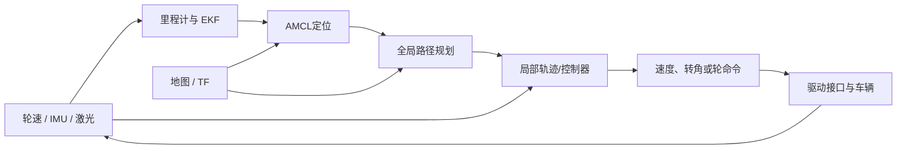

# P5 智能车自主导航：车怎样知道位置、选路并执行

## 先建立一趟导航的画面

导航把多个不同问题连起来：轮速/IMU 提供运动信息，定位把传感器放到地图坐标里，全局规划找一条可行路线，局部规划和控制根据障碍与车辆运动限制产生当前动作，驱动接口再把动作交给车辆。

**算法证据要分开：**本地配置能看到 Navfn、L1/RPP 等组件及历史 TEB 配置；当前源码副本没有证明简历里提到的 Hybrid A*、TEB、MPC 全部以同一版本部署。Hybrid A*、TEB、DWA 和 MPC 的新算例是学习用模型时，会明确标成教学内容。

## 推荐学习顺序

1. [项目结构与完整数据链](00_项目全貌与学习路线/01_项目结构与完整数据链.md)：先认定位、规划、控制、驱动各自回答什么问题。
2. [先修与学习验收](00_项目全貌与学习路线/02_先修知识与学习验收.md)：复习车辆几何、坐标、概率和优化基础。
3. [一趟导航怎样走出来](00_项目全貌与学习路线/03_P5导航一趟路是怎样走出来的.md)：先从真实输入到最后驱动命令走一遍。
4. 按原理顺序深入：

| 章节 | 先回答的问题 |
|---|---|
| [01 车辆模型、反馈与驱动接口](01_原理与子系统/01_车辆模型反馈与驱动接口.md) | 前轮转角、轴距、车速怎样限制转弯？控制量最终交给什么接口？ |
| [02 轮式/IMU、EKF 与 AMCL](01_原理与子系统/02_轮式IMUEKF与AMCL定位.md) | 轮速和 IMU 如何预测位置？地图定位怎样修正漂移？ |
| [03 TF 时间对齐与定位异常](01_原理与子系统/03_TF时间对齐与定位异常.md) | 同一位置为什么要有 map、odom、base 等坐标？传感器时间不一致会怎样？ |
| [04 Hybrid A* 碰撞与运动基元](01_原理与子系统/04_HybridAStar碰撞与运动基元.md) | 为什么节点带朝向？车辆能选哪些短弧？桶、父节点和回溯怎样形成路径？ |
| [05 TEB 局部优化与跟踪接口](01_原理与子系统/05_TEB局部优化与跟踪接口.md) | TEB 如何调整带时间的轨迹、绕开障碍并考虑速度/转向约束？ |
| [06 MPC 模型、代价、约束与滚动执行](01_原理与子系统/06_MPC模型代价约束与滚动执行.md) | 优化器具体选哪些连续控制值？\(Q,R,Q_f\)、时域和约束怎样影响结果？ |
| [07 启动、重规划与失败恢复](01_原理与子系统/07_整车启动重规划与失败恢复.md) | 定位失效、路径被堵、求解超时后怎样停下或恢复？ |

## 曾经卡住的概念，从这里复习

| 疑惑 | 主讲位置 |
|---|---|
| \(\tan\delta=L/R\) 从直角三角形怎样得到；转角 \(\delta\) 的几种算法各用什么输入 | 第 01 章与[历次推导第 1–2 节](05_中英文面试/05_历次问题归纳与完整推导.md) |
| EKF 的 \(F\) 怎样由运动模型求导；\(FPF^\mathsf T\) 为什么这样乘；\(Q\) 怎样从噪声假设来 | 第 02 章与历次推导第 3 节 |
| BFS/A*怎样记录父节点并回溯；Hybrid A*如何用朝向桶和连续短弧搜索 | 第 04 章与历次推导第 4–5 节 |
| TEB 输出的局部点、朝向和时间间隔怎样决定车辆下一步走法 | 第 05 章与历次推导第 6 节 |
| DWA 采样和 MPC 优化的区别；MPC 输入怎样设范围，优化器怎样选数值 | 第 06 章与历次推导第 7–10 节 |
| \(N\) 个动作为什么对应 \(N+1\) 个状态；\(Q,R,Q_f\) 是如何权衡目标的 | 第 06 章 |

完整复习入口：[历次问题归纳与完整推导](05_中英文面试/05_历次问题归纳与完整推导.md)。建议每次只沿一条线学习：定位 → 路径 → 可执行轨迹 → 当前控制量。

## 源码、实验和面试

- 源码：[版本与文件地图](02_源码阅读与运行/01_源码版本与文件地图.md) → [一个导航周期](02_源码阅读与运行/02_一个周期的调用与数据流.md) → [环境与入口](02_源码阅读与运行/03_环境配置与运行入口.md)。
- 实验：[逐步实验](03_实验_故障与验证/01_逐步实验手册.md)、[故障与量化](03_实验_故障与验证/02_故障诊断与量化方法.md)。
- 表达：[CV/PS证据](04_贡献_证据与材料映射/01_CV_PS表述与证据.md)、[术语与口述](05_中英文面试/01_术语与三种长度口述.md)、[原理问答](05_中英文面试/02_原理实现与验证问答.md)、[连续追问](05_中英文面试/03_连续追问模拟.md)、[白板练习](05_中英文面试/04_综合推理与白板练习.md)。

读源码时先核启动配置和插件实际加载，再讨论算法是否运行；教学仿真用于理解算法，不自动构成项目历史部署或实车性能证据。
