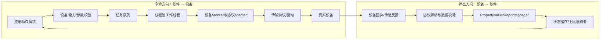

# P6 项目结构与完整数据链

## 先用一个日常画面理解平台

假设上层软件请求“让设备 A 打开开关”。软件不能把中文句子直接送给硬件。它要先确定设备 A 是谁、支持什么能力、请求参数是否合适；再选择对应设备处理器/适配器，把通用动作翻译成该设备的协议；设备回报后，平台把状态和动作结果交还上层。



## 软件里要区分的四种记录

| 名称 | 它回答的问题 | 示例 |
|---|---|---|
| 设备身份 | “这是哪台设备？” | 设备 ID、型号、通信地址 |
| 能力 | “这台设备允许做什么/能报告什么？” | `open`、`stop`、温度属性 |
| 状态 | “最近一次设备反馈是什么？” | 在线判断、传感器数值、开关状态 |
| 动作请求/结果 | “软件请求了什么，处理到哪一步？” | action ID、参数、校验错误、执行回执 |

发现设备不等于识别型号；注册设备不等于设备已在线；在线状态不等于所有功能都健康；收到命令回执也不必然等于物理动作完成。状态缓存还要有来源和时间，否则断线后旧状态可能继续被当成当前状态。

## 命令方向：从请求到结果

学习材料中可见的动作路径可按下面的步骤理解：

1. **上层创建请求。**请求至少指明设备、操作和参数；若协议支持，还应有动作 ID、截止时间和模式。
2. **命令入口检查。**`Base.ExecCommand` 路径检查请求，再优先选择设备专用 handler；没有对应专用路径时才看通用映射。
3. **任务交给线程池。**任务排队后由工作线程取走。`HIGH` 是优先级标签，不表示固定延迟保证；队列忙时命令仍可能等待。
4. **适配器转换数据。**设备 handler 根据型号/配置把平台动作转成协议值。不同设备对“速度”“位置”“打开”的单位和语义可能不同。
5. **通信接口发送。**写入 socket、串口或其他传输路径只代表消息到达该软件接口；设备是否收到要看协议和回执。
6. **结果回到调用方。**`promise/future` 关联任务结果。`future.get()`等待该结果；若任务阻塞或没有超时，调用线程可能长时间等待。
7. **状态与动作结果分开更新。**命令处理状态说明软件处理进度；属性反馈说明设备最近报告的状态。要确认物理效果，需要定义哪种反馈能证明完成。

## 状态方向：从设备反馈回到软件缓存

设备反馈通常要经过：

```text
收到协议数据
  → 检查设备地址/消息长度/字段合法性
  → 解码成平台属性值
  → 带设备身份、来源和时间更新状态管理器
  → 上层读取状态并判断是否新鲜
```

状态消费方应明确最大可接受数据年龄。若当前源码只判断“曾经收到一帧”，那它没有证明输入此刻仍然新鲜。排错时至少记录设备 ID、反馈序号/时间、解析结果、缓存更新时间和在线变化。

## 把概念流程对齐到本地源码

上面的图是帮助理解的逻辑分层，不表示本地副本一定含有“自动发现 → 注册 M-DDS → 在线握手”的完整流程。当前可见的 BaseDeviceHandler 从 Init(deviceId) 接收设备 ID，并调用子类 OnInit；专用发现/动态设备目录需看其他平台入口，当前不能从这个函数推出。

本地 BaseDeviceHandler 的可见生命周期顺序为：

1. 创建该插件的线程池，读取短/长 worker 数量和默认轮询周期。
2. 初始化属性上报入口，再调用子类 OnInit；子类可注册命令、建立资源并设置 pollTask。
3. OnInit 成功后，基类登记 deviceId、调用 SetDeviceOnline、建立轮询 schedule。
4. 用户命令进入 ExecCommand。它先检查 deviceId/cmd，再先查设备专属 handler、后查通用 handler。
5. 将命令提交为 HIGH 短任务；worker 调 handler，promise 保存返回码；调用方通过 future.get 等结果。
6. 到期的轮询由 scheduler 交给 LOW 长任务。若短任务正在运行，本次轮询可能跳过而不补齐所有遗漏周期。
7. Release 移除设备和 schedule，调用子类清理；最后设备释放时停止 scheduler 并关闭线程池。

因此，这段本地代码可以支持对生命周期和命令/轮询调度的阅读，但它不能单独证明设备发现机制、权限服务、完整动作幂等或平台专用 DDS 通信。

## 用地锁案例看“写成功”和“到位”之间的差别

本地 GroundLockHandler 是一个可读的具体例子：

~~~text
ExecCommand(deviceId, "up")
  → 查到 Up handler
  → Up 找端口和从站地址
  → WriteLockCommand 构造 0x06 单寄存器写
  → ModbusAdapter 转成 DataOption 并交给 RTU 服务
  → 写调用返回
  → handler 更新 currentStatus 并上报属性
  → 后续轮询读取状态寄存器，才有新的读回证据
~~~

这个案例有两点要单独记：第一，写返回成功后立即更新的 currentStatus 是软件缓存，不能自动叫机械到位；第二，读取失败时 ReadLockStatus 可能把旧缓存写进输出参数，但仍返回错误码。调用方必须看返回码和最后一次有效采样时间。寄存器地址 0x0006 与源码 allData[7] 的数组映射也要核对底层返回布局。

## 本地代码证据与平台材料范围

当前本地副本可用于学习可见的 C++ 设备接口、适配层、线程池、协议与状态上报组件。项目材料中的 M-Robots/M-DDS 专用实现尚未在当前快照中完整定位，因此不能用新写的教学 registry 或相似接口名称代替原平台源码证据。

区分三种结论：

- **源码静态事实：**某类、函数或配置在这个快照中存在，及可见的调用关系。
- **运行事实：**节点/设备确实启动、连接、收发或执行，需要日志和版本记录。
- **个人贡献：**本人具体负责的实现或调试，需要提交记录、实验记录或本人材料佐证。

复述时可以在笔记旁标注 **S（source）**、**T（teaching）**、**R（runtime record）**、**P（proposal）**：

- S：在这个静态源码快照中能定位到函数、分支或数据结构。
- T：普通电脑的 synthetic/Mock 程序用来解释原理，不能说成历史实现。
- R：真实构建、设备日志、实验数据或部署记录能支持的运行事实。
- P：面向未来的安全、超时、持久去重等改进建议，不代表已实现。

## 三类失败要沿不同方向查

| 症状 | 先查哪一段 | 有用的观测量 |
|---|---|---|
| 设备不在列表中 | 发现、身份解析、注册 | 设备 ID、型号、通信地址、注册错误 |
| 请求返回错误或一直等待 | 校验、队列、handler、future | 错误码、队列长度、任务开始/结束时间、超时、异常 |
| 上层显示状态正常但设备已断线 | 反馈更新与状态过期策略 | 最后反馈时间、数据年龄、在线状态变化、旧缓存失效原因 |
| 请求显示成功但设备没有动作 | 协议写入、设备 ACK、状态反馈、物理确认 | action ID、写入结果、ACK、设备状态变化、传感器/执行结果 |

对本地地锁再加两个排查点：读取失败却拿到 status 数字时，检查 ret 是否错误以及缓存年龄；写请求后平台立即显示目标状态时，检查它来自命令后的缓存更新还是独立寄存器读回。

具体动作例见[一次设备动作怎样走过软件平台](03_P6一次设备动作怎样走过软件平台.md)；线程问题见[线程池与共享状态](../01_原理与子系统/03_线程池回调共享状态与调度.md)，协议问题见[协议适配与状态同步](../01_原理与子系统/04_协议适配发现注册与状态同步.md)，幂等和确认级别见[动作策略与执行回执](../01_原理与子系统/05_动作策略执行回执与幂等.md)。

## 读取失败在上层被掩盖的具体路径

当前ReadLockStatus失败可输出旧缓存，但ListeningTask在非OK分支没有立即返回（return被注释），继续缓存更新与ReportPropertyImpl。上报成功可能让最终返回变成OK，并触发基类online更新。因此检查应包括read_ret、report_ret、poll_ret和last_success_read_time，而不是只看上报成功或online。详见[协议章第7节](../01_原理与子系统/04_协议适配发现注册与状态同步.md)。
