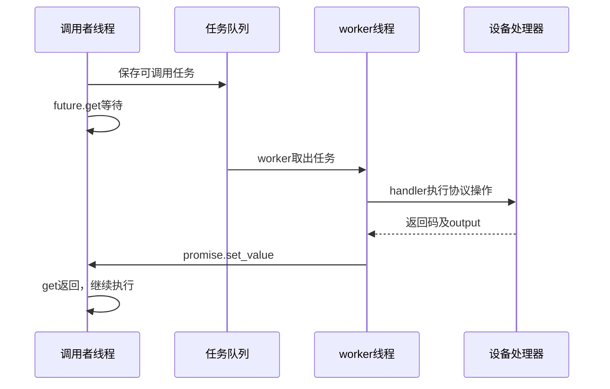

# 03 从排队到返回：线程池、等待、锁与轮询时序

本章回答：为什么提交到线程池后调用者还会等待；HIGH究竟影响什么；怎样区分正常等待、死锁和关闭错误。源码入口是ThreadPoolManager和BaseDeviceHandler::ExecCommand，定位见[文件地图](../02_源码阅读与运行/01_源码版本与文件地图.md)。

## 1. 三种参与者先分开

队列只是保存工作；worker才执行工作；调用者可以在另一线程等待结果。线程池限制worker数量，避免每次命令都新建线程，不意味着所有任务同时运行。

## 2. promise和future到底传什么

`promise<int32_t>`是结果的写入端，`future<int32_t>`是结果的读取端。worker执行handler后把返回码写入promise；调用者从future.get取得它。

当前ExecCommand先异步提交，但随后同步等待。因此，对调用者来说这是一个**等待完成后才返回的API**。不能仅凭里面使用线程池，就说上层不会阻塞。

教学时间轴：100ms提交，120ms worker开始，150ms协议函数返回，151ms set_value，152ms调用者继续。排队20ms，worker工作约31ms，端到端约52ms。只报告30ms协议时间，会漏掉排队和唤醒开销。

## 3. worker怎样安全取任务

常见模式是在锁内检查/取队列项，然后释放锁，再执行慢工作。`condition_variable.wait(lock,predicate)`等待时释放互斥锁，被唤醒后重新取得锁并检查条件。

为什么需要predicate？唤醒并不自动证明队列一定非空，可能是关闭通知或伪唤醒。判断“有任务或已经关闭”，才能决定取任务还是退出。

如果拿着队列锁完成整个串口读写，其他调用者可能无法提交任务，worker也无法取新任务。锁应保护共享结构，不应把所有慢操作都绑在全局队列锁里。

## 4. 当前HIGH短任务与LOW轮询怎样交错

源码有独立的短任务和长任务worker/队列。要按以下三种阶段解释：

| 轮询所在阶段 | 短任务开始后可能发生什么 |
|---|---|
| 仍在长任务队列 | 第一个运行短任务调用ClearPendingLongTasks，弹出待执行长任务并置取消标记 |
| 已取出但尚未执行 | LongTaskWorker检查runningShortTaskCount，可能跳过 |
| 已进入handler/I/O | 不会因HIGH标签自动被中断 |

因此HIGH不是操作系统抢占正在运行轮询的证明。长任务和短任务还可能同时竞争同一个串口锁，短任务也可能需要等已运行的I/O结束。

scheduler到期时会推进nextRunTime，即使这一次没有真正提交或随后被丢弃。一次跳过的轮询不保证立即补做，所以状态年龄必须单独观察。

## 5. 周期配置和实际轮询频率怎样区别

接口SetPollingInterval的参数以秒表示，内部乘1000保存毫秒。默认周期值、每设备intervalMs、下一次nextRunTime，以及实际handler开始时间是不同字段。

教学例：设10秒周期，计划0、10、20秒；10秒时有短任务，轮询被跳过；下一次实际读取是20秒。此时不能宣称设备每10秒都获得一次新状态。

实际有效采样间隔应使用**成功读回**时间差：20−0=20秒。scheduler提交间隔、worker开始间隔、读回成功间隔，各说明不同阶段。

当前scheduler使用`now + interval`推进下次时间，不能把它说成完全保持最初相位的固定绝对周期；具体抖动还受扫描、队列、锁和设备时间影响。

## 6. lambda捕获为什么与超时相关

当前命令任务按引用捕获deviceId、cmd、input、output和promise，而外层future.get等待。正常路径中外层还未返回，这些局部对象仍存活。

如果将来把get改成等待50ms后直接return，worker可能第80ms才执行。此时它引用的参数或promise可能已不存在，产生悬空访问。**仅增加timeout还不够**，必须同时设计拥有数据的请求对象、结果通道及取消语义。

取消标签也不是强行终止线程。若任务已进入阻塞I/O，只有底层支持超时或任务主动检查取消，才能结束这段工作。

## 7. 两个常见死锁怎样发生

### 7.1 单worker等待自己的子任务

worker执行A；A又向同一个只有一个worker的池提交B，并get等待B。唯一worker正在等，B没有机会执行。队列、promise都可能正确，组合方式却不允许进展。

### 7.2 锁顺序相反

线程A拿设备表锁后等连接锁；线程B拿连接锁后等设备表锁。双方都有对方需要的锁。统一锁顺序或先取得对象快照再释放全局锁，可以减少此风险；实际路径仍需完整审阅。

atomic只保护某个单独数值的原子访问，不保证“位置、速度、时间戳”三项组成一致快照。要么共同锁下复制，要么使用版本/不可变消息等策略。

## 8. 关闭、重启和取消记录：当前源的三个边界

1. **Shutdown不保证排空队列。**外层worker循环检查isShutdown；关闭后它可能完成当前任务即退出。若未执行任务中的promise没人设置，调用方可能继续等待。join只证明线程退出。
2. **同对象再Init需核实关闭标志。**当前Init没有显示把isShutdown复位；不能直接把Shutdown后再次Init当可靠重启。
3. **清队列不等于删登记记录。**ClearPendingLongTasks设置taskCancelFlags_后弹出任务，但未在该路径erase。被弹出任务不再走worker的erase，可能留下条目至对象销毁；这是静态增长风险，不是已测得的泄漏。

## 9. 一组能说明效率和问题的日志

记录taskId、deviceId、提交时间、开始时间、结束时间、成功读回时间、队列长度、丢弃轮询数、取消map大小和返回原因。

计算`queue_wait=start−submit`、`work_time=end−start`、`response=end−submit`。比较延迟分布而不仅平均值；如果状态年龄越来越大，还要检查轮询是否饥饿、取消或读取失败。

复习时讲清“谁在等谁、谁持有什么锁、什么条件让它继续”。英文：*The pool executes work asynchronously, but ExecCommand waits synchronously for its result. Priority, cancellation, timing and shutdown must each have explicit semantics.*
