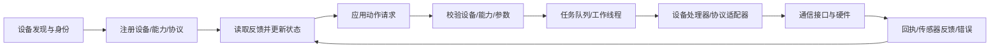

# P6 深开鸿 KaihongMeta：设备平台如何连接软件与硬件

## 先建立系统画面

P6 重点是设备接入和通信软件：上层用统一接口提出动作，平台识别设备能力、安排处理任务，由适配器转换成设备协议；设备回报状态后，平台更新缓存并关联结果。

先记住三层边界：这里学习的是**设备平台软件**，不是机器人运动学或控制器；本地代码快照能证明的是其可见的设备处理器、线程池、协议适配和属性上报；申请材料提到的专用机器人/M-DDS 部分若没有对应源码与运行证据，就继续标记为待核实。

## 推荐学习顺序

1. [项目结构与完整数据链](00_项目全貌与学习路线/01_项目结构与完整数据链.md)：先分清命令方向和状态返回方向。
2. [先修与学习验收](00_项目全貌与学习路线/02_先修知识与学习验收.md)：需要的 C++ 对象、线程、锁、网络和数据结构基础。
3. [一次设备动作怎样走过软件平台](00_项目全貌与学习路线/03_P6一次设备动作怎样走过软件平台.md)：按一个完整动作理解设备、接口、适配器、回执和状态。
4. 按子系统深入：

| 章节 | 先回答的问题 |
|---|---|
| [01 平台版本、组件与申请范围](01_原理与子系统/01_平台版本组件与申请范围.md) | 当前手里的代码具体支持哪些结论？产品名、代码组件和本人贡献怎样分开？ |
| [02 C++ 设备抽象与生命周期](01_原理与子系统/02_Cpp设备抽象与生命周期.md) | 基类接口、虚函数、派生适配器、RAII 和关闭顺序如何协作？ |
| [03 线程池、回调、共享状态与调度](01_原理与子系统/03_线程池回调共享状态与调度.md) | 命令何时排队、哪个线程处理？锁、`future.get()` 和旧状态会造成什么问题？ |
| [04 协议适配、发现注册与状态同步](01_原理与子系统/04_协议适配发现注册与状态同步.md) | 找到设备后如何识别、注册能力、读写属性和更新状态？ |
| [05 动作策略、执行回执与幂等](01_原理与子系统/05_动作策略执行回执与幂等.md) | 命令“已提交、已接收、已完成”有何区别？重试如何避免重复副作用？ |
| [06 跨硬件接口与系统故障](01_原理与子系统/06_跨硬件接口与系统故障.md) | 相同接口的设备差异怎样表达？断线、超时、状态过期时怎样排查？ |

5. 章节读完后，按 [源码版本与文件地图](02_源码阅读与运行/01_源码版本与文件地图.md)回到真实函数，再走 [完整调用周期](02_源码阅读与运行/02_一个周期的调用与数据流.md)。一次只沿一个具体动作追踪，不把概念图直接当成本地源码路径。

## 曾经卡住的概念，从这里复习

| 疑惑 | 主讲位置 |
|---|---|
| 设备被发现、注册、在线、健康分别意味着什么 | 第 01、04 章 |
| 基类指针为何能调用不同设备版本的函数；虚析构、智能指针和 RAII 分别解决什么 | 第 02 章 |
| 线程池只是排队还是能保证实时；`future.get()`为什么可能让线程一直等 | 第 03 章 |
| 回调和任务线程同时读写状态，怎样避免拼出不同时刻的数据 | 第 03、04 章 |
| 通用动作如何变成具体协议报文；接口相同为何不代表单位和行为相同 | 第 04、06 章 |
| ACK、状态变化与动作完成怎样区分；为什么超时不代表设备没执行；幂等 ID 能解决到哪一步 | 第 05 章 |

先看[历次问题归纳与完整讲解](05_中英文面试/05_历次问题归纳与完整讲解.md)，再回到对应章节逐步复算。读每个接口都要说出它的拥有者、输入、返回值、线程和失败方式。面试准备从[原理、实现与验证问答](05_中英文面试/02_原理实现与验证问答.md)开始，目前包含 Q01–Q33；英文口述入口在[三种长度口述](05_中英文面试/01_术语与三种长度口述.md)。

## 源码、实验与证据

- 源码：[版本与文件地图](02_源码阅读与运行/01_源码版本与文件地图.md) → [调用与数据流](02_源码阅读与运行/02_一个周期的调用与数据流.md) → [环境与运行入口](02_源码阅读与运行/03_环境配置与运行入口.md)。
- 实验：[逐步实验](03_实验_故障与验证/01_逐步实验手册.md)、[故障诊断](03_实验_故障与验证/02_故障诊断与量化方法.md)。
- 面试：[材料证据](04_贡献_证据与材料映射/01_CV_PS表述与证据.md)、[术语与口述](05_中英文面试/01_术语与三种长度口述.md)、[原理问答](05_中英文面试/02_原理实现与验证问答.md)、[连续追问](05_中英文面试/03_连续追问模拟.md)、[综合推理](05_中英文面试/04_综合推理与白板练习.md)。

## 一次复习时的四个检查

1. **实体和字段：**这是哪个设备？deviceId、cmd、input、output、寄存器值、状态缓存各是什么？
2. **处理和时间：**调用在哪个对象/线程执行？它是立即执行、排队等待，还是周期轮询？样本什么时候采到？
3. **结果的含义：**函数成功、协议写成功、设备 ACK、状态读回、物理动作完成分别有什么证据？
4. **证据层级：**当前源码能证明什么；教学代码只模拟什么；硬件运行和个人贡献还需哪些记录？

推荐总复述：应用提出带设备和动作的请求 → Base handler 检查并找到命令处理函数 → 线程池排队执行 → 设备 handler 调协议 adapter → 通信接口与设备交换数据 → 返回码/ACK/状态回报各自更新 → 上层读取带来源和时间的状态。遇到具体硬件案例时，必须用源码确认其真实入口，不能把这个概念流程误说成所有设备一致的实现。

当前可见的本地代码用于学习设备接入组件和协议适配；材料中的 M-Robots/M-DDS 等专用实现尚未在这份源码快照中定位。不会用相似命名或新写的教学示例填补这个证据空缺。

## 本轮完整复习入口

用[对话疑惑覆盖与复习索引](00_项目全貌与学习路线/04_对话疑惑覆盖与复习索引.md)按对象、任务、协议、反馈与故障逐组检查。原理六章已收拢重复的模板段落，改为连续地锁案例与具体手算；新增下层读取错误未传播、调度等待与停止通知的说明。
