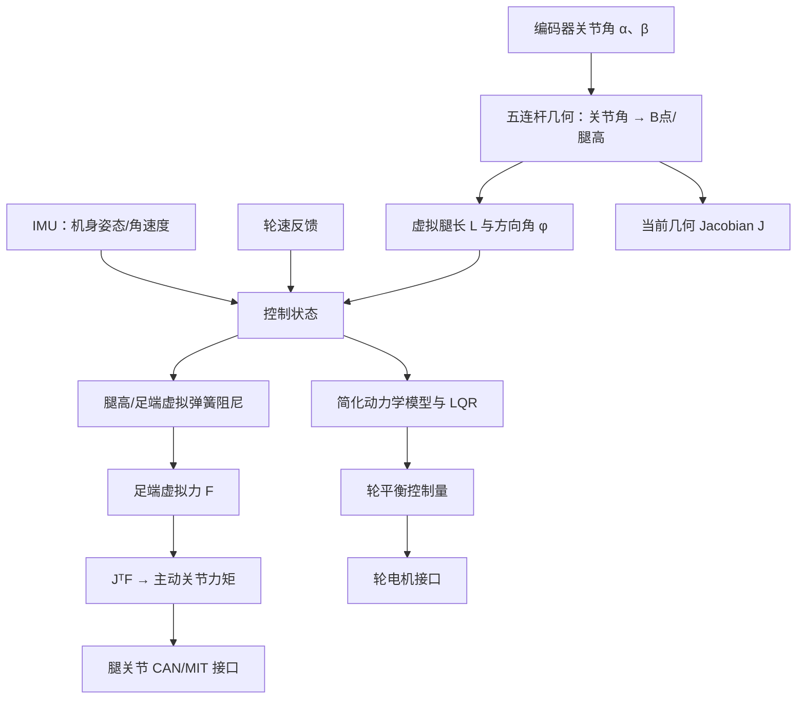

# P7 轮腿机器人：闭链腿、轮子与机身平衡

## 先看机器人和课程版本

本项目按你指定的课程代码 `F:\27fall\申请材料\gaint_bipedal_wheeled_robot-master\课程代码` 和 StackForce/Gaint 视频推导学习。第 5、6、8、9、10、11 课是不同阶段的代码/推导材料；学习时可以沿课程顺序理解原理，但不把它们说成同一份已验证固件。

轮子负责沿地面移动；左右五连杆腿改变机身高度，并通过轮反馈帮助机身保持平衡。轮控制和腿部 VMC 都会影响机身，但它们输出到不同物理对象。

## 推荐学习顺序

1. [结构与课程间的数据链](00_项目全貌与学习路线/01_项目结构与完整数据链.md)：先分清机械结构、状态、控制输出和课程版本。
2. [先修知识与学习验收](00_项目全貌与学习路线/02_先修知识与学习验收.md)：复习平面三角、导数、矩阵、动力学和反馈控制。
3. [机身怎样靠轮子和腿一起站稳](00_项目全貌与学习路线/03_P7机身怎样靠轮子和腿一起站稳.md)：先用整机因果链串起章节。
4. 按机械、状态、控制、执行顺序学习：

| 章节 | 先回答的问题 |
|---|---|
| [01 五连杆闭链与解支](01_原理与子系统/01_五连杆闭链与解支.md) | 两个主动关节角怎样决定闭链交点 B？固定机身坐标系中左右腿高度怎样算？ |
| [02 虚拟腿长、角度与速度](01_原理与子系统/02_虚拟腿长角度与速度.md) | B 点坐标怎样变成腿长/方向？关节速度怎样通过 Jacobian 变成腿端速度？ |
| [03 IMU、轮速与关节反馈](01_原理与子系统/03_IMU轮速与关节反馈.md) | 每个测量量来自哪里，怎样变成控制器用的状态？ |
| [04 从物理模型推导 LQR](01_原理与子系统/04_LQR从物理模型推导到状态反馈.md) | 简化模型怎样从动能/势能和拉格朗日方程得到状态空间？LQR 的状态、输入、输出各是什么？ |
| [05 轮平衡与腿部 VMC](01_原理与子系统/05_VMC腿长PID与关节力矩.md) | 腿端虚拟弹簧/阻尼如何给出足端力，(J^T F) 为什么变成两个关节力矩？ |
| [06 ESP32 任务与 TWAI/CAN 执行链](01_原理与子系统/06_ESP32任务与TWAI_CAN执行链.md) | 控制量怎样进入轮电机和腿电机接口？任务周期和反馈又如何回来？ |

## 曾经卡住的概念，从这里复习

| 疑惑 | 主讲位置 |
|---|---|
| 机身固定坐标系的原点和方向是什么；连杆倾斜后为何坐标轴不跟着走 | 第 01 章 |
| 两个关节角如何算 A、C、B；为什么 B 是两圆交点；左右腿“高度”如何从坐标取出 | 第 01 章与[历次问题归纳第 2 节](05_中英文面试/05_历次问题归纳与新源码视频完整讲解.md) |
| \(J_C\) 为什么是偏导数组成；视频里的定长杆速度约束如何求到 Jacobian | 第 02 章和第 05 章 |
| 第八课的 LQR 与六状态/两控制量说法是否相同；LQR 输出给谁 | 第 04 章：按物理模型、状态排列和实际矩阵分开核对 |
| VMC 输出什么；虚拟力作用在哪个点；为什么乘 \(J^\mathsf T\) 后得到关节力矩 | 第 05 章 |
| 轮平衡和腿部 VMC 怎样配合；轮电机命令、腿关节 torque 字段如何区分 | 第 05、06 章 |

更完整的问答总汇见[历次问题归纳：新源码与视频完整讲解](05_中英文面试/05_历次问题归纳与新源码视频完整讲解.md)。图中的正方向要沿所读课程版本固定；课程使用毫米还是米、弧度还是角度，也要看具体函数和接口。

## 源码、实验和表达

- 源码：[版本与文件地图](02_源码阅读与运行/01_源码版本与文件地图.md) → [第十一课完整周期](02_源码阅读与运行/02_一个周期的调用与数据流.md) → [环境与运行入口](02_源码阅读与运行/03_环境配置与运行入口.md)。
- 实验：[逐步实验](03_实验_故障与验证/01_逐步实验手册.md)、[故障诊断](03_实验_故障与验证/02_故障诊断与量化方法.md)。
- 面试：[术语与口述](05_中英文面试/01_术语与三种长度口述.md)、[原理问答](05_中英文面试/02_原理实现与验证问答.md)、[连续追问](05_中英文面试/03_连续追问模拟.md)、[白板练习](05_中英文面试/04_综合推理与白板练习.md)。

文件中出现力矩字段或 LQR 数值，仍需确认单位换算、符号、限幅和驱动协议；静态代码与视频推导不等于实机性能验证。
